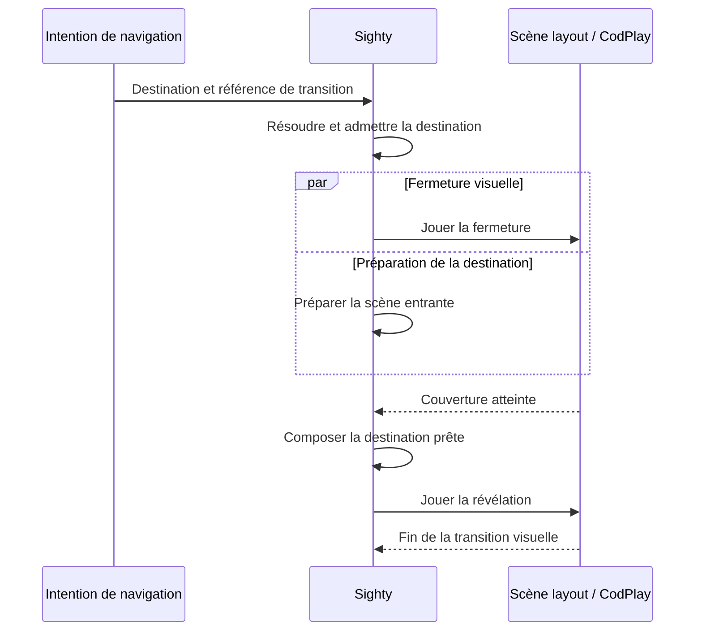

# Sighty : des transitions de page nommées, inspirées d’Interlude

**27 octobre 2026.** Pistes pour une classe métier de transitions entre scènes,
portées visuellement par la scène layout.

## Proposition

**Le principe d’Interlude s’adapte bien à Sighty : un nom désigne une recette
de transition, quelques paramètres la personnalisent, et la scène layout
en réalise les effets.** CodPlay possède déjà l’essentiel des moyens
d’animation nécessaires. L’apport à reprendre est la collection de
chorégraphies et leur organisation, sans importer le routeur Astro ni
conserver GSAP comme moteur supplémentaire.

La répartition serait la suivante :

| Élément | Responsabilité |
| --- | --- |
| Classe métier de transitions | Résoudre un nom, ses paramètres et ses valeurs par défaut ; produire la recette pour le layout. |
| Scène layout | Porter le cadre des pages, les slots, les caches, les masques et les éléments de transition. |
| Sighty | Admettre la navigation, préparer et sélectionner les scènes, coordonner le passage entre elles. |
| CodPlay | Exécuter les actions, interpoler et présenter les états du layout et des scènes. |

Le layout devient ainsi la **scène de mise en scène du changement de page**.
Les scènes de contenu n’ont pas à connaître les transitions qui les font
entrer ou sortir. Le même contenu peut être présenté par un fondu, un rideau
ou un effet de carte selon le parcours.

## 1. Ce qu’Interlude propose

L’[article Codrops](https://tympanus.net/codrops/2026/10/07/interlude-astro-page-transitions/)
renvoie au dépôt [codrops/interlude](https://github.com/codrops/interlude).
Il s’agit d’un projet de départ pour Astro, avec **21 transitions** réparties
en fichiers séparés.

Chaque transition définit principalement :

- `leave` : cacher la page sortante, ou conserver sa représentation à l’écran ;
- `enter` : révéler la nouvelle page ;
- éventuellement `prepare` : placer la nouvelle page dans son état de départ.

Le contrôleur Interlude coordonne ces fonctions avec le routeur Astro. Il
maintient une couche visuelle qui survit au remplacement de page. Le chargement
de la destination et la fermeture peuvent se dérouler en parallèle ; la
révélation attend que la fermeture et la préparation de la destination soient
prêtes.

Cette couche persistante correspond bien au rôle du layout Sighty. En revanche,
les événements Astro, le remplacement du document, la gestion de l’historique
du navigateur et la recherche du `<main>` ne sont pas les parties à transposer.
[Contrat des transitions][i-types], [fonctionnement][i-how], [contrôleur][i-controller].

## 2. Les transitions et leur adaptation

### Recouvrir puis découvrir

Ces cinq transitions utilisent principalement des éléments propres à la couche
de transition. Elles sont les meilleurs premiers candidats : elles peuvent
cacher le changement de contenu sans reproduire la page sortante.

| Nom source | Fonctionnement | Adaptation au layout et paramètres utiles |
| --- | --- | --- |
| `curtain` | Un panneau grandit depuis le bas, puis se rétracte vers le haut. Le contenu dérive légèrement et s’efface. | Un perso panneau et, si souhaité, une action sur le cadre du slot. Axe, sens, couleur, durée et amplitude de dérive. |
| `wipe` | Un panneau traverse l’écran horizontalement et accompagne le mouvement du contenu. | Translation du panneau et du cadre de page. Direction, couleur, durée et décalage du contenu. |
| `columns` | Plusieurs bandes montent avec un décalage, recouvrent la page, puis poursuivent leur trajet pour révéler la suivante. | Plusieurs persos panneaux, une grille et des actions décalées. Nombre de bandes, ordre, décalage et couleur. |
| `circle` | Un disque grandit depuis l’origine de la navigation ; un trou circulaire s’ouvre ensuite pour révéler la destination. | Masque ou composant visuel appartenant au layout. Origine, couleur, durée et courbe. |
| `typewriter` | Une grille écrit une phrase en vague sur un fond opaque, puis l’efface. | Un fond et un composant de cellules textuelles. Phrase, densité, vitesse et décalage. |

Les sources `curtain` et `wipe` emploient des tweens ordinaires : échelle,
translation, opacité et easing. Il n’y a pas de capacité particulière à GSAP
à conserver. `columns` ajoute surtout une génération répétée et un décalage
temporel. `circle` et `typewriter` demandent davantage de composition visuelle,
mais leur progression reste un nombre fourni par CodPlay.
[Fichiers des effets][i-transitions], [curtain][i-curtain],
[columns][i-columns], [circle][i-circle], [typewriter][i-typewriter].

### Montrer les deux pages pendant le passage

Neuf transitions conservent une image visuelle de la page sortante et font
apparaître la destination dans la même composition.

| Nom source | Fonctionnement | Ce qu’il faut reprendre |
| --- | --- | --- |
| `stack` | La page recule comme une carte, s’assombrit et se fait recouvrir par une feuille. | Échelle, assombrissement, panneau de couverture et leur synchronisation. |
| `slide-over` | La destination glisse sur la page sortante, qui recule dans l’ombre. | Deux plans de page, translation, échelle et film sombre. |
| `peel` | Une feuille semble se retourner depuis un coin. | Calcul des polygones de la feuille, du pli et des ombres. L’effet est construit en 2D, sans simulation de papier. |
| `slices` | Les deux pages sont découpées en colonnes ; chaque colonne de la nouvelle pousse l’ancienne. | Découpes, déplacements et décalage par bande. |
| `frame` | Un rectangle coloré apparaît au centre, puis une fenêtre sur la nouvelle page grandit à l’intérieur. | Deux ouvertures imbriquées et leurs intervalles. |
| `carousel` | La page recule dans une rangée, la rangée défile jusqu’à la destination, puis revient au premier plan. | Géométrie de la rangée, zoom et parcours entre les cartes. |
| `cube` | Les deux pages deviennent deux faces d’un volume qui recule, pivote et revient. | Structure CSS 3D, perspective, rotations et assombrissement des faces. |
| `corner` | Des rectangles puis une fenêtre sur la destination grandissent depuis un coin. | Masques rectangulaires, origine et décalage des couches. |
| `tear` | Une ligne irrégulière déchire la page, puis les deux moitiés s’écartent. | Génération de la ligne, polygones de découpe, bords et trajectoires des moitiés. |

**Ces effets ne sont pas tous des effets WebGL.** Le retournement `peel` est
une composition de `clip-path: polygon()` ; `cube` emploie des transformations
CSS 3D. Les calculs géométriques sont particulièrement intéressants à reprendre,
avec les progressions et actions CodPlay comme pilotage.
[Peel][i-peel], [cube][i-cube], [tear][i-tear], [ensemble des recettes][i-transitions].

### Dessiner la transition par shader

Les sept autres transitions utilisent Three.js et TSL :

| Nom source | Effet | Paramètres possibles |
| --- | --- | --- |
| `dither` | Des carrés se remplissent par points ordonnés, sur trois tailles de grille. | Taille des cellules, densité, ordre et couleur. |
| `dissolve` | Des taches fusionnent, avec un bord lumineux, puis la page se révèle par d’autres trous. | Échelle du bruit, largeur et couleur du bord. |
| `ink` | Une tache irrégulière se propage depuis un point. | Origine, irrégularité, douceur et couleur. |
| `spiral` | Une spirale sombre et lumineuse couvre l’image. | Origine, bras, torsion, vitesse et lumière du bord. |
| `velvet` | Un rideau rouge se ferme avec des plis et un mouvement de tissu. | Plis, profondeur, retard du bas et couleur. |
| `particles` | Des particules se rassemblent en un mot, puis se dispersent. | Mot, densité, taille, couleurs et dispersion. |
| `channel` | L’image semble perdre le signal d’un téléviseur puis retrouver la destination. | Grain, bandes, scintillement et amplitude des sauts. |

La plupart de ces shaders dessinent un **cache coloré transparent**, sans lire
les pixels des pages. Ils peuvent donc recouvrir une scène HTML, une vidéo
ou une scène Three sans convertir leur contenu en texture. `particles` est
une scène de points plutôt qu’un simple shader plein cadre. `channel` ajoute
aussi des secousses CSS sur des copies de pages.
[Couche shader][i-webgl], [dither][i-dither], [particles][i-particles], [channel][i-channel].

Le rendu source utilise `WebGPURenderer` avec choix du backend et des matériaux
à nœuds TSL. Ce n’est pas un fichier GLSL à coller directement dans n’importe
quel matériau de l’intégration Three existante. Deux adaptations sont possibles :
porter les formules vers un matériau compatible avec le host actuel, ou
faire évoluer explicitement cette intégration pour accueillir ce rendu à nœuds.
Dans les deux cas, le composant possède son dessin et le host conserve son
commit de rendu. Les callbacks du ticker GSAP et le temps `performance.now()`
du source deviennent des valeurs de présentation pilotées par CodPlay.
[Three CodPlay][c-three], [frontière des intégrations][c-targets].

## 3. Reprendre le modèle de capsule-automation

Le rapprochement demandé existe déjà dans le projet. `AutoCapsule` résout des
références comme `fade`, `cut`, `zoom` ou `swipe-left` dans un catalogue de
définitions. Une définition peut fournir les styles d’intro et d’outro et une
durée par défaut ; une utilisation peut préciser sa durée. Les calculs restent
portables, sans manipuler le DOM.
[Définitions actuelles][a-definitions], [types][a-types], [résolution][a-resolve].

La Demo 4 emploie déjà ce principe dans sa scène layout : un carrousel de
conteneurs menu/chapitre est construit à partir d’AutoCapsule, et les actions
des conteneurs produisent le mouvement. C’est un circuit concret à prolonger.
[Construction du carrousel layout][d-carousel], [scène layout][d-layout].

La classe métier pourrait reprendre le même usage : **une référence, des
valeurs par défaut, des paramètres et un résultat auteur**. La proposition
ci-dessous illustre la forme souhaitée ; `PageTransitions` reste à concevoir.

```ts
const pageTransitions = new PageTransitions({
  defaults: {
    durationMs: 900,
    ease: 'inOutCubic',
    color: '#111111',
  },
})

const chapterTransition = pageTransitions.resolve({
  ref: 'columns',
  params: { count: 5, staggerMs: 45, direction: 'up' },
})

const detailTransition = pageTransitions.resolve({
  ref: 'circle',
  durationMs: 700,
  params: { origin: { x: 0.5, y: 0.5 }, color: '#f04b23' },
})
```

L’appel par nom sélectionnerait une recette ; il ne chargerait pas un second
moteur de transition. Les valeurs spécifiques seraient limitées à celles
qui ont un sens pour cette recette. `columns` accepte un nombre de bandes ;
`circle` une origine ; `peel` un coin et des ombres. Un éditeur pourrait tirer
de ces descriptions ses contrôles et ses aperçus.

La classe fournirait les éléments à composer dans le layout, leurs styles et
actions CodPlay, ainsi que les repères utiles à l’orchestration. La création
des persos nécessaires appartient à la construction de scène ; jouer une
transition ensuite utilise ces persos et les événements du scénario.
Le nom reste stable tandis que les paramètres changent.

À l’exécution, le choix par nom peut venir d’une action du scénario ou des
données d’une intention envoyée à `runtime.dispatch`. Une éventuelle méthode
métier pour « jouer cette transition vers cette destination » transmettrait
cette intention au même circuit Sighty. Le contenu de cette demande et son
raccord à la recette restent à définir ; Sighty n’interprète pas actuellement
un champ de transition de page par le seul fait qu’il figure dans `event.data`.

### Réutiliser les définitions simples, enrichir les recettes complexes

Les définitions existantes de `fade`, `cut` et des glissements doivent rester
la source commune lorsque leur comportement convient. Il serait inutile de
recopier un deuxième catalogue de fondus dans l’outil de pages.

Le type actuel `AutoCapsuleEventDefinition` décrit principalement des paires
de valeurs par propriété. Il ne décrit pas à lui seul cinq bandes, plusieurs
plans de page ou un matériau shader. La classe de pages peut donc résoudre
les définitions simples et ajouter des générateurs de composition pour les
autres recettes, sans transformer AutoCapsule en routeur ni y introduire la
gestion des instances Sighty.

La durée doit avoir un sens clair. Dans cette proposition, `durationMs`
désigne le temps animé cumulé de fermeture et de révélation ; une attente
de préparation de la destination s’y ajoute. Pour `columns`, les décalages
des bandes font partie de ce budget. Cela évite qu’un passage de trois à
sept bandes allonge silencieusement toute la transition.

## 4. Organisation de la scène layout

Le layout devrait porter trois fonctions visuelles distinctes :

1. **Le cadre de page**, qui fixe la surface, le cadrage et le débordement.
2. **Les hôtes de contenu**, les slots où Sighty compose les scènes.
3. **La couche de transition**, avec les panneaux, masques, ombres, textes ou
   canvas qui recouvrent le cadre.

Les éléments ajoutés au layout ont donc un rôle visuel, au-delà du simple
raccord de montage. Sighty continue à demander les montages par les adresses
logiques des slots ; il ne fabrique pas les éléments HTML et ne déplace pas
les racines de contenu à la main.
[Composition Sighty][s-spec], [slots CodPlay][c-slot].

### Une seule page sous un cache

Pour `columns`, `circle` ou un rideau sans déplacement simultané des pages,
un hôte de contenu peut suffire : A est visible ; le layout ferme son cache ;
Sighty remplace A par B sous ce cache ; le layout révèle B. Les menus et
commandes du layout peuvent rester hors de la zone recouverte.

Les dimensions doivent venir du **cadre layout**, pas de `window.innerWidth`
ou du `body` comme dans plusieurs fonctions source. Pour le cercle, l’origine
peut être normalisée entre 0 et 1 dans ce cadre. Le rayon maximal correspond
au coin le plus éloigné du cadre, même si la leçon n’occupe qu’une partie
de la fenêtre.

### Deux pages visibles ensemble

Pour un glissement ou une rotation de cube, deux plans sont nécessaires.
Un layout peut déclarer deux hôtes stables et les transformer, pendant que
Sighty conduit leur composition. Les noms des slots ne changent pas quand
leurs rôles visuels s’échangent. L’animation porte les conteneurs du layout,
sans exiger que chaque scène enfant expose une action « se déplacer ».

Cette présentation peut utiliser les vraies scènes montées, avec la politique
de pause et d’interaction choisie pour le passage. Ce n’est pas la même chose
que créer une deuxième occurrence d’une scène pour imiter son apparence.
La rétention physique des racines sortantes, déjà distinguée de leur activité
logique dans Sighty, est précisément un point d’appui pour ce travail.
[Cycle de composition et conservation physique][s-spec].

### Des copies pour les découpes multiples

Interlude emploie des copies visuelles pour `slices`, `tear` ou `peel`. Son
helper ne fait pas un simple `cloneNode(true)` : il retire les identifiants,
neutralise les éléments interactifs, remplace certains contenus et peint
les frames de vidéo/canvas dans des canvases de substitution. Ce sont des
images visuelles figées, pas des pages actives.
[Copie de l’ancienne page][i-old-page].

CodPlay possède déjà un circuit d’instantanés de remplacement. **La reprise
ne doit donc pas ajouter un cloneur de scène à la classe métier.** Si les
effets retenus ont besoin de découpes ou de snapshots supplémentaires, leur
prise en charge relève de la présentation qui possède ces instantanés.
Une copie DOM ne garantit pas la reproduction d’une iframe ou d’un rendu
natif ; ce point est distinct des capacités d’interpolation.
[Remplacement et instantanés][c-slot], [contenus foreign][c-foreign-plan].

## 5. Raccorder la chorégraphie au changement de scène

L’organisation visée peut se lire ainsi. Les étapes du dessin sont des
repères de chorégraphie proposés, pas de nouvelles API ou phases runtime
déjà disponibles dans Sighty.



Il faut distinguer trois moments : la navigation est acceptée, la nouvelle
scène est montée, puis sa présentation devient complètement visible. Le début
de lecture du contenu peut être choisi en fonction de la recette : dès le
début de révélation ou après que le cache a suffisamment disparu. Ce choix
se coordonne avec `showMode` ; un tween visuel ne décide pas seul de jouer
la scène enfant.

### Le raccord actuel à préciser

Le contrat Sighty actuel applique une route avant le handler d’action qui
l’accompagne. Il ne suffit donc pas d’ajouter un handler après `go` pour
obtenir une fermeture **avant** le changement de scène. De même, le verrou
`changing` protège la réconciliation de composition ; il ne prouve pas que
toute la durée d’une animation visuelle fait partie de cette opération.
[Résolution des actions et cycle de transition][s-spec].

Le point à concevoir est le rendez-vous entre la recette du layout et le
coordinateur de navigation existant : à quel moment le montage peut avoir
lieu et quand le passage est terminé. La classe métier prépare la recette ;
elle ne doit pas recréer une file de navigation, un registre d’occurrences
ou un routeur pour obtenir ces rendez-vous.

L’article fournit une bonne séparation fermeture/révélation. Son contrôleur
Astro n’est pas la solution à importer. Une mise en œuvre Sighty devra décider
ce raccord dans son propre circuit, plutôt que supposer des hooks tels que
`beforeNavigate` ou `awaitTransition` qui ne figurent pas dans le contrat public.

### Le remplacement déjà disponible

Le slot CodPlay fournit déjà `replace` avec `fade` et `fade-in`, et la Demo 4
l’utilise. Cela donne un premier comportement nommé sans inventer de nouvelles
surfaces. **Les noms Interlude ne peuvent cependant pas être passés directement
à `replace.transition`** : le profil `slot` actuel ne les implémente pas, et
`replace.split` n’y active pas de découpe.

Les recettes de layout et le remplacement natif doivent se coordonner. Pour
une navigation déjà entièrement masquée par des colonnes, un deuxième fondu
de remplacement n’apporte rien. Pour un fondu simple, le circuit `replace`
existant peut suffire. Étendre ses stratégies pour les effets qui ont réellement
besoin de ses instantanés serait un travail propre à ce circuit, pas une
conséquence automatique de l’ajout d’un nom dans le catalogue métier.
[Contrat du slot et de replace][c-slot], [layout consommateur][d-layout].

## 6. Exemples de recettes adaptées

### `columns` : le premier effet à réaliser

La classe résout cinq bandes occupant toute la hauteur du cadre, avec un
léger recouvrement horizontal pour éviter les fentes entre elles. Chaque
bande possède une action de fermeture et une action de révélation. Les
départs sont décalés selon l’ordre demandé.

La fermeture fait passer chaque bande de `y = 100%` à `0%`. Quand la dernière
est en place, tout le cadre est couvert. Après composition de B, les bandes
vont de `0%` à `-100%`. Pour une navigation précédente, l’ordre peut être
inversé. Les bandes sont des persos du layout ; leurs translations et easings
sont des actions CodPlay ordinaires.

Cette recette démontre l’usage « nom + paramètres » sans WebGL ni capture
de l’ancienne page. Elle convient à des contenus très différents, puisque
le cache n’a pas à les reproduire.

### `slide-over` : une mise en scène des deux hôtes

Le cadre A passe par exemple de `scale = 1` à `0.9`, sous un film sombre.
Le cadre B vient de `y = 100%` jusqu’à `0%`. Les animations partagent leur
intervalle. Les scènes restent indépendantes : la transition appartient aux
conteneurs du layout et Sighty gère leur activité.

La recette peut réutiliser les définitions de glissement existantes pour
ses mouvements élémentaires, puis ajouter la composition, l’échelle et
l’assombrissement. Elle est plus riche qu’un simple `intro/outro` de capsule,
car elle décrit leur relation dans une même présentation.

### `peel` : conserver les calculs, changer leur application

Le source calcule les parties d’une feuille séparées par une droite mobile,
le pli réfléchi et plusieurs zones d’ombre. Ces fonctions géométriques peuvent
être adaptées pour produire les polygones depuis une progression.

La classe métier résoudrait le coin, les durées et les paramètres d’ombre.
Un composant de présentation appliquerait les découpes aux représentations
fournies par le circuit propriétaire des instantanés. CodPlay piloterait la
progression. La récupération intéressante est donc le calcul du pli et son
dessin, sans son ancienne recherche du DOM de page ni sa timeline GSAP.

### `dither` : un cache shader indépendant des contenus

Le source répartit des carrés sur trois tailles de grille et les remplit selon
une matrice de Bayer. La progression décide de la densité ; un paramètre
distingue fermeture et révélation, pour que l’ouverture ne soit pas seulement
le film joué à l’envers.

Une fois le raccord du matériau choisi, un composant de cache dans le layout
peut recevoir ces paramètres. A et B restent de vraies scènes sous lui.
Il n’est pas nécessaire d’en faire des textures. C’est un bon premier effet
shader après les caches en panneaux.

## 7. Les comportements à garder simples

**Navigation rapide.** Interlude sait interrompre une révélation et repartir
de son état courant. Sighty possède déjà une politique de refus des intentions
concurrentes pendant `changing`. Il n’est pas nécessaire de copier l’interruption
d’Interlude pour disposer de ces effets. Le choix le plus simple est de garder
la conduite Sighty et de coordonner clairement la durée visuelle avec elle.

**Précédent/suivant.** Le sens visuel vient de l’intention Sighty ou du choix
d’auteur. Il n’exige ni écoute de `popstate` ni historique Astro. Une transition
peut être symétrique, inversée ou identique dans les deux sens.

**Médias et interactions.** Le cache visuel ne suffit pas à désactiver une
page sortante ni à arrêter un média indépendant. Sighty et les scènes
conservent leurs politiques de transport ; le layout porte l’état interactif
de la zone qu’il recouvre. À la fin, le focus doit rejoindre le contenu admis
plutôt que rester sur une commande masquée.

**Redimensionnement.** Les dimensions, l’origine et les masques sont résolus
dans le cadre du layout. Une progression courante doit pouvoir être
représentée avec les nouvelles dimensions. Les tirages aléatoires de `tear`
ou `typewriter` sont préparés pour la transition, puis conservés pendant son
évaluation, plutôt que recalculés à chaque présentation.

**Mouvement réduit.** Le choix auteur peut désigner `cut` ou `fade` lorsque
l’utilisateur préfère moins de mouvement. Cette variante appartient au choix
de recette, sans modifier la destination ni les règles d’accès du parcours.

## 8. Direction recommandée

Le premier ensemble pourrait exposer `cut` et `fade` par leur circuit
existant, puis `curtain`, `wipe`, `columns` et `circle` dans le layout. Il
couvre déjà des transitions sobres, directionnelles et expressives avec
peu de paramètres. `slide-over` et `stack` apporteraient ensuite la composition
simultanée des pages ; `peel`, `slices` et `tear` demanderaient le raccord
des représentations découpées. Les shaders formeraient une famille de rendu
supplémentaire derrière la même sélection par nom.

La classe métier aurait intérêt à rester proche des fabriques d’authoring
existantes : elle résout et compose, comme AutoCapsule, tandis que Sighty
orchestre et CodPlay anime. L’éditeur ou le scénario choisit une référence
et ses paramètres, sans connaître la géométrie de chaque effet.

Le code Interlude est fourni sous licence MIT avec sa notice. Les parties
les plus utiles à adapter sont `src/transitions/` et leurs calculs visuels.
Le contrôleur Astro, ses listeners globaux et son cloneur de pages ne sont
pas des dépendances de cette proposition.
[Licence][i-license], [recettes][i-transitions].

[i-types]: https://github.com/codrops/interlude/blob/3f1a9ce2b27ef724817659236599ecd63062fef2/src/lib/interlude/types.ts
[i-how]: https://github.com/codrops/interlude/blob/3f1a9ce2b27ef724817659236599ecd63062fef2/docs/how-it-works.md
[i-controller]: https://github.com/codrops/interlude/blob/3f1a9ce2b27ef724817659236599ecd63062fef2/src/lib/interlude/controller.ts
[i-transitions]: https://github.com/codrops/interlude/tree/3f1a9ce2b27ef724817659236599ecd63062fef2/src/transitions
[i-curtain]: https://github.com/codrops/interlude/blob/3f1a9ce2b27ef724817659236599ecd63062fef2/src/transitions/curtain.ts
[i-columns]: https://github.com/codrops/interlude/blob/3f1a9ce2b27ef724817659236599ecd63062fef2/src/transitions/columns.ts
[i-circle]: https://github.com/codrops/interlude/blob/3f1a9ce2b27ef724817659236599ecd63062fef2/src/transitions/circle.ts
[i-typewriter]: https://github.com/codrops/interlude/blob/3f1a9ce2b27ef724817659236599ecd63062fef2/src/transitions/typewriter.ts
[i-peel]: https://github.com/codrops/interlude/blob/3f1a9ce2b27ef724817659236599ecd63062fef2/src/transitions/peel.ts
[i-cube]: https://github.com/codrops/interlude/blob/3f1a9ce2b27ef724817659236599ecd63062fef2/src/transitions/cube.ts
[i-tear]: https://github.com/codrops/interlude/blob/3f1a9ce2b27ef724817659236599ecd63062fef2/src/transitions/tear.ts
[i-webgl]: https://github.com/codrops/interlude/blob/3f1a9ce2b27ef724817659236599ecd63062fef2/src/lib/interlude/webgl.ts
[i-dither]: https://github.com/codrops/interlude/blob/3f1a9ce2b27ef724817659236599ecd63062fef2/src/transitions/dither.ts
[i-particles]: https://github.com/codrops/interlude/blob/3f1a9ce2b27ef724817659236599ecd63062fef2/src/transitions/particles.ts
[i-channel]: https://github.com/codrops/interlude/blob/3f1a9ce2b27ef724817659236599ecd63062fef2/src/transitions/channel.ts
[i-old-page]: https://github.com/codrops/interlude/blob/3f1a9ce2b27ef724817659236599ecd63062fef2/src/lib/interlude/old-page.ts
[i-license]: https://github.com/codrops/interlude/blob/3f1a9ce2b27ef724817659236599ecd63062fef2/LICENSE
[a-definitions]: ../../../../packages/authoring/capsule-automation/src/config/event-definitions.ts
[a-types]: ../../../../packages/authoring/capsule-automation/src/types/public.ts
[a-resolve]: ../../../../packages/authoring/capsule-automation/src/core/resolve-events.ts
[d-carousel]: ../../../../packages/demos/src/sighty/demo4/carousel.ts
[d-layout]: ../../../../packages/demos/src/sighty/demo4/scenes/layout-scene.ts
[s-spec]: ../../../../packages/sighty/specs/authoring-library-spec.md
[c-slot]: ../../../../packages/codplay/specs/slot-component-spec.md
[c-foreign-plan]: ../../../../packages/codplay/plan/foreign-scene-component-plan.md
[c-three]: ../../../../packages/codplay/specs/third-party-threejs-spec.md
[c-targets]: ../../../../packages/codplay/specs/third-party-target-bridge-spec.md
