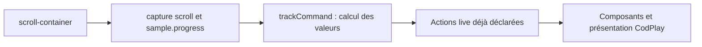

# Scrollytelling : quels effets reprendre avec CodPlay ?

**27 octobre 2026.** Analyse de [BSMNT Scrollytelling](https://github.com/basementstudio/scrollytelling)
et des effets présentés sur son [site de démonstration](https://scrollytelling.basement.studio/).

## Les possibilités les plus intéressantes

**Oui, une partie importante des effets peut être reprise avec CodPlay.**
Le plus utile est de récupérer les compositions, les formules de mouvement,
les shaders et certains éléments graphiques. **CodPlay possède déjà l’essentiel
des moyens d’animation nécessaires à ces exemples.** GSAP et ScrollTrigger
sont les outils employés par le projet source ; leur présence ne rend pas
les effets dépendants de ces bibliothèques une fois transposés dans CodPlay.
Le travail porte surtout sur la traduction des chorégraphies et le raccord
des rendus spécialisés.

Trois familles se distinguent :

| Famille | Ce qui se récupère | Mise en place avec CodPlay |
| --- | --- | --- |
| Texte, parallaxe, panneaux fixes, défilement horizontal | CSS, découpage des éléments, intervalles et valeurs de transformation. | Scènes et actions CodPlay, avec le scroll existant comme source. C’est la voie la plus directe. |
| Galerie en cylindre, séquence d’images | Calculs de pose ou de sélection d’image, composition visuelle. | Composant spécialisé pour la représentation qu’il possède ; progression fournie par CodPlay. |
| Modèles 3D, texte déformé, réfraction | Géométries, matériaux, shaders et paramètres. | Intégration Three.js existante, complétée par les composants propres à l’effet. |

La recommandation est de constituer une petite bibliothèque de **recettes
visuelles utilisant les capacités CodPlay existantes**. Ces recettes
pourraient ensuite être proposées par un éditeur : révélation par mots,
parallaxe à plusieurs plans, bandeau horizontal, galerie courbe ou objet 3D.
Sighty conduirait leur composition dans un parcours, les changements de scène
et les interactions entre scènes.

## 1. Distinguer la bibliothèque, sa démonstration et le laboratoire

Le dépôt contient deux ensembles :

- `scrollytelling/` fournit la bibliothèque React et ses outils : `Root`,
  `Animation`, `Stagger`, `Parallax`, `Pin`, `Waypoint` et un canvas de séquence
  d’images.
- `website/` contient les effets réellement composés pour la démonstration :
  introduction typographique, ordinateur 3D, casquettes, grand texte
  horizontal, galerie en cylindre, parallaxe finale et confettis.

La galerie affiche aussi des expériences intitulées « Twisted 3D text »,
« Refraction » ou « Gradient SVG ». **Leur code se trouve dans un autre dépôt,
[Basement Laboratory](https://github.com/basementstudio/basement-laboratory).**
Scrollytelling récupère un catalogue distant pour afficher leurs vignettes et
leurs liens. Copier la galerie ne copie donc pas ces effets. Les trois
expériences sont détaillées plus bas, car leurs sources sont accessibles.
[Sources : page principale][b-page], [catalogue de la galerie][b-lab],
[laboratoire][lab-readme].

Le README cite également des exemples externes : tween simple, Lenis,
empilement de panneaux et tube Three.js. Ils illustrent des usages du
pilotage ; ce ne sont pas des effets tous intégrés au package.
[Exemples externes][b-readme].

## 2. Comment Scrollytelling produit le mouvement

### Une position de scroll devient une progression

`Root` crée une timeline GSAP et un ScrollTrigger. Les limites `start` et
`end` définissent deux positions géométriques : par exemple, lorsque le haut
d’une section rejoint le haut du viewport, puis lorsque son bas atteint ce
même endroit. Entre ces limites, le défilement donne une progression de 0 à 1.

Les animations sont placées sur une échelle de **0 à 100**. Une animation
déclarée entre 20 et 50 occupe cette partie du parcours. Sa « durée » vaut
alors 30 unités de la timeline : avec le scroll lié, cela représente une
distance de défilement, pas trente secondes.
[Root][b-root], [construction des tweens][b-util].

Pour comprendre ou porter un effet, on peut ramener chaque intervalle à :

```text
p = progression générale entre 0 et 1
u = clamp((p - début) / (fin - début), 0, 1)
valeur = départ + easing(u) × (arrivée - départ)
```

Par exemple, une révélation entre 20 % et 50 % a `u = 0,5` lorsque le parcours
atteint 35 %. Cette représentation est largement réutilisable indépendamment
de React et de GSAP. Une translation, une opacité, une rotation, un indice
d’image ou un paramètre de shader peuvent tous en dépendre.

`scrub: true` lie directement l’animation au scroll. Une valeur numérique
comme `scrub={0.75}` ajoute un rattrapage d’environ 0,75 seconde. L’effet continue
alors brièvement après l’arrêt du geste. Ce lissage est distinct de l’easing
qui transforme la progression à l’intérieur d’un mouvement.
[Documentation ScrollTrigger](https://gsap.com/docs/v3/Plugins/ScrollTrigger/).

### Un panneau fixe est surtout du CSS

Le composant `Pin` crée un conteneur haut et un enfant en `position: sticky`.
L’introduction réserve ainsi `300vh` et maintient son contenu sur `100vh`.
La section des casquettes utilise `700vh`, et le grand texte horizontal
`800vh`. Ces hauteurs donnent la distance nécessaire à la chorégraphie.

On peut reprendre ce principe sans GSAP. Le parent réserve le trajet ; le
panneau reste visible pendant que les valeurs animées changent. La sortie
du panneau est déterminée par la fin de son conteneur. Il faut situer
correctement le scrollport et les ancêtres portant `overflow` pour conserver
la bonne zone de stickiness.
[Pin][b-pin], [introduction][b-hero], [bandeau et CSS][b-marquee-css].

### Certains effets se déclenchent puis jouent dans le temps

`Waypoint` ne sert pas seulement à lire une valeur au scroll. Il peut lancer
un tween autonome ou appeler une fonction au franchissement d’un point, puis
inverser le tween au retour. Dans la dernière section, les images apparaissent
avec un effet élastique pendant 1,2 seconde après le seuil de 75 %. Dans le
footer, un seuil lance les confettis.

Cette distinction compte pour CodPlay : un effet continuellement lié au scroll
et une animation temporelle déclenchée à l’entrée doivent emprunter les
circuits correspondants. Le second peut continuer après l’arrêt du défilement.
[Waypoint][b-waypoint], [section finale][b-last], [footer][b-footer].

## 3. Les effets de la démonstration, et ce qu’on peut en faire

### Révélation progressive d’un texte

Dans « We want to help… », la phrase est découpée en mots. Chaque mot passe
d’une opacité de `0.2` à `1`, dans un intervalle qui lui est attribué.
`Stagger` répartit l’intervalle global entre les éléments ; son paramètre
`overlap` permet de faire commencer un élément avant la fin du précédent.

**À reprendre :** le découpage, les bornes d’opacité, l’ordre et les intervalles.
Il n’y a pas ici de plugin de découpage typographique à récupérer : le code
sépare simplement les mots.

**Mise en place CodPlay :** construire les unités animées comme persos si elles
doivent être adressées individuellement. Une recette calcule leurs intervalles
et produit les actions de style. Pour une animation liée au scroll, la valeur
de chaque mot dépend de la progression live ; pour une entrée animée, un
événement déclenche les actions temporelles. Un texte très long peut justifier
un composant typographique qui possède ses éléments internes.

La méthode peut aussi colorer successivement les mots, les faire monter ou
les agrandir. Les retours à la ligne doivent rester ceux de la composition
responsive ; les espaces et une lecture accessible de la phrase doivent être
préservés.
[Phrase et Stagger][b-caps-section], [répartition des intervalles][b-stagger].

### Parallaxe sur plusieurs plans

`Parallax` est un raccourci vers une translation linéaire : pour une amplitude
`A`, il déplace un élément de `-A` à `+A`. L’introduction du laboratoire utilise
des amplitudes et des signes différents pour le titre et les dessins. Le
décalage relatif fait percevoir plusieurs profondeurs.

**À reprendre :** les amplitudes, les directions et le placement des plans.
Avec une progression `p`, une couche peut suivre `y = -A + 2 × A × p`.

**Mise en place CodPlay :** garder le dessin ou l’image dans un perso, poser
son cadrage en CSS et appliquer la translation par les canaux de transformation.
La progression peut venir de la capture scroll existante. Il faut conserver
un peu de débord autour d’une image pour que son déplacement ne découvre pas
son bord.
[Parallax][b-parallax], [composition des plans][b-intro].

### Défilement horizontal et lettres qui apparaissent

Le bandeau « FROM THE LABORATORY… » combine trois mouvements : le groupe
traverse horizontalement un panneau sticky ; les caractères apparaissent en
montant et en grandissant ; à la fin, le texte s’écarte et un globe SVG
grandit. Une grande partie du résultat vient du corps typographique, de la
largeur du texte, du cadrage et des intervalles qui se chevauchent.

**À reprendre :** cette composition, ses décalages par caractère et le principe
de panneaux imbriqués. La dernière phase occupe 90–100 % du parcours.

**Mise en place CodPlay :** séparer le panneau qui cadre, le groupe qui se
déplace et les caractères animés. Une translation horizontale du groupe et
des actions de translation, échelle et opacité des lettres suffisent pour
recréer l’essentiel. Le dessin du globe peut être un SVG propre au projet.

Il faut traduire les conventions GSAP : `xPercent` désigne un pourcentage de
la largeur de l’élément ; `autoAlpha` associe opacité et visibilité. Ce ne sont
pas des propriétés CodPlay à copier telles quelles. De même, une transformation
CSS de centrage et une transformation animée doivent être composées
explicitement, par exemple sur deux niveaux distincts.
[Bandeau][b-marquee], [CSS][b-marquee-css], [transformations CodPlay][c-transform].

### Galerie en cylindre : de la 3D en CSS

Cet effet est particulièrement intéressant à récupérer. Les cartes ne sont
pas rendues par WebGL : elles sont des éléments HTML sous un parent avec
`perspective`. Un calcul donne à chaque carte une hauteur, une profondeur,
une rotation et une opacité.

Pour `n ≥ 2` cartes, l’essentiel du calcul source est :

```text
a = angle disponible × (index / (n - 1) - progression)
y = rayon × sin(a)
z = rayon × cos(a) - rayon
rotationX = -a × 180 / π
```

Les cartes semblent donc suivre un cylindre horizontal. Une mesure de distance
à la position centrale règle leur visibilité. La carte centrale devient
cliquable et fait apparaître ses informations par une transition CSS.

**À reprendre :** les formules et la structure CSS. React, le fetch du catalogue
et `gsap.set()` ne sont pas indispensables à cette géométrie.

**Mise en place CodPlay :** une scène peut construire les cartes et produire
leurs poses depuis une progression commune ; un composant de galerie est une
autre possibilité si les cartes restent son contenu interne. Dans les deux
cas, remplacer la sélection globale `[data-experiment]` par les identités ou
les éléments possédés par cette instance. Remplacer aussi le `progress` mutable
déclaré au niveau du module par une donnée locale à l’occurrence.

Les transformations 3D CSS et leur ordre doivent être raccordés au rendu
choisi. La spec des canaux CodPlay ne garantit pas automatiquement toute
combinaison `z`/`rotateX`/`perspective` utilisée par GSAP ; un composant peut
posséder ce rendu spécialisé. Les transitions d’information indépendantes
du scroll peuvent conserver leur rôle décoratif.
[Galerie][b-cylinder], [formules][b-cylinder-math], [perspective et styles][b-cylinder-css].

### Casquettes et ordinateur 3D

Les casquettes donnent une impression de chute, mais le code ne simule pas
une physique : huit occurrences d’un GLB apparaissent avec une opacité, une
petite translation et une rotation complète. Leur progression est décalée par
un Stagger avec chevauchement. Le helper Drei `Float` ajoute un flottement.
L’ordinateur utilise un autre GLB et tourne autour de son axe selon
`2π × progressionScroll`.

**À reprendre :** les positions, rotations, matériaux, modèles utiles et la
chorégraphie. Une vraie simulation de chute n’est pas nécessaire pour obtenir
ce rendu.

**Mise en place CodPlay :** utiliser le host Three existant, puis des composants
spécialisés qui possèdent les objets. Les géométries et matériaux sont préparés
une fois ; chaque présentation applique la pose issue du temps ou de la
progression. Les modèles passent par le preload de l’intégration.

Le `useFrame` React Three Fiber et le `Float` ne se copient pas comme boucles
autonomes. Un flottement compatible avec la lecture temporelle peut être
calculé directement, par exemple `y(t) = y0 + A × sin(ωt + phase)`. Le même
temps redonne alors la même pose. Le correctif impératif présent dans l’exemple
des casquettes pour le retour rapide en haut n’est pas une recette nécessaire
à conserver : c’est la pose absolue qui doit exprimer l’état voulu.
[Casquettes][b-caps], [ordinateur][b-mac], [Three CodPlay][c-three].

### Contraste, changement de fond et confettis

Le titre final emploie `mix-blend-mode: difference` pour contraster avec le
fond et les images. Des Waypoints animent la couleur du `body`, puis le footer
lance `canvas-confetti`.

Le mélange CSS est directement réutilisable dans une composition adaptée.
Le fond animé devrait viser la racine de la scène ou du layout qui le possède,
afin que plusieurs occurrences puissent cohabiter. Le déclenchement de
confettis est réutilisable comme effet décoratif ponctuel ; une animation de
particules reconstruisible au Seek demanderait un état initial et une
évaluation déterministes, ce que cet appel à `canvas-confetti` ne fournit pas.
[Section finale et CSS][b-last], [mélange visuel][b-last-css], [confettis][b-footer].

## 4. La séquence d’images : un outil supplémentaire

`ImageSequenceCanvas` permet de précharger un ensemble d’images et de dessiner
une frame à la demande. Il ne produit pas une animation 3D en temps réel :
l’illusion vient de vues déjà calculées, comme une rotation de produit ou une
transformation rendue en images successives. Le helper existe dans la
bibliothèque, sans être utilisé par les sections principales de cette démo.
[Source du helper][b-sequence].

La sélection est simple :

```text
frameIndex = round(progression × (nombreImages - 1))
```

Avec CodPlay, un composant canvas pourrait recevoir l’indice, dessiner
l’image préparée et adapter sa résolution au cadre. Les images devraient
être déclarées au preload existant. Le composant n’aurait besoin ni de React,
ni de ScrollTrigger, ni d’une seconde horloge. Le préchargement, le dessin et
le cache sont les parties intéressantes à adapter.

Il ne faut pas reprendre aveuglément le cache global du helper. Les images
décodées occupent bien plus de mémoire que les fichiers compressés. Par
exemple, 60 images RGBA de 1280 × 720 représentent environ **211 Mio** de
pixels. Le choix du nombre de frames et de la résolution fait partie du
design de l’effet. Le dessin asynchrone doit également présenter la frame
actuellement demandée, sans laisser une ancienne demande la remplacer après
son chargement.
[Préparation des ressources CodPlay][c-preload].

## 5. Trois effets du laboratoire également récupérables

### Gradient SVG : le plus simple à transposer

`35.gradient-svg.js` superpose des formes colorées, un flou gaussien important,
un mélange `color-dodge` et une texture de bruit. Un groupe de formes suit
le pointeur. Le code convertit les coordonnées écran vers le repère du SVG
avec l’inverse de sa matrice de transformation.

Ce rendu n’exige ni Three.js ni shader WebGL. On peut récupérer le SVG et ses
filtres, remplacer la texture par une ressource du projet et faire varier la
position du groupe depuis une capture pointeur CodPlay. Un composant SVG
spécialisé pourrait conserver la conversion de coordonnées et le dessin.
Une variante temporelle ou pilotée au scroll peut utiliser le même rendu.

Les identifiants de filtres, de clips et leurs références doivent être propres
à chaque occurrence. Les grands flous ont un coût de rendu : réduire leur
surface est souvent plus efficace que multiplier les optimisations du calcul
de déplacement.
[Source : Gradient SVG][lab-gradient].

### Twisted 3D Text : récupérer le shader de déformation

`52.twisted-3d-text.js` crée une géométrie de texte extrudé et modifie le vertex
shader d’un matériau standard. La position horizontale d’un sommet détermine
un angle ; le texte s’enroule autour d’un cercle et se tord. Les normales sont
également transformées pour conserver un éclairage cohérent.

Les paramètres utiles sont le texte, la profondeur, le rayon, le nombre de
torsions et les vitesses de rotation et de torsion. **Le code GLSL constitue
la partie la plus intéressante à récupérer.**

Pour CodPlay, le composant Three spécialisé construirait la géométrie quand
le texte ou sa forme changent, puis mettrait à jour les uniforms. Le source
incrémente `uTime` avec le delta de frame ; il faudrait le remplacer par le
temps absolu présenté, exprimé en secondes. Une progression de scroll pourrait
aussi piloter directement l’angle ou la torsion.

Le panneau Leva, la grille de démonstration et les contrôles OrbitControls
ne sont pas nécessaires à l’effet. La fonte géométrique reste une ressource
à choisir et à préparer. L’injection par `onBeforeCompile` référence des
fragments de shader Three : son raccord dépend de la version utilisée par
l’intégration CodPlay.
[Source : Twisted 3D Text][lab-twisted].

### Refraction : récupérer un matériau et un rendu en plusieurs passes

`47.refraction.js` rend une vue intermédiaire dans une texture, puis utilise
cette texture dans un matériau de lentille. Le fragment shader déplace ses
échantillons selon la normale et la direction de vue. Il utilise des indices
de réfraction distincts pour le rouge, le vert et le bleu, ce qui sépare les
couleurs. Une texture ajoute les marques de surface.

Le rendu est une approximation graphique de réfraction à partir d’une image
de la scène, pas une simulation optique complète. Son apparence provient des
passes de rendu, du shader et du modèle de lentille ; ScrollTrigger n’y joue
aucun rôle.

Pour CodPlay, les paramètres exposés pourraient être la puissance de
réfraction, l’aberration chromatique et les indices des trois canaux. Le
composant posséderait la lentille et le matériau ; l’intégration du host Three
organiserait la passe vers la texture puis le rendu final. Il faut préserver
le commit de rendu du host, plutôt que recopier un `useFrame` qui appelle
son propre renderer à côté de lui.

Cette reprise est plus lourde que celle du texte déformé : elle demande une
cible de rendu, sa résolution au resize, sa libération et le raccord des
ressources du GLB. Le shader effectue aussi plusieurs lectures par pixel.
Le coût dépend donc fortement de la surface rendue et de la résolution.
[Source : Refraction][lab-refraction], [frontière de rendu CodPlay][c-targets].

## 6. Comment raccorder les effets au scroll CodPlay

### Réutiliser la source existante

CodPlay dispose déjà de `scroll-container`, de sa capture de progression et
de `emit.observe`. La progression géométrique ne commande pas le temps
logique de la scène. Cela permet de laisser un effet suivre le scroll tandis
qu’une narration ou une autre animation suit son propre temps CodPlay.
[Contrat scroll][c-scroll].

Le raccord pour une parallaxe ou un bandeau continu serait :



Le module et le composant optionnels sont enregistrés par les définitions
existantes de `@codplay/component-v2`. L’adaptateur navigateur existant est
fourni dans `htmlHost.sourceAdapterFactories`. Le scrollport reçoit sa
hauteur et son `overflow` dans la scène ; la capacité n’invente pas le layout.

Pour une couche qui va de `-40px` à `40px`, le calcul d’une capture peut
prendre cette forme. Il s’agit du fragment à placer dans la déclaration
`emit.scroll.capture` du scroll-container :

```ts
trackCommand: ({ sample }) => ({
  actions: [{
    name: 'layer:scroll',
    data: {
      style: { y: `${-40 + 80 * sample.progress}px` },
    },
  }],
  captureState: { progress: sample.progress },
}),
```

L’action `layer:scroll` doit déjà être déclarée dans les `actions` du perso
à déplacer. Les valeurs `style` passent par le circuit live existant. Le
[compteur de progression de la scène scroll][c-scroll-example] emploie ce
même circuit avec `scaleX` ; le fragment transpose son principe à une couche.
Les unités sont explicites pour ne pas confondre pixels et longueurs logiques
de scène.

Les actions live de capture s’arrêtent avec la session. Si la couche doit
rester à sa dernière pose après `scrollend`, la dernière progression peut
être conservée dans `captureState`, puis réappliquée par l’événement `endEmit`
et son action. C’est le mécanisme déjà prévu pour le compteur. Les samples
ne deviennent pas une suite d’événements journalisés ; conserver la pose
finale ne conserve pas toute la trajectoire de scroll.
[Capture et pose finale][c-scroll], [unités][c-units].

### Choisir la bonne mesure pour chaque effet

`sample.progress` est la progression sur l’ensemble du scrollport. Le
`ratio` d’une observation est la proportion visible d’une cible : ce n’est
pas sa position sur une grande plage de défilement. Une petite ligne de texte
peut devenir entièrement visible en quelques pixels.

Pour une couleur qui suit la visibilité, `observe.liveAction` convient. Pour
une entrée qui lance une animation, les événements `enter` et `leave`
conviennent. Pour une longue chorégraphie, utiliser une progression et des
intervalles adaptés à la structure du scrollport. Les limites géométriques
`top bottom` de ScrollTrigger ne possèdent pas une traduction automatique
dans le ratio d’intersection CodPlay.

Sighty intervient lorsqu’un franchissement doit changer une étape du parcours,
une scène active ou une possibilité de navigation. Il n’a pas à recevoir un
événement pour chaque pixel défilé : les valeurs continues restent dans le
circuit live de la scène.
[Observations CodPlay][c-scroll], [rôle de Sighty][s-authoring].

### Garder les possibilités temporelles de CodPlay

Les mêmes recettes visuelles peuvent être jouées dans le temps : remplacer
la progression de scroll par une progression temporelle change la conduite,
pas la formule de pose. Cela permet une version narrée, un replay ou une
scène pilotée par une télécommande.

La présentation live issue du scroll et une reconstruction au Seek ont
cependant des sources différentes : CodPlay ne relit pas le viewport pour
reconstituer son journal. La recette doit choisir ce qu’elle exprime comme
effet géométrique vivant et ce qu’elle inscrit comme action reconstruisible.
Ce sont des possibilités de composition propres à CodPlay, sans obligation
de reproduire exactement le comportement de ScrollTrigger.
[Reconstruction][c-reconstruction], [actions temporelles][c-tween].

## 7. Traduire les usages de GSAP vers les circuits CodPlay

Les besoins d’animation rencontrés dans ces exemples ont déjà leurs circuits
dans CodPlay. La reprise consiste à y exprimer les valeurs, les intervalles
et les déclenchements de la composition source.

| Usage dans le code GSAP | Circuit à utiliser dans CodPlay |
| --- | --- |
| Interpoler entre deux valeurs | Intervalles et tweens ACE. |
| Appliquer un easing | Courbes ACE ; traduire le nom et les paramètres de la courbe source. |
| Enchaîner plusieurs mouvements | Actions temporelles et séquences ; primitives de keyframes ACE pour les calculs concernés. |
| Décaler les mots ou les objets | Répartition des intervalles entre les actions, avec le chevauchement voulu. |
| Animer position, rotation, taille ou opacité | Actions de style et canaux de transformation existants. |
| Faire suivre une animation au scroll | Source scroll-container, capture et actions live. |
| Déclencher une animation à l’entrée d’une zone | Observations et événements vers les actions de scène. |
| Mettre à jour un objet Three ou un uniform | Composant de l’intégration, alimenté par l’état et la présentation CodPlay. |

ACE offre aussi des calculs de répétition, de sens, de ressort et de chemin.
Leur emploi doit suivre la surface auteur ou d’intégration qui les expose :
une syntaxe GSAP ne devient pas pour autant une syntaxe CodPlay identique.
[Calculs ACE][c-ace], [actions temporelles][c-tween], [transformations][c-transform].

Pour les effets décrits ici, aucun besoin propre à GSAP n’a été identifié qui
justifierait son ajout. Les adaptations intéressantes concernent le dessin,
les géométries, les shaders et les ressources. Une intégration GSAP ne serait
à envisager qu’en présence d’un besoin concret non couvert, et non parce que
la composition d’origine l’utilise.

## 8. Ce qui pourrait être proposé dans un éditeur

Un premier ensemble utile serait :

| Recette | Réglages visibles pour l’auteur |
| --- | --- |
| Révélation de texte | Mots ou caractères, opacité initiale, décalage, ordre, chevauchement. |
| Parallaxe | Plans, amplitude, direction, plage de progression, cadrage. |
| Panneau sticky | Hauteur visible, distance de défilement, position du panneau. |
| Bandeau horizontal | Contenu, traversée, apparition des lettres, sortie. |
| Galerie cylindrique | Cartes, rayon, courbure, carte centrale, visibilité des voisines. |
| Séquence d’images | Images, nombre de frames, résolution, plage de progression. |
| Effet Three | Paramètres propres au matériau ou à l’objet : rayon, torsion, rotation, réfraction. |

L’auteur choisirait aussi la source : scroll, entrée dans une zone ou temps
de scène. Une recette produirait des persos et actions existants quand ils
suffisent ; un composant spécialisé serait réservé au rendu qu’il possède.
Les recettes partageraient les calculs d’intervalles plutôt que de recréer
un moteur d’animation pour chaque effet.

**Les meilleurs premiers candidats sont la révélation de texte, la parallaxe,
le bandeau horizontal et le cylindre CSS.** Ils couvrent une large variété
de motion design avec peu de dépendances. Le gradient SVG serait un bon
complément interactif. Le texte 3D déformé et la réfraction apporteraient
ensuite des effets plus distinctifs, au prix d’une intégration WebGL plus
spécialisée.

## 9. Réutilisation des sources et des ressources

Le dépôt Scrollytelling fournit une licence MIT pour son code, avec
conservation de la notice ; il distingue explicitement la licence de GSAP.
Le laboratoire annonce également MIT dans son README. Les modèles, fontes,
images et contenus distants doivent être examinés selon leur provenance ;
ils ne se confondent pas avec le code des effets.
[Licence Scrollytelling][b-license], [README du laboratoire][lab-readme].

La licence GSAP ne concerne la transposition que si cette dépendance est
effectivement conservée. Dans ce cas, la licence de la version retenue
compte. La licence standard actuelle comporte des conditions particulières
pour certains outils visuels de création d’animations concurrents de Webflow.
L’usage de GSAP dans un futur éditeur CodPlay demande donc un examen adapté
à ce produit ; une reprise des recettes CSS et des formules sans GSAP évite
d’ajouter cette dépendance.
[Licence officielle GSAP](https://gsap.com/community/standard-license/).

[b-readme]: https://github.com/basementstudio/scrollytelling/blob/0c26959b106d9e81931c30af7dfeebfd83d0a379/README.md
[b-page]: https://github.com/basementstudio/scrollytelling/blob/0c26959b106d9e81931c30af7dfeebfd83d0a379/website/src/app/page.tsx
[b-root]: https://github.com/basementstudio/scrollytelling/blob/0c26959b106d9e81931c30af7dfeebfd83d0a379/scrollytelling/src/primitive.tsx
[b-util]: https://github.com/basementstudio/scrollytelling/blob/0c26959b106d9e81931c30af7dfeebfd83d0a379/scrollytelling/src/util/index.ts
[b-pin]: https://github.com/basementstudio/scrollytelling/blob/0c26959b106d9e81931c30af7dfeebfd83d0a379/scrollytelling/src/components/pin/index.tsx
[b-hero]: https://github.com/basementstudio/scrollytelling/blob/0c26959b106d9e81931c30af7dfeebfd83d0a379/website/src/app/sections/hero/index.tsx
[b-waypoint]: https://github.com/basementstudio/scrollytelling/blob/0c26959b106d9e81931c30af7dfeebfd83d0a379/scrollytelling/src/components/waypoint/index.tsx
[b-stagger]: https://github.com/basementstudio/scrollytelling/blob/0c26959b106d9e81931c30af7dfeebfd83d0a379/scrollytelling/src/components/stagger/index.tsx
[b-parallax]: https://github.com/basementstudio/scrollytelling/blob/0c26959b106d9e81931c30af7dfeebfd83d0a379/scrollytelling/src/components/parallax/index.tsx
[b-intro]: https://github.com/basementstudio/scrollytelling/blob/0c26959b106d9e81931c30af7dfeebfd83d0a379/website/src/app/sections/lab-cylinder/intro/index.tsx
[b-marquee]: https://github.com/basementstudio/scrollytelling/blob/0c26959b106d9e81931c30af7dfeebfd83d0a379/website/src/app/sections/horizontal-marquee/index.tsx
[b-marquee-css]: https://github.com/basementstudio/scrollytelling/blob/0c26959b106d9e81931c30af7dfeebfd83d0a379/website/src/app/sections/horizontal-marquee/horizontal-marquee.module.scss
[b-lab]: https://github.com/basementstudio/scrollytelling/blob/0c26959b106d9e81931c30af7dfeebfd83d0a379/website/src/app/sections/lab-cylinder/index.tsx
[b-cylinder]: https://github.com/basementstudio/scrollytelling/blob/0c26959b106d9e81931c30af7dfeebfd83d0a379/website/src/app/components/cyllinder/index.tsx
[b-cylinder-math]: https://github.com/basementstudio/scrollytelling/blob/0c26959b106d9e81931c30af7dfeebfd83d0a379/website/src/app/components/cyllinder/helpers.tsx
[b-cylinder-css]: https://github.com/basementstudio/scrollytelling/blob/0c26959b106d9e81931c30af7dfeebfd83d0a379/website/src/app/components/cyllinder/cyllinder.module.scss
[b-caps-section]: https://github.com/basementstudio/scrollytelling/blob/0c26959b106d9e81931c30af7dfeebfd83d0a379/website/src/app/sections/falling-caps/index.tsx
[b-caps]: https://github.com/basementstudio/scrollytelling/blob/0c26959b106d9e81931c30af7dfeebfd83d0a379/website/src/app/sections/falling-caps/caps.tsx
[b-mac]: https://github.com/basementstudio/scrollytelling/blob/0c26959b106d9e81931c30af7dfeebfd83d0a379/website/src/app/sections/hero/mac-model.tsx
[b-last]: https://github.com/basementstudio/scrollytelling/blob/0c26959b106d9e81931c30af7dfeebfd83d0a379/website/src/app/sections/last-parallax/index.tsx
[b-last-css]: https://github.com/basementstudio/scrollytelling/blob/0c26959b106d9e81931c30af7dfeebfd83d0a379/website/src/app/sections/last-parallax/last-parallax.module.scss
[b-footer]: https://github.com/basementstudio/scrollytelling/blob/0c26959b106d9e81931c30af7dfeebfd83d0a379/website/src/app/sections/footer/index.tsx
[b-sequence]: https://github.com/basementstudio/scrollytelling/blob/0c26959b106d9e81931c30af7dfeebfd83d0a379/scrollytelling/src/image-sequence-canvas.tsx
[b-license]: https://github.com/basementstudio/scrollytelling/blob/0c26959b106d9e81931c30af7dfeebfd83d0a379/LICENSE
[lab-readme]: https://github.com/basementstudio/basement-laboratory/blob/6ef0088410c163a0ecbf5466abcdd50cf09dd8ef/README.md
[lab-gradient]: https://github.com/basementstudio/basement-laboratory/blob/6ef0088410c163a0ecbf5466abcdd50cf09dd8ef/src/experiments/35.gradient-svg.js
[lab-twisted]: https://github.com/basementstudio/basement-laboratory/blob/6ef0088410c163a0ecbf5466abcdd50cf09dd8ef/src/experiments/52.twisted-3d-text.js
[lab-refraction]: https://github.com/basementstudio/basement-laboratory/blob/6ef0088410c163a0ecbf5466abcdd50cf09dd8ef/src/experiments/47.refraction.js
[c-scroll]: ../../../../packages/codplay/specs/scroll-container-spec.md
[c-scroll-example]: ../../../../packages/demos/src/v2/demos/scroll-container/main.ts
[c-transform]: ../../../../packages/codplay/specs/transform-properties-v2-spec.md
[c-units]: ../../../../packages/codplay/specs/unit-values-v2-spec.md
[c-preload]: ../../../../packages/codplay/specs/preload-v2-spec.md
[c-three]: ../../../../packages/codplay/specs/third-party-threejs-spec.md
[c-targets]: ../../../../packages/codplay/specs/third-party-target-bridge-spec.md
[c-reconstruction]: ../../../../packages/codplay/specs/runtime-reconstruction-v2-spec.md
[c-tween]: ../../../../packages/codplay/specs/action-sequence-tween-v2-spec.md
[c-ace]: ../../../../packages/codplay/specs/ace-calculation-v2-spec.md
[s-authoring]: ../../../../packages/sighty/specs/authoring-library-spec.md
