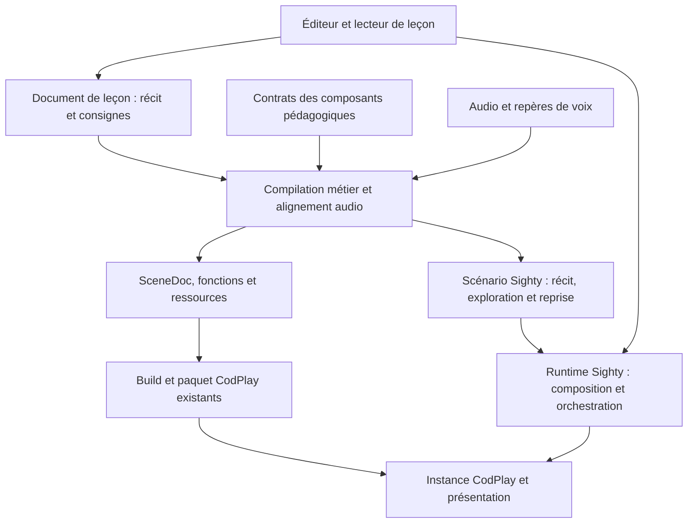

# Tangible : analyse et pistes pour des leçons narratives avec CodPlay

**27 octobre 2026.** Analyse de Tangible et pistes pour un outil de création de
leçons narratives fondé sur Sighty et CodPlay.

## Avis proposé

Tangible montre une expérience pédagogique intéressante pour CodPlay : une
explication parlée conduit une scène que l’apprenant peut aussi manipuler. Le
récit montre une relation, s’arrête pour laisser expérimenter, puis reprend.
Un assistant facultatif peut répondre en faisant une démonstration dans cette
même scène.

**La piste la plus pertinente est un outil d’authoring de leçons narratives,
avec un éditeur centré sur le texte, un scénario Sighty et des scènes CodPlay.**
Sighty porterait la conduite de la leçon et l’arbitrage entre récit et
intervention de l’apprenant ; CodPlay conserverait l’exécution des scènes.
Cette répartition s’applique aussi à une leçon qui ne présente qu’une seule
expérience scientifique. La création d’une simulation scientifique
resterait une compétence de composant ou d’intégration, éventuellement assistée
par un agent.

Le rapprochement est fort sur la reconstruction temporelle, les médias et les
composants. L’objectif est une expérience pédagogique comparable, avec les
possibilités propres à CodPlay et Sighty. Les règles de pause, de reprise et de
Seek peuvent conserver leurs spécificités ; leur différence avec Tangible ne
constitue pas une limitation. La reconstruction depuis les faits journalisés
offre notamment une base pour des expériences qui tiennent compte des actions
de l’apprenant, plutôt que de les effacer systématiquement au Seek.
Le partage des paramètres entre récit et apprenant relève de l’orchestration
Sighty, avec ses actions, son contexte, ses événements et son pilotage des scènes.

## 1. Ce que fait Tangible

### L’expérience de l’apprenant

Une leçon combine une scène interactive, une narration enregistrée, des
sous-titres et des changements visuels synchronisés. Dans l’exemple des
optimiseurs, l’apprenant observe une surface de perte et compare les trajectoires
de SGD, momentum et AdamW. Il peut agir sur les réglages et le point de départ,
changer le point de vue, interrompre la lecture et explorer la relation entre
les paramètres et les résultats. Cette expérience est accessible dans la
[leçon publique sur les optimiseurs](https://huggingface.co/spaces/dlouapre/tangible-optimizers).
[Présentation][t-readme], [scène des optimiseurs][t-optimizers].

Le récit peut afficher des équations ou des notes dans un tableau, changer de
chapitre et s’arrêter sur une consigne. Cette pause laisse la scène interactive.
Le bouton Continuer, le contrôle de lecture ou la barre d’espace reprennent
le récit. Avancer directement au-delà d’une pause la franchit sans l’imposer ;
revenir avant elle permet de la rencontrer de nouveau en lecture.
[Documentation des directives][t-directives], [gestion des pauses][t-pause].

Une leçon peut contenir plusieurs scènes. L’exemple du cercle trigonométrique
passe du cercle au graphe du cosinus, puis revient au cercle, avec une narration
commune. Les paramètres des deux scènes restent indépendants ; les valeurs
écrites par le récit suivent le temps global, tandis que les manipulations
de l’apprenant sont effacées lors d’un changement de scène ou d’un Seek.
[Guide multi-scène][t-multiple], [script de l’exemple][t-circle-script].

### La fabrication d’une leçon

L’auteur fournit principalement :

| Fichier | Rôle |
| --- | --- |
| `scenes/*.ts` | Déclarer les paramètres, dessiner la scène et définir ses interactions. |
| `script.md` | Écrire la narration et placer les consignes de synchronisation. |
| `lesson.yaml` | Choisir les scènes, les réglages de narration et les options de publication. |
| `assistant.md` | Donner les consignes pédagogiques de l’assistant facultatif. |

Tangible est donc actuellement un toolkit orienté texte, TypeScript et ligne
de commande. Le parcours documenté n’est pas celui d’un éditeur visuel permettant
de créer n’importe quelle simulation sans code. Un agent peut aider à construire
la scène et à traduire les intentions de l’auteur, mais l’auteur conserve le
choix du propos, de la narration et de la qualité pédagogique.
[Parcours auteur][t-authoring].

Le texte peut contenir une intention silencieuse entre doubles crochets,
qu’un agent traduit ensuite en directive. Les directives synchronisent les
changements avec les mots de la narration. Un exemple représentatif est :

```markdown
@cue(theta -> HALF_PI, over: 2s)
Turn through ninety degrees.
@pause(prompt: "Move the angle slider and explore the curve.")
```

Cet extrait illustre la syntaxe Tangible ; il ne propose aucune syntaxe publique
CodPlay. Les directives et indications silencieuses sont retirées du texte
prononcé. Un contrôle statique vérifie les noms, valeurs et références avant
de solliciter les fournisseurs de voix.
[Exemple source][t-circle-script], [référence des directives][t-directives].

### Narration, compilation et diffusion

Le compilateur transforme le texte et le contrat des scènes en audio, pistes
de paramètres et sous-titres VTT. Il résout les positions des directives depuis
les horodatages de la voix, puis produit les artefacts du lecteur. Le navigateur
ne compile pas le Markdown et ne synthétise pas la voix. L’audio constitue
l’horloge du lecteur.
[Architecture][t-architecture], [résolution temporelle][t-resolve],
[production des artefacts][t-emit], [horloge][t-clock].

Trois parcours facilitent l’itération : une preview de scène seule, une leçon
silencieuse avec sous-titres, et une narration vocale. La voix peut venir du
modèle local Supertonic, d’ElevenLabs ou d’un endpoint Qwen compatible. Les
résultats de synthèse sont mis en cache. La précision des repères dépend du
fournisseur : les horodatages locaux ou interpolés ne garantissent pas un
alignement exact sur chaque mot. Une écoute finale reste nécessaire.
[Narration et cache][t-narration].

Le parcours documenté suppose actuellement des leçons en anglais ; la voix
locale Supertonic est fixe et anglaise. Une expérience francophone doit donc
valider sa chaîne de voix, la prononciation des symboles, les sous-titres et
l’alignement sur son propre corpus. La présence d’un fournisseur multilingue
ne suffit pas à établir ce résultat.
[Configuration des leçons][t-authoring], [narration][t-narration].

Une leçon sans assistant peut être diffusée en site statique. L’assistant
nécessite un serveur de même origine qui garde ses identifiants côté serveur.
Le projet prévoit la publication sur Hugging Face Spaces et un export MP4.
Ce dernier évalue chaque image au temps voulu ; il produit une lecture linéaire
sans les manipulations du visiteur et remplace les pauses par des temps d’arrêt
finis. Ces sorties répondent à des usages différents.
[Publication][t-deploy], [export vidéo][t-video].

## 2. Les idées techniques et pédagogiques à retenir

### Un vocabulaire conceptuel partagé

La scène expose des paramètres tels que l’angle, le taux d’apprentissage ou
la visibilité d’une projection. Le même vocabulaire sert au récit, aux contrôles
de l’apprenant et aux commandes autorisées de l’assistant. Chaque paramètre
déclare son type, sa valeur initiale, son interpolation et sa politique de
contrôle. La commande `lesson ref` rend ce contrat consultable.
[Types][t-types], [contrat de scène][t-scene-contract].

L’idée utile pour CodPlay serait de décrire les prises pédagogiques d’un
composant. L’auteur choisirait « angle » ou « projection », sans manipuler les
détails du canvas ou l’arbre des objets Three.js. Cette description devrait
référencer les définitions propriétaires existantes ; elle ne devrait pas
constituer un second catalogue de capacités runtime.

### Trois manières de partager un paramètre

| Politique Tangible | Effet après une manipulation |
| --- | --- |
| `script` | La valeur de l’apprenant est maintenue temporairement, puis rejoint progressivement celle du récit. |
| `shared` | Elle reste en place jusqu’à la prochaine écriture du récit, puis rejoint sa consigne. |
| `viewer` | Le récit cesse de piloter ce paramètre après la première intervention, pendant la session courante. |

Pendant une manipulation, l’apprenant a la main. La pause fige les valeurs
modifiées ; la reprise redonne un délai de maintien aux paramètres `script`.
Un Seek efface les interactions. La documentation recommande généralement
`viewer` pour les caméras, mais les choix effectifs restent propres à chaque
scène : il ne faut pas les déduire de la nature du contrôle.
[Règles de partage][t-ownership], [réconciliation implémentée][t-reconciler].

Cette politique répond à une question pédagogique essentielle : comment laisser
essayer sans perdre l’exemple que la voix est en train d’expliquer ? C’est une
source d’inspiration plus structurante que la présence d’un champ de discussion.

Dans l’architecture du projet, cette responsabilité est portée par **Sighty**.
Le scénario détermine quand le récit commande une valeur, quand l’apprenant
garde la main et quand la conduite guidée reprend. Les actions de scène et
leur interpolation restent exécutées par CodPlay ; le modèle scientifique
reste dans son composant. Les actions, le contexte et la passerelle d’événements
Sighty constituent les circuits à examiner pour exprimer ces politiques.
Les trois modes Tangible sont des exemples de choix pédagogiques, sans devenir
des options Sighty promises ni une liste de comportements à reproduire.
[Responsabilités, actions et événements Sighty][s-authoring].

Tangible transmet également à la scène les paramètres en cours de manipulation,
leur origine — récit, apprenant ou assistant — et une intensité. La scène peut
ainsi souligner le réglage qui change au moment où la voix en parle. Pour un
éditeur dédié, relier une consigne à son effet visible serait une fonction
utile ; une telle observation ne doit pas être présumée disponible dans CodPlay.
[Contrat de rendu][t-scene-contract].

### Le temps adressable et le calcul scientifique

Les valeurs écrites par le récit sont évaluables directement à un instant.
Il n’est pas nécessaire de rejouer toutes les images depuis le début pour
effectuer un Seek. Il faut toutefois distinguer cette propriété de l’état
affiché pendant une interaction : les changements temporaires et leur retour
progressif possèdent leur propre état de session.
[Invariants][t-architecture], [réconciliation][t-reconciler].

Tangible propose aussi des calculs déterministes à la compilation, les
`bakers`, qui deviennent des pistes ordinaires. Cela convient à une expérience
préparée. Cela ne suffit pas pour un résultat qui doit être recalculé quand
l’apprenant change ses entrées : les optimiseurs possèdent leur propre modèle
de simulation et échantillonnent ses trajectoires. Pour CodPlay aussi, il
faudra distinguer les données précalculées de la simulation manipulable.
[Calcul préparé][t-bake], [modèle des optimiseurs][t-model].

### Un assistant qui peut montrer

L’assistant reçoit le guide pédagogique, la narration de la leçon, un contrat
compact des contrôles et le contexte courant. La position transmise dans le
message de l’apprenant décrit le chapitre, la phrase courante et la consigne
de pause ; cette position n’ajoute pas les phrases futures. Le contexte système
contient néanmoins la narration complète : l’assistant n’est pas limité à ce
qui a déjà été entendu.
[Composition du contexte][t-assistant-context].

Il retourne une réponse structurée en étapes contenant du texte, des valeurs
absolues et une durée de transition. Le serveur valide les paramètres autorisés,
leurs types et leurs bornes. Le modèle ne reçoit aucun outil d’exécution de
code. La démonstration visuelle est temporaire, cède à une manipulation de
l’apprenant et disparaît à la reprise ou à une nouvelle question ; les Seek
et changements de scène invalident également les réponses concernées.
[Service][t-assistant-service], [présentation des réponses][t-answer],
[contrat de l’assistant][t-assistant-context].

Dans cette proposition, Sighty coordonnerait aussi la demande de démonstration,
son interruption par l’apprenant et le retour au récit. Le service d’IA
resterait applicatif et CodPlay exécuterait les effets de scène. La présentation
temporaire et le temps de la démonstration demandent une validation explicite,
après stabilisation de l’expérience sans IA.

## 3. Correspondances et spécificités CodPlay

| Besoin de la leçon | Circuit CodPlay identifié | Application à cette proposition |
| --- | --- | --- |
| Décrire puis compiler une scène | [SceneDoc → build → CompiledScene][c-scene] | Fondation existante ; la traduction d’une leçon narrative reste à concevoir. |
| Évaluer un état à un instant | [Reconstruction logique][c-reconstruction] et [Engine/Player][c-player] | Temps et journal partagés par Play/Seek ; ne certifie pas tous les cas de rendu continu. |
| Arbitrer entre récit et apprenant | [Scénario, actions, contexte et événements Sighty][s-authoring] | Le scénario exprime le choix pédagogique avec les circuits existants ; les modes Tangible servent de comparaison. |
| Piloter une narration enregistrée | [Media-sync][c-media] et [preload][c-preload] | `sync: 'master'` peut conduire le temps logique ; les frontières de pause, dérive et reprise de la leçon restent à accepter. |
| Animer les éléments | [Actions temporelles][c-tween], [ACE][c-ace] | Sous-ensembles vérifiés ; l’intégration continue et plusieurs compositions restent au [plan][p-tween]. |
| Recevoir un réglage de l’apprenant | [Perso.emit][c-emit], [pipeline][c-events], [capture][c-capture] et [événements Sighty][s-authoring] | La scène reçoit l’interaction ; les événements publics admis peuvent conduire le scénario. Distinguer pause du récit et pause de cette scène. |
| Dessiner une expérience scientifique | [Composants][c-scene], [pont tiers][c-targets], [Three.js][c-three] | Des extensions sont possibles ; un modèle de perte, un graphe ou une caméra orbitale Tangible ne sont pas automatiquement disponibles. |
| Lire ou prévisualiser l’état | [Façade : snapshot et présentation][c-facade] | `snapshot.set` est une preview au temps présenté, sans écriture au journal ; ce n’est pas un moteur de politiques d’interaction. |
| Conduire la leçon et ses scènes | [Sighty][s-authoring] | Actions, contexte, composition, navigation et pilotage existants ; vérifier leur composition pour le récit, l’exploration et la reprise, y compris avec une seule expérience. |
| Diffuser la scène | [Paquet CodPlay][c-export] | Scène, fonctions et ressources prises en charge sont transportables ; les capacités requises restent fournies par l’engine du site. |

### Distinguer pause du récit et pause de la scène interactive

La [spécification de `Perso.emit`][c-emit] établit qu’une entrée DOM ordinaire
n’émet pas avant lecture ni pendant la pause de son player. Ce fait ne permet
pas de conclure qu’une pause pédagogique exige de modifier CodPlay : une pause
du récit ne signifie pas nécessairement la pause de toutes les scènes de la
composition Sighty.

Le scénario Sighty doit exprimer le passage du récit à l’exploration et la
reprise, en ciblant les occurrences concernées par les ports CodPlay existants.
Une scène d’expérience peut ainsi rester active pendant que la conduite
narrative est suspendue, si cette composition est explicitement définie et
validée. Une pause complète du player peut aussi être un choix pédagogique
utile pour observer un état stable avant de reprendre. L’expérience n’a pas
à donner à toute pause la signification retenue par Tangible.

Cette distinction permet de construire la leçon avec les contrats existants,
sans poser comme préalable une modification de la pause CodPlay. Le montage
choisi dépend de l’alternance souhaitée entre explication, observation et essai.

### Le journal et le Seek sont des possibilités à exploiter

Tangible efface les manipulations au Seek. CodPlay reconstruit depuis ses faits
journalisés ; le sort des événements utilisateur situés après un Seek arrière
reste une décision ouverte du [plan Player][p-player]. Des événements peuvent
aussi avoir été produits par des straps, qui ne sont pas réexécutés au Seek.

Cette différence peut être un avantage : les actions journalisées de
l’apprenant participent à l’état reconstruit. Une piste pédagogique serait
de revenir sur un essai pour en expliquer le résultat. Il s’agit d’un usage
à éprouver dans le scénario, sans supposer une persistance de parcours ni
trancher les décisions encore ouvertes du player. L’effacement systématique
appliqué par Tangible n’est pas un critère d’acceptation du produit envisagé.

Sighty porte la politique de reprise du scénario : conserver l’essai de
l’apprenant, revenir à une consigne ou réinitialiser une expérience. Il dispose
notamment des actions, de `showMode` à l’admission des vues et du reset sélectif
sur une action. Ces mécanismes ont des portées distinctes : `showMode` n’est
pas une politique par paramètre ni une réaction à chaque Seek.
[Politiques et reset Sighty][s-authoring].

Le scénario doit choisir la reprise adaptée à son propos avec ces circuits
et les effets de scène existants. Il peut conserver un résultat de l’apprenant
ou revenir à une situation guidée selon les opérations disponibles. Le
traitement interne des faits journalisés reste celui de CodPlay. La comparaison
avec Tangible ne crée aucun besoin de suppression de faits, de second journal
ou de déplacement de l’arbitrage dans le player.

### Une narration multi-scène demande plus que de la navigation

Le `@scene` de Tangible conserve une horloge de leçon commune, détruit la scène
sortante et recrée l’entrante depuis son état évalué. Sighty possède déjà les
circuits de composition et de navigation ; il faut les réutiliser. En revanche,
ils ne prouvent pas à eux seuls le passage d’un temps global de narration à
une scène et à sa position locale, notamment lors d’un Seek direct.

Le raccord de l’audio commun, des temps et des scènes masquées doit être étudié
dans cette orchestration Sighty. Une première preuve peut présenter cercle et
graphe dans une même scène d’expérience, tout en faisant déjà conduire le récit,
l’exploration et la reprise par le scénario. Ce périmètre réduit ne valide pas
le Seek global entre plusieurs scènes scientifiques.

### Le rendu spécialisé doit rester dans son intégration

Les objets d’une simulation et leurs caches de calcul appartiennent au
composant spécialisé. Les horloges, événements et faits reconstruisibles
restent dans leurs circuits CodPlay. Le pont tiers et le cycle de présentation
existants doivent porter le rendu, sans boucle de lecture concurrente.
L’extension `sync: 'independent'` aux intégrations tierces est acceptée mais
différée dans le [plan tiers][p-third-party] ; elle ne peut pas être présumée
disponible pour animer une démonstration pendant la pause.

## 4. À quoi pourrait ressembler l’outil dédié ?

### Une interface centrée sur l’explication

Un éditeur adapté à ce besoin montrerait principalement trois zones : le texte
du récit, la scène réelle et les propriétés de la consigne sélectionnée. Une
timeline secondaire montrerait la voix, les repères, les chapitres et les pauses.
Elle servirait au réglage fin, sans imposer d’éditer chaque mouvement comme un
montage d’animation généraliste.

L’auteur pourrait sélectionner une phrase, choisir un paramètre exposé par la
scène, régler sa valeur et sa durée, puis écouter la transition. Une commande
« Ajouter une exploration » associerait une pause et une consigne. Un diagnostic
indiquerait la phrase ou l’action incorrecte avant la génération de la voix.

La preview de scène seule et le mode silencieux méritent d’être repris tôt :
ils permettent de travailler la relation scientifique et la chorégraphie sans
attendre une synthèse vocale. La génération de voix et l’assistant resteraient
des services facultatifs avec leurs coûts et leur cycle propres.

### Une source auteur unique

La recommandation est de conserver un document de leçon lisible qui possède
le récit, les consignes et leurs ancrages. L’interface et l’agent modifieraient
ce même document par les commandes de l’outil. Les secondes calculées seraient
une sortie de compilation reliée à la version du texte et de l’audio.

L’outil projetterait ce document vers le scénario Sighty et les scènes CodPlay,
en conservant leurs responsabilités respectives. Le choix précis entre
Markdown annoté et document structuré relève d’un futur
plan. Le point à préserver est l’absence de deux sources indépendantes — texte
et timeline — qu’il faudrait ensuite réconcilier. Une première version peut
privilégier le texte et des formulaires ; un aller-retour riche avec un éditeur
Markdown externe augmente sensiblement la portée.

### La chaîne de production envisagée



Ce dessin présente une hypothèse d’organisation. Le compilateur métier
produirait le scénario Sighty et les entrées existantes du build CodPlay ; il
n’ajouterait pas un format de pistes exécuté par un lecteur parallèle.
L’éditeur piloterait la leçon par son intégration Sighty. Les sous-titres, repères et pauses
devraient être projetés sur des capacités identifiées, avec leurs éventuelles
extensions décidées avant implémentation. La syntaxe Tangible ne serait pas
copiée dans `SceneDoc` comme si elle en faisait déjà partie.

### Réutiliser l’existant avec ses limites connues

| Piste | Apport | Limite pour ce besoin |
| --- | --- | --- |
| Éditeur de scène existant | Timeline, commandes documentaires, preview, raccord à la façade et travail de sélection. | Il vise surtout l’édition de décor et de mouvement. Sa migration V2 possède encore des gates ; son [plan][e-plan] consigne notamment des écarts de validation auteur. |
| Sighty | Scénario, actions, contexte, admission des événements, composition et pilotage des scènes. | Il porte l’arbitrage récit/apprenant selon le choix pédagogique de la leçon et les contrats CodPlay. |
| Elcé | Authoring pédagogique, document, médias, preview et parcours Sighty. | Son [modèle][elce-document] décrit des pages et blocs ; le [builder Diapo][elce-diapo] ne constitue pas un contrat de narration alignée sur les mots. |
| Outil de leçon dédié | Interface et vocabulaire adaptés au récit manipulable. | Il demande un nouveau modèle métier et une interface ; il doit réutiliser les circuits de scène, de transport et de parcours existants. |

La recommandation est d’explorer l’outil dédié, en auditant les modules
réutilisables des deux applications. Cela ne signifie pas reconstruire leur
transport ou leur gestion d’instances. Une intégration ultérieure dans Elcé
pourrait devenir pertinente si l’usage principal est un cours composé de pages ;
ce n’est pas un prérequis à la première leçon.

## 5. Exemple d’une leçon à créer

Le cercle trigonométrique serait un bon premier sujet : sa relation centrale
est simple à vérifier, il permet un réglage au clavier et par pointeur, et il
réunit animation, narration et exploration sans imposer Three.js.

Une leçon de deux ou trois minutes pourrait faire tourner un point, montrer sa
projection horizontale, puis comparer cette projection au graphe du cosinus.
Une consigne demanderait de prédire où le cosinus est nul, laisserait déplacer
le point, puis reprendrait l’explication. Le composant pourrait rendre ensemble
le cercle et le graphe dans une seule scène pour cette première portée.

Dans l’éditeur, l’auteur écrirait « Le cosinus est la position horizontale du
point », sélectionnerait cette phrase et lui associerait l’apparition de la
projection. Sur la phrase suivante, il choisirait une rotation vers un quart
de tour. Il ajouterait ensuite la consigne « Cherchez les deux positions où le
cosinus est nul » et un temps d’exploration.

Sighty conduirait cette alternance. CodPlay présenterait le mouvement, les
réglages de l’apprenant et les états reconstruits. La reprise pourrait repartir
de l’essai obtenu pour l’expliquer, ou revenir à une position choisie par
l’auteur. Le journal pourrait servir à revenir sur un essai intéressant.

Une version plus riche ferait passer du cercle au graphe dans deux scènes
distinctes, puis proposerait de comparer les essais. Un assistant pourrait
répondre à « Pourquoi le cosinus est-il négatif ici ? » en mettant en évidence
la projection et la moitié gauche du cercle. L’export vidéo permettrait de
partager l’explication guidée, tandis que la version interactive conserverait
la manipulation.

## 6. Direction proposée

L’apport à reprendre est la boucle **expliquer → montrer → laisser essayer →
reprendre**, ainsi que le contrat conceptuel partagé entre la scène et le récit.
Sighty porte cette conduite et l’arbitrage récit/apprenant ; CodPlay exécute
les scènes. Un éditeur textuel avec preview réelle paraît mieux adapté à cette boucle
qu’une extension immédiate de tous les panneaux d’un éditeur d’animation.
La valeur de la proposition se juge sur cette expérience et sur l’usage des
possibilités CodPlay, avec ses propres règles de pause, de journal et de Seek.

[t-readme]: https://github.com/scienceetonnante/tangible/blob/1ad33b5ef3830380023644d796beb9db639f8c2e/README.md
[t-optimizers]: https://github.com/scienceetonnante/tangible/blob/1ad33b5ef3830380023644d796beb9db639f8c2e/lessons/optimizers/scenes/scene.ts
[t-directives]: https://github.com/scienceetonnante/tangible/blob/1ad33b5ef3830380023644d796beb9db639f8c2e/DOCUMENTATION.md#narration-directives
[t-pause]: https://github.com/scienceetonnante/tangible/blob/1ad33b5ef3830380023644d796beb9db639f8c2e/packages/player/src/pause-gate.ts
[t-multiple]: https://github.com/scienceetonnante/tangible/blob/1ad33b5ef3830380023644d796beb9db639f8c2e/DOCUMENTATION.md#add-another-scene
[t-circle-script]: https://github.com/scienceetonnante/tangible/blob/1ad33b5ef3830380023644d796beb9db639f8c2e/lessons/unit-circle/script.md
[t-authoring]: https://github.com/scienceetonnante/tangible/blob/1ad33b5ef3830380023644d796beb9db639f8c2e/DOCUMENTATION.md#authoring-workflow
[t-architecture]: https://github.com/scienceetonnante/tangible/blob/1ad33b5ef3830380023644d796beb9db639f8c2e/CONTRIBUTING.md#architecture
[t-resolve]: https://github.com/scienceetonnante/tangible/blob/1ad33b5ef3830380023644d796beb9db639f8c2e/packages/compiler/src/resolve.ts
[t-emit]: https://github.com/scienceetonnante/tangible/blob/1ad33b5ef3830380023644d796beb9db639f8c2e/packages/compiler/src/emit.ts
[t-clock]: https://github.com/scienceetonnante/tangible/blob/1ad33b5ef3830380023644d796beb9db639f8c2e/packages/player/src/clock.ts
[t-narration]: https://github.com/scienceetonnante/tangible/blob/1ad33b5ef3830380023644d796beb9db639f8c2e/DOCUMENTATION.md#choose-and-configure-narration
[t-deploy]: https://github.com/scienceetonnante/tangible/blob/1ad33b5ef3830380023644d796beb9db639f8c2e/DOCUMENTATION.md#deploy-to-hugging-face-spaces
[t-video]: https://github.com/scienceetonnante/tangible/blob/1ad33b5ef3830380023644d796beb9db639f8c2e/DOCUMENTATION.md#export-a-video
[t-types]: https://github.com/scienceetonnante/tangible/blob/1ad33b5ef3830380023644d796beb9db639f8c2e/packages/core/src/types.ts
[t-scene-contract]: https://github.com/scienceetonnante/tangible/blob/1ad33b5ef3830380023644d796beb9db639f8c2e/DOCUMENTATION.md#scene-contract
[t-ownership]: https://github.com/scienceetonnante/tangible/blob/1ad33b5ef3830380023644d796beb9db639f8c2e/CONTRIBUTING.md#parameter-ownership
[t-reconciler]: https://github.com/scienceetonnante/tangible/blob/1ad33b5ef3830380023644d796beb9db639f8c2e/packages/player/src/reconciler.ts
[t-bake]: https://github.com/scienceetonnante/tangible/blob/1ad33b5ef3830380023644d796beb9db639f8c2e/DOCUMENTATION.md#build-time-computation
[t-model]: https://github.com/scienceetonnante/tangible/blob/1ad33b5ef3830380023644d796beb9db639f8c2e/lessons/optimizers/scenes/model.ts
[t-assistant-context]: https://github.com/scienceetonnante/tangible/blob/1ad33b5ef3830380023644d796beb9db639f8c2e/DOCUMENTATION.md#understand-the-assistant-request
[t-assistant-service]: https://github.com/scienceetonnante/tangible/blob/1ad33b5ef3830380023644d796beb9db639f8c2e/packages/cli/src/assistant-service.ts
[t-answer]: https://github.com/scienceetonnante/tangible/blob/1ad33b5ef3830380023644d796beb9db639f8c2e/packages/player/src/answer-timeline.ts
[c-scene]: ../../../../packages/codplay/specs/scene-authoring-spec.md
[c-reconstruction]: ../../../../packages/codplay/specs/runtime-reconstruction-v2-spec.md
[c-player]: ../../../../packages/codplay/specs/engine-player-v2-spec.md
[c-media]: ../../../../packages/codplay/specs/media-sync-v2-spec.md
[c-preload]: ../../../../packages/codplay/specs/preload-v2-spec.md
[c-tween]: ../../../../packages/codplay/specs/action-sequence-tween-v2-spec.md
[c-ace]: ../../../../packages/codplay/specs/ace-calculation-v2-spec.md
[c-emit]: ../../../../packages/codplay/specs/perso-emit-v2-spec.md
[c-events]: ../../../../packages/codplay/specs/event-pipeline-v2-spec.md
[c-capture]: ../../../../packages/codplay/specs/capture-v2-spec.md
[c-facade]: ../../../../packages/codplay/specs/facade-v2-spec.md
[c-targets]: ../../../../packages/codplay/specs/third-party-target-bridge-spec.md
[c-three]: ../../../../packages/codplay/specs/third-party-threejs-spec.md
[c-export]: ../../../../packages/codplay/specs/scene-package-export-v1-spec.md
[p-tween]: ../../../../packages/codplay/plan/action-sequence-tween-plan.md
[p-player]: ../../../../packages/codplay/plan/player-engine-plan.md
[p-third-party]: ../../../../packages/codplay/plan/2026-09-18-third-party-components-v2-plan.md
[s-authoring]: ../../../../packages/sighty/specs/authoring-library-spec.md
[e-plan]: ../../../../packages/editor/plan/2026-09-01-editor-v2-organization-plan.md
[elce-document]: ../../../../packages/elce/specs/document-model-spec.md
[elce-diapo]: ../../../../packages/elce/specs/diapo-scene-builder-spec.md
