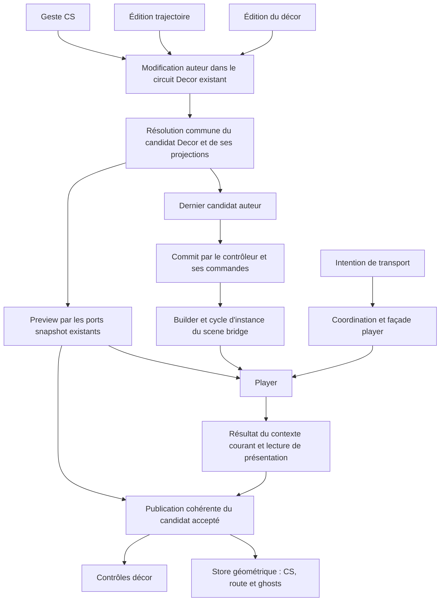

# Analyse du circuit Editor vers le player

## Périmètre et références

Cette note conserve le raisonnement préparatoire du renforcement général du
couplage décor/projections, encore soumis à revue dans le
[mémo Editor](../decisions-a-prendre.md#2-fermer-les-portes-mouvement-v2).
Le comportement vérifié de rotation est désormais le mode unique par item de
la [spec d’orientation](../../specs/path-tangent-orientation-spec.md).
Les propositions ci-dessous ne constituent pas un contrat ni une autorisation
d’implémenter le couplage général. Les interactions de trajectoire restent les
références de non-régression de cette reprise éventuelle.

Références vérifiées : [présentation des items](../../specs/item-presentation-spec.md),
[orientation de trajectoire](../../specs/path-tangent-orientation-spec.md),
[intégration](../../specs/editor-v2-integration-spec.md),
[document Editor](../../specs/editor-document-model-spec.md),
[move](../../../codplay/specs/move-v2-spec.md),
[transformations](../../../codplay/specs/transform-properties-v2-spec.md),
[calculs ACE](../../../codplay/specs/ace-calculation-v2-spec.md),
[unités](../../../codplay/specs/unit-values-v2-spec.md) et
[façade](../../../codplay/specs/facade-v2-spec.md#lecture-et-projection-détat).
Pour l’élargissement : [interpolation des styles de décor](../../specs/decor-style-interpolation-spec.md)
et responsabilités des ponts décrites par la spécification d’intégration.

## Architecture à rendre prévisible

L’objet de la reprise est l’architecture du passage Editor → player. Les
rotations, couleurs et opérations de timeline servent à en éprouver les règles.
Élargir seulement la liste des correctifs laisserait les mêmes interférences
possibles entre des calculs pourtant corrects pris séparément.

### Noyau : synchronisation immédiate du décor et de sa projection

Le périmètre prioritaire est le couplage fort entre **le décor en cours
d’édition et toutes ses représentations**. Le décor ne désigne pas seulement
la palette : il contient aussi les offsets, le pivot, le chemin et son option
tangentielle, quel que soit l’outil qui les modifie. Les CS, l’overlay de
trajectoire et les champs de palette sont des entrées et des vues de cette
même édition.

Toute modification acceptée doit se répercuter pendant l’interaction, à
chaque mise à jour, sur le candidat Decor effectif, les contrôles concernés,
l’item projeté et la géométrie commune des CS, de la route et des ghosts.
« Immédiat » signifie dans la même mise à jour logique et dès la présentation
normale suivante du navigateur : pas au relâchement, au blur, après un délai
d’inactivité ou à l’occasion d’un futur seek. La modification de la couleur
ne déplace pas l’item ; la conservation de sa pose participe néanmoins à
cette synchronisation.

Ce couplage est bidirectionnel du point de vue des outils : un geste de CS
met à jour les valeurs auteur du décor ; une saisie de ces valeurs déplace
immédiatement le CS et l’item. Le flux interne garde un sens déterminé :
intention → modification auteur → résolution commune → projection et
contrôles. Le rafraîchissement des contrôles est une lecture du candidat,
sans réémission du même patch comme une nouvelle intention.

Le commit est une autre frontière : il persiste le dernier candidat par les
commandes existantes, une fois à la fin du geste. Il ne déclenche pas la première
mise en cohérence et ne refait pas le calcul. Cette distinction conserve
l’écriture sparse, le copy-on-write et la granularité Undo/Redo.

#### Raisonnement de convergence

1. **Faire converger les producteurs.** Les contrôles palette et les CS passent
   déjà par `DecorEditorController.applyPatch` / `onDecorChange`. Le drag de
   trajectoire peut rejoindre ce même traitement de modifications auteur via
   la frontière de callbacks existante de l’overlay, tout en conservant son
   dessin pendant le drag et son unique notification de fin. Son `path`
   vise le décor du KF cible du segment entrant, sans cascade ; le mode de
   rotation est propre à l’item ;
   les offsets visent la pose éditée. Une cible commune d’interaction ne signifie
   donc pas écrire aveuglément tous les champs dans le même Decor.
2. **Résoudre un seul candidat effectif.** Étendre le registre de modifications
   existant et la résolution du bridge. La base, le patch sparse et le contexte
   de pose/segment déterminent ensemble le décor effectif et les projections
   nécessaires. Aucun outil ne conserve une seconde valeur auteur effective.
3. **Appliquer et publier ce même résultat.** Les ports snapshot existants
   présentent le candidat ; les contrôles décor le relisent et le store
   géométrique publie CS/route/ghosts issus du même contexte. L’application
   acceptée et cette publication forment une même mise à jour logique.
   Un refus ne doit pas laisser un nouveau CS présenté comme accepté devant
   un ancien item. Aucune nouvelle transaction ou nouveau store de synchronisation
   n’est requis par cette proposition.
4. **Conserver le couplage jusqu’à la reprise de présentation.** La fin du geste
   écrit ce candidat. La reconstruction et les relectures reprennent ses valeurs
   persistées ; abandon, Undo/Redo et Seek remettent ensemble contrôles et
   projections dans leur contexte, sans réintroduire un brouillon périmé.

#### Écarts concrets du circuit actuel

- `previewFrame` passe par `controller.applyPatch`, mais choisit aussi sa frame
  affichée et sa frame auteur autour de `onDecorChange`. Les deux passages
  doivent devenir les étapes ordonnées d’une seule résolution, sans que la
  palette et le CS publient chacun leur interprétation du résultat.
- `MotionOverlay.moveDrag` ne met à jour que `draftControl` et son rendu local.
  `onPathChange` ne remonte qu’à `endDrag`, puis `commitMotionPath` écrit
  directement les commandes. Le rendu de la courbe pendant le drag fonctionne
  et doit être préservé. Il ne prouve pas à lui seul la synchronisation immédiate
  du décor, de l’item et de la tangente. Renforcer cette remontée interne ne
  justifie pas de remplacer le rendu, de déplacer la notification de fin dans
  le pointermove ou de modifier les gestes existants. Le plan détaille cette
  extension après la correction et la non-régression de rotation.
- `onDecorChange` recalcule actuellement la pose pour tout patch de palette.
  La reprise doit résoudre les dépendances pertinentes sans désolidariser le
  décor de sa projection : une couleur conserve la pose, une bordure ou un
  padding modifie les insets, une rotation modifie l’orientation sous ses
  contraintes, et un chemin modifie le point/tangente au temps édité.
- Les champs hors style ne sont pas tous transmis par `toSnapshotPatches`.
  C’est un écart de couverture à examiner pour satisfaire l’exigence immédiate,
  pas une exclusion implicite du périmètre. Une ressource non encore disponible
  ne peut être annoncée comme projetée : établir le résultat natif réellement
  disponible, sans substitut DOM ni changement de CodPlay.

La structure actuelle nomme déjà les propriétaires, mais l’ordre effectif
dépend aussi de callbacks de ponts, de flags de preview et de promesses de
reconstruction/seek. L’écart à traiter est entre cette répartition déclarée
et un enchaînement dont les préconditions et les sorties sont explicites.

### Autorités et dépendances

| Information | Autorité existante | Règle architecturale proposée |
|---|---|---|
| Document accepté et historique | Contrôleur et commandes Editor | Toute écriture auteur y passe ; aucune relecture de présentation n’écrit spontanément |
| Candidat d’une interaction | Bridge propriétaire de l’interaction et registre existant | Base de départ stable, candidat identifié et remplacé explicitement ; aucune deuxième version indépendante dans un autre consommateur |
| Document/instance en cours de publication | `scene-player-bridge` | Compilation, ressources, staging et remplacement ont le même propriétaire ; document demandé et instance publiée sont distingués |
| Temps demandé en édition | `sequence-editor`, relayé par le contrôleur | Une demande reste une demande jusqu’au résultat du seek applicable |
| Temps et pose réellement présentés | Façade player et ports snapshot/presentation | Les lecteurs utilisent une présentation du contexte courant ; un bind ne vaut pas présentation à l’instant demandé |
| Passage entre modules | `EditorCoordinationBridge` | Raccord et relais des ports existants ; ni calcul auteur concurrent ni mutation documentaire |
| Contours, route, ghosts | `MotionGeometryStore` | Une projection commune de la pose retenue ; pas trois reconstructions divergentes |

Ces autorités sont complémentaires. « Un seul circuit » signifie un
propriétaire par responsabilité et des dépendances explicites ; il ne signifie
pas copier toutes ces informations dans un nouvel état global.

Le retour vers les contrôles est une observation. Il n’emprunte le chemin
d’intention que lorsqu’un geste utilisateur ou une commande explicite le
demande. La capture de KF reste cette commande explicite, pas un enregistrement
automatique de ce que le player vient d’afficher.

### Transitions à expliciter dans les propriétaires actuels

Les lignes suivantes décrivent un modèle de lecture et de revue. Elles ne
créent ni états runtime, ni nouveaux events, ni service d’ordonnancement.

| Transition | Précondition | Sortie attendue et autorité suivante |
|---|---|---|
| Commencer une interaction | Cible, base, temps et repère compatibles | Un contexte de départ détenu par son bridge ; la base ne dépend plus des previews suivantes |
| Modifier l’aperçu | Même interaction et contexte encore valides | Décor, contrôles, item et géométrie actualisés depuis le même candidat accepté, pendant l’interaction ; un refus ne remplace pas un résultat accepté |
| Terminer l’interaction | Dernier candidat connu et propriétés touchées connues | Une transaction auteur, puis publication du document par le scene bridge ; aucun deuxième calcul auteur au relâchement |
| Adopter la présentation après commit | Résultat de la scène/instance et du temps encore applicables | La présentation redevient la base ; les données transitoires consommées sont libérées une fois |
| Annuler | Interaction non commitée | Abandon du candidat par les nettoyages existants ; aucun patch inverse écrit dans le document |
| Seek ou sélection avec seek | Phase en attente traitée selon le contrat existant | Temps demandé relayé, puis resynchronisation au seek appliqué ; aucune lecture prématurée prise comme base |
| Undo/Redo ou nouveau document | Frontière explicite du contrôleur | Travail différé et candidats précédents invalidés ; nouveau document publié par le même propriétaire |
| Play, puis retour à l’édition | Flush et publication/seek applicables achevés | Autorité temporelle du player en lecture, puis adoption unique du temps auteur au retour |
| Resize/scroll | Contexte de présentation courant disponible | Reprojection dans le même circuit, sans mutation documentaire ni reprise d’un ancien geste |
| Échec ou résultat remplacé | Résultat refusé ou contexte devenu ancien | Pas d’adoption comme réussite courante ; état demandé et état effectivement présenté restent distinguables |

Pour chaque transition, la revue doit pouvoir indiquer son déclencheur, son
propriétaire, les données lues, les effets autorisés et sa condition de fin.
Les gardes et rendez-vous existants sont les points à consolider. Une lacune
doit être nommée dans le plan avant toute proposition d’API supplémentaire.

### Propriétés qui rendent le circuit prédictible

- Même document, même temps, même base et mêmes contraintes donnent le même
  candidat, indépendamment des callbacks déjà traversés pour atteindre cet état.
- Une valeur porte un rôle précis : auteur, candidat ou présentation ; pour
  le spatial, son repère et son unité sont connus à chaque frontière.
- Un calcul produit un résultat transmis à l’étape suivante. Un consommateur
  ne le remplace pas par son propre calcul du même phénomène.
- Un effet documentaire a un seul chemin d’écriture. Une observation ou une
  préférence d’interface ne produit pas un commit implicite.
- Une fin d’opération ne peut adopter le résultat d’une autre scène, instance,
  interaction ou demande de temps ; les mécanismes existants portent ce contrôle.
- Début, remplacement, consommation et abandon d’un candidat sont explicites,
  y compris quand une opération en interrompt une autre.
- Les événements nécessaires et leurs dépendances sont identifiables ; le
  résultat ne repose pas sur un délai ou un ordre fortuit d’observers.

Cette grille permet de prédire un parcours avant de l’exécuter, puis de comparer
la trace réelle à cette prédiction. Elle est le critère de revue de
l’architecture ; le passage d’un exemple visuel ne suffit pas à l’établir.

## Circuit existant et propriétaires

| Étape | Propriétaire existant | Entrée et sortie |
|---|---|---|
| Geste | `selection-frame/src/v2/rotation-modifier.ts` | Pointeur viewport, pivot et frame initiale → delta cumulatif en degrés ; preview finale avant commit |
| Cible et état auteur | `decor-editor-bridge.ts` : `resolveTarget`, `readLogicalFrame`, `authoredRotationAtGestureStart` | Document, snapshot de base au temps présenté, KF/segment → pose auteur et décalage tangent |
| Géométrie | `motion-editor/geometry.ts`, `content-box.ts`, `border-insets.ts` | Pose, bordure, padding, pivot → contenu, cadre extérieur et ancre de chemin |
| Candidat | `previewFrame`, `displayFrameForAuthorFrame`, `setAuthorFrame` | Base du geste et delta → candidat auteur et candidat présenté |
| Aperçu | `toSnapshotPatches` → coordination → `snapshot.set` → `ItemComponent` | Candidat affiché, inverse de la pose présentée → visuel temporaire ; aucun changement documentaire |
| Écriture | `commitSelectionFrameDrop` → `commitMotionDrop` → commandes Decor du contrôleur | Candidat auteur → patch dans la transaction existante ; copy-on-write et historique existants |
| Reconstruction | Builder → `scene-player-bridge` → `SEEK_APPLIED` → `syncSelection` | Document → instance présentée → réattachement du CS |
| Reprojection | `refreshProjectionAfterResize`, store `MotionGeometryStore` | Géométrie courante → CS, trajectoire et ghosts ; sans écriture auteur |

Ces étapes existent déjà. La correction doit rendre leurs conversions
cohérentes et supprimer les recalculs concurrents à ces frontières, sans créer
un second moteur de mouvement, store de géométrie ou chemin de commande.

## Constats de conception

1. **Les repères ne sont pas suffisamment explicites.** `authorFramePx` et
   `displayFramePx` partagent `SelectionFrameValue`. `logicalFrameToPx` change
   l’unité avec la largeur de scène ; cette opération n’applique aucune matrice
   de parent. Les endpoints de `resolveMotionOverlaySegments` sont construits
   par cette voie. Inversement, `presentedContentBoxFrameForItem` lit une pose
   déjà composée. Ces valeurs ne sont pas interchangeables dans une capsule.
2. **L’écriture ne possède pas une frontière inverse explicite de parent.**
   `frameToOffsetPatch` convertit des pixels en cqw et normalise l’angle ; il
   ne retire pas la transformation du parent. `authorFrameForGesture` change
   l’angle et l’ancre, mais ne réalise pas cette conversion de repère. Le nom
   « auteur » n’établit donc pas à lui seul la provenance correcte d’une frame.
3. **Plusieurs relectures peuvent changer la base du calcul.** Le bridge garde
   les bases du geste, les frames courantes et le candidat de commit. Le chemin
   temporaire lit une pose interpolée ; le KF exact lit le document ; le CS lit
   la présentation. La fin du geste repasse par `previewFrame`, puis par le
   flush et la résolution du drop. Il faut une seule base de geste et un même
   candidat transmis jusqu’à l’écriture, avec des repères nommés.
4. **La preview a déjà un changement de repère utile.** `itemPreviewInverse`
   utilise `invertMatrix` sur la pose complète. Le composant applique cet
   inverse à son ancre privée. Ce calcul reste correct seulement si l’inverse
   et le candidat visent exactement la même racine de présentation. Il ne
   constitue pas une conversion documentaire vers le parent.
5. **La représentation du CS a une limite affine réelle.**
   `selectionFrameFromPresentedPose` extrait angle et normes des colonnes,
   puis reconstruit une rotation avec deux échelles. Son commentaire reconnaît
   la perte d’un cisaillement hérité. Une capsule tournée suffit au cas rigide ;
   une échelle parentale non uniforme combinée à une rotation enfant impose de
   garder la matrice exacte pour les calculs, même si le contrôle est approché.
6. **Le retour de présentation doit être analysé comme une étape du circuit.**
   L’intégration certifie des rendez-vous précis et ne possède pas de second
   flux de géométrie. Un `SEEK_APPLIED` et un rafraîchissement de taille peuvent
   être distincts. Le commentaire supposant un ordre entre observers ne prouve
   pas que le CS a adopté la dernière pose de l’instance reconstruite.

Les observations antérieures (`53°` puis environ `35,381°`) prouvent une rupture
de continuité dans le parcours exercé. Les essais natifs sont des signaux
complémentaires ; ils ne justifient ni une modification de CodPlay ni une
compensation Editor. La responsabilité exacte du saut doit être confrontée à
des entrées, repères et instants explicitement tracés.

## Grandeurs et ordre de calcul à rendre explicites

- Rotation auteur : valeur persistée ; avec tangente, décalage de référence.
- Tangente : direction du chemin au même temps eased que le point résolu.
- Angle utile de l’item : orientation résultante dans le repère de présentation.
- Angle de commande du CS et orientation de son contour : rôles à distinguer
  dans le vocabulaire interne ; aucune de ces valeurs ne devient automatiquement
  la rotation auteur. La spec actuelle fait suivre au contour la pose publiée.
- Pose de capsule : matrice complète, avec son origine et son pivot ; pas un
  simple angle à ajouter ou à retrancher partout.

L’ordre à formaliser dans le circuit actuel est :

1. Fixer l’item, le temps, le segment, la progression eased, la pose auteur,
   les insets, le pivot, l’ancre et la pose du parent dans le contexte du geste.
2. Qualifier les unités. La conversion cqw/pixels ne change pas le repère.
   Conserver la référence d’unité du contrat existant ; vérifier l’accord entre
   conversion numérique et conteneur CSS dans les capsules avant de la modifier.
3. Résoudre le point et la tangente sur le même chemin préparé. Projeter les
   endpoints, le point et les directions dans un repère commun, une seule fois.
4. Appliquer le delta à la base du geste, arrondir l’angle absolu commandé au
   degré entier, puis retrouver la rotation auteur dans son repère. Un décalage
   tangent peut rester fractionnaire : arrondir aussi cet offset changerait
   l’angle final. Préserver le passage par ±180° et les tours du pointeur.
5. Recomposer la pose utile avec ce résultat auteur, le parent et les insets.
   Pour une rotation seule, conserver l’ancre ; un pivot ou des insets
   asymétriques peuvent nécessiter une compensation de translation auteur.
   Cette compensation ne doit pas redéfinir le chemin et sa tangente.
6. Envoyer ce candidat par l’aperçu existant et publier sa géométrie une seule
   fois dans `MotionGeometryStore` pour le CS, la route et les ghosts.
7. Au relâchement, écrire le candidat auteur déjà calculé par les commandes
   existantes. Ni le flush ni le rebuild ne doivent réinterpréter un angle de
   présentation comme un offset auteur.
8. Après reconstruction/reprojection, adopter la pose publiée au rendez-vous
   existant approprié, retirer le candidat temporaire et vérifier la continuité.
   Un refresh sans geste reste une projection, jamais une correction persistée.

Cet ordre est une proposition de reprise à relire, pas un nouveau contrat vérifié.

## Capsule tournée et fonctions disponibles

Soit `P` la transformation du repère de contenu du parent vers la scène,
`L` la transformation auteur locale de l’item et `K` le changement d’origine
contenu/cadre établi par les fonctions d’insets. La composition s’écrit
`W = P × L × K`. Pour une pose présentée candidate, le retour auteur nécessite
`L = inverse(P) × W × inverse(K)`, dans cet ordre. Le calcul doit établir les
origines exactes de `P` et `K` avec les conventions existantes, sans appliquer
une seconde fois la bordure ou le pivot.

Les points prennent la matrice affine complète. Une direction de tangente
prend seulement sa partie linéaire : la translation ne la tourne pas. Pour
un parent simplement tourné de `30°`, une tangente locale de `20°` et un offset
de `10°` conduisent à une direction utile de `60°` ; le document garde l’offset
`10°`. L’addition scalaire n’est pas un modèle général dès qu’une échelle
non uniforme, une réflexion ou un changement de parent intervient. Le contrat
`orientToPath` réoriente dans l’espace de présentation : il faut conserver
cette sémantique plutôt que lui substituer une autre composition locale.

Fonctions déjà exposées par CodPlay/ACE et utilisables dans Editor :

| Surface | Usage dans ce circuit |
|---|---|
| `ace`: `multiplyMatrix`, `invertMatrix`, `transformPoint` | Composition parent/enfant et conversion inverse, sans réécriture de l’algèbre affine |
| `ace`: `createTranslateMatrix`, `createRotateMatrix`, `createScaleMatrix` | Matrices locales, pivot et changements d’origine ; `createRotateMatrix` reçoit des radians |
| `ace`: `prepareSvgPath`, `resolvePath`, `resolvePathFrame` | Point et tangente cohérents ; réutiliser la préparation et le timing existants |
| `instance.presentation.get()` | Matrices et origines présentées de l’item et des capsules au même temps |
| `instance.snapshot.get/set/clear` | État logique de base et aperçu ; aucune entrée supplémentaire au journal |

L’alias `ace` d’Editor pointe déjà vers `packages/codplay/src/ace/index.ts`.
Les utilitaires internes du runner ne doivent pas devenir une dépendance
nouvelle d’Editor. Une inverse singulière est signalée par `null` ; aucune
matrice identité de repli ne doit transformer un calcul impossible en écriture.

Une capsule animée est évaluée au temps auteur du geste ; sa pose doit être
réévaluée au Seek/Play suivant. La pose de départ du geste ne devient pas un
cache permanent de la transformation du parent. Les capsules imbriquées
composent leurs matrices dans l’ordre de la hiérarchie.

## Élargissement à toute remontée d’Editor vers le player

### Inventaire des voies actuelles

| Origine et intention | Voie existante vers le player | Écriture et résultat à distinguer |
|---|---|---|
| Palette : couleurs, styles, typographie, propriétés ouvertes | `onDecorChange` → registre sparse → `previewPatch` → coordination.snapshot → façade player | Aperçu accepté distinct du document ; fin du contrôle → commandes Decor existantes |
| Contenu, classes, custom, source texte/image/média | Commandes documentaires et candidat complet de décor → Builder/rebuild | `toSnapshotPatches` transporte actuellement le style vivant ; ne pas prétendre que toutes les autres propriétés disposent déjà d’une preview native |
| Déplacement, rotation, taille, pivot, trajectoire | Selection Frame/overlay → bridge décor → géométrie → snapshot ; commit via commandes pose/chemin | Conversion parent/local et unités ; le résultat présenté n’est pas un patch auteur |
| Zones, grille, type et distribution de capsule | Commandes du contrôleur → Builder, Capsule Automation et CapsuleDistribution → rebuild | Placement et timing ont déjà leurs propriétaires ; aucune duplication dans la coordination |
| Timeline : insertion/déplacement/suppression de KF, bornes, timing | `sequence-editor-bridge` → enrichissement sparse éventuel → `RUN_TRANSACTION` → rebuild | Capture différée d’un candidat au bon snapshot, sans figer les propriétés non touchées |
| Création/suppression d’item, visibilité, ordre, rattachement | `EditorActionsFacade` / commandes centrales → Builder/rebuild | Une capsule affecte son sous-arbre ; ordre, parent et existence de la cible changent ensemble |
| Chargement/changement de scène, Undo/Redo | `sceneLoaded`, `sceneCommitted`, `sceneReverted`, frontière d’historique → `scheduleRebuild` | Remplacement de contexte et invalidation des candidats/captures ; pas un nouvel edit auteur |
| Scrub, sélection d’un KF demandant un seek | Temps auteur → contrôleur `SEEK` → scene bridge → façade `execute(seek)` → `SEEK_APPLIED` | La demande n’est pas la présentation ; le snapshot doit correspondre au temps player demandé |
| Play/Pause/Stop, rewind et vitesse | Ports transport de coordination → façade player ; Play attend flush/rebuild/seek applicables | Pas d’entrée documentaire ; retour unique du temps de lecture à l’édition |
| Resize/scroll et taille de région | Circuit de projection et observation existants | Reprojection de l’état courant, sans commit ni recréation arbitraire d’instance |
| Sélection, panneaux, zoom timeline, préférence de hauteur | État UI / préférences existants | Pas d’envoi documentaire au player ; distinguer un seek explicitement associé et l’effet DOM d’un resize |

La sauvegarde SQLite n’est pas une autre voie de présentation. Un document
sauvegardé, un document compilé et une instance effectivement présentée sont
trois états observables différents. Leur succès ne doit pas être confondu.

### Ce que le circuit actuel garantit déjà

Le contrôleur possède l’écriture et l’historique. Le scene bridge possède le
Builder, les ressources, le staging et le remplacement d’instance. La façade
player possède l’accès à l’instance et l’adaptation du temps auteur/player.
La coordination raccorde ces ports et les candidats, sans écrire le document.
Ces propriétaires suffisent à l’élargissement ; le circuit ne manque pas d’un
nouveau dispatcher général.

Trois usages légitimes restent distincts : publier un document par compilation,
présenter un aperçu temporaire, commander le transport. Les forcer dans une
nouvelle file unique ou dans un même event runtime changerait leurs sémantiques.
L’unification recherchée porte sur la préparation des valeurs, les frontières
d’application et le contrôle de cohérence dans leurs voies actuelles.

### Points de conception à examiner au-delà de la rotation

1. **Une modification décorative traverse aussi le calcul de pose.**
   `onDecorChange` construit un `authorCandidate` et appelle
   `displayFrameForAuthorFrame`, même pour un patch de couleur. Ensuite,
   `toSnapshotPatches` ajoute une pose complète au style envoyé. La présence de
   cette pose peut être nécessaire au visuel composé ; elle ne justifie pas de
   redéfinir sa tangente lorsqu’aucun champ spatial n’a changé. L’analyse doit
   distinguer conserver la pose et recalculer la pose, avec le registre ouvert
   des propriétés déjà modifiées, sans nouvelle whitelist de styles.
2. **Les fins de preview sont distribuées.** Le bridge décor gère ses flags et
   `snapshot.clear`; le bridge timeline efface la preview après sa transaction
   et consomme les candidats de KF. Un rebuild détruit physiquement l’ancienne
   contribution, et les handlers de chargement/historique nettoient leurs
   candidats. Il faut tracer la propriété du candidat et son moment de
   consommation dans ces callbacks existants, sans ajouter un second registre.
3. **Le même signal peut avoir deux causes.** `sceneCommitted` est aussi émis
   pour une sélection avec le même objet scène. `scheduleRebuild` compare déjà
   l’identité de scène pour conserver l’instance. L’élargissement doit préserver
   cette distinction, sinon une action UI deviendrait une compilation inutile.
4. **La publication d’instance précède son seek final.** `bindPlayer` publie
   immédiatement les états de transport de la nouvelle instance, puis le scene
   bridge exécute son seek au temps auteur. Lire un transport bindé ne prouve
   donc pas à lui seul que le snapshot, la géométrie ou les contrôles ont adopté
   la frame demandée. La timeline possède déjà `snapshotIsPresentedAt` et
   l’attente de `SEEK_APPLIED` pour une insertion : exploiter ce contrat existant.
5. **Les opérations asynchrones ont déjà leurs gardes.** `rebuildRevision`,
   `seekRevision`, `playbackRequestRevision` et les références d’instance/scène
   écartent des résultats remplacés. Les prises de snapshot en attente sont
   annulées aux frontières d’historique. Étendre cette cohérence depuis ces
   propriétaires ; ne pas superposer un compteur ou ordonnanceur concurrent.
6. **Les défauts CSS sont une étape particulière de compilation.** Les sources
   manquantes passent par une instance de mesure transitoire avant le build
   publié. Ces valeurs appartiennent à cette compilation ; elles ne remplacent
   ni la cascade auteur ni le snapshot courant. Les accès DOM de cette mesure
   initiale ne doivent pas devenir une manière générale de capturer les edits.
7. **Les refus ne signifient pas tous la même chose.** La preview possède un
   résultat synchrone accepté/refusé ; la façade transport vérifie ses
   postconditions ; le rebuild peut échouer au build, au preload ou au staging.
   Le plan doit établir ce qui reste affiché et ce qui reste édité après chaque
   refus, sans affirmer qu’une sauvegarde, un bind ou une promesse résolue prouve
   la présentation. Aucune API d’acquittement supplémentaire n’est supposée.

### Ordre commun proposé dans les propriétaires existants

Pour chaque intention, tracer les étapes suivantes sans créer un protocole
runtime, un nouvel event ou une enveloppe générique obligatoire :

1. Identifier l’origine et son autorité : UI, candidat temporaire ou document.
   Qualifier scène, cible(s), temps auteur/player et, si nécessaire, parent,
   unité, repère et composantes effectivement touchées.
2. Résoudre la base dans cette autorité. Ne pas prendre `snapshot.get()` pour
   une lecture de preview, ni la présentation DOM pour le document.
3. Préparer une seule fois les transformations pertinentes : géométrie pour un
   edit spatial, cascade/tween pour le décor, timing pour la timeline. Une
   couleur ne déclenche pas une nouvelle résolution de trajectoire.
4. Appliquer par le port existant adapté. Le geste peut avoir plusieurs previews,
   mais une fin d’interaction ne crée qu’une transaction documentaire. Un seek
   ou un resize n’est pas une écriture de compensation.
5. Vérifier le résultat propre à cette voie et sa pertinence pour la scène,
   l’instance et le temps encore courants. Consommer le candidat au bon moment,
   ou conserver l’information de refus ; ne pas annoncer une application absente.
6. Réconcilier une fois les consommateurs concernés : palette et géométrie,
   sélection et timeline, ou temps de lecture. Éviter que cette relecture soit
   réinterprétée comme une nouvelle intention et provoque une boucle.

Le candidat auteur reste sparse pour les propriétés décoratives ; la capture
complète d’une pose lors de la création d’un waypoint conserve son exception
documentée. La réutilisation de cet ordre ne fusionne pas ces deux écritures.
Les contraintes de parent et de capsule tournée décrites plus haut s’appliquent
à toute remontée spatiale, y compris celles issues de la palette ou d’un KF.

## Évaluation

Un correctif ponctuel d’arrondi, de signe ou de relâchement ne suffit pas au
périmètre demandé : la conversion parent/local n’est pas explicitement fermée
et plusieurs chemins reconstruisent encore la géométrie.

La reprise nécessaire porte d’abord sur les autorités, transitions et
dépendances du couplage immédiat décor–projection. Toutes les entrées de
modification doivent rejoindre sa résolution commune. Les conversions de pose
en constituent le premier parcours à remettre en ordre dans le bridge et ses fonctions
géométriques existantes. Cette reprise doit remplacer les branches redondantes
et qualifier les valeurs qui circulent entre les étapes.
Il n’y a pas de justification à réécrire Editor, son modèle de document, son
historique, son Builder complet ou CodPlay. Le contrôleur, les commandes,
la façade snapshot, les fonctions ACE et le store de géométrie restent les
propriétaires à étendre. Le plan organise cette reprise du circuit existant,
avec le cas capsule dès son premier chemin d’acceptation.
Le comportement de trajectoire actuellement fonctionnel reste une contrainte
de cette reprise, contrôlée avant et après chaque étape qui touche ses données.

L’élargissement confirme une reprise transversale des frontières entre les
ponts Editor existants : calcul pertinent, candidat, application et retour de
présentation. Il ne justifie pas la réécriture de tous les modules UI ni le
remplacement des trois voies document/preview/transport. La rotation est le
premier cas spatial de cette reprise ; couleur, contenu, structure, timing et
transport doivent en contrôler la cohérence sans devenir des circuits annexes.
