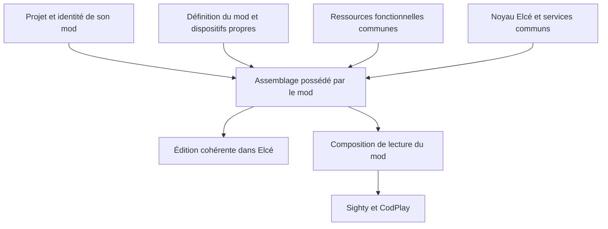

# Elcé — séparation du noyau, des ressources communes et du mod Learning

Date : 20 octobre 2026.

Proposition d’organisation à partir des intentions réunies dans
l’[étude générale](2026-10-15-elce-mods-study.md). Les contrats actuels ont été
relus avant cette étude. Le [plan dédié](../plan/2026-10-20-elce-mods-reconfiguration-plan.md)
porte les conclusions et les décisions retenues ou encore à préciser. Les choix
techniques ci-dessous sont des propositions, sans implémentation ni nouvelle
spécification de comportement vérifié.

L’[étude technique Learning](2026-10-20-learning-extraction-study.md)
précise les destinations et les raccords envisagés dans le code actuel.
Les classements exploratoires de cette note en expliquent les frontières.

## Faisabilité des mods face à des applications séparées

Learning et DGS sont les deux intérêts prioritaires exprimés. Les autres mods
restent des exemples secondaires, dont certains ne seront jamais réalisés.
La séparation doit donc être éprouvée d’abord sur cette paire ; les besoins
hypothétiques des autres expériences ne définissent pas ses abstractions.

L’analyse soutient la faisabilité d’une organisation en mods dans Elcé.
Les expériences décrites conservent une même matière éditoriale, les mêmes
outils de création et les mêmes mécanismes de construction des vues. Elles
diffèrent principalement par les dispositifs qui organisent et conduisent
la lecture. Le réemploi par copie puis adaptation et la cohérence des
interfaces auteur renforcent cette direction.

Les responsabilités mêlées dans les fichiers actuels indiquent un coût
d’extraction depuis le mod Learning. Elles ne démontrent pas une incompatibilité
entre les expériences. La séparation décrite ci-dessous explique comment
les mods sont envisageables ; elle n’est pas une décision de refonte ni un
programme d’implémentation déjà accepté. Aucun besoin de plusieurs applications
auteur indépendantes n’est établi par les exemples étudiés.

La limite à surveiller est la substance réellement commune : si un futur mod
imposait un autre modèle de contenu et d’autres gestes auteur pour la plupart
des opérations, son intégration demanderait une nouvelle évaluation. Les
différences de Sommaire, de jeu, de calendrier ou de collecte à distance
présentées jusqu’ici peuvent rester des dispositifs propres aux mods.

## Le sujet est l’assemblage de l’application

La précision de l’utilisateur recentre cette étude : « choisir un mod à la
création » exprime le fait qu’un noyau commun charge les ressources nécessaires
à l’expérience. Cela ne fixe ni écran initial, ni sélecteur, ni parcours de
création définitif. Le rattachement du projet à son mod et l’interface qui le
détermine sont deux sujets distincts. L’interface reste ouverte.

La reconfiguration doit rendre identifiables trois ensembles de code : le
noyau Elcé, les ressources fonctionnelles réutilisables et les dispositifs
propres à chaque mod. Une ressource fonctionnelle désigne ici un BDC avec ses
outils, un format de page ou un mécanisme de conditions. Les contenus personnels
de l’auteur sont des données, traitées plus loin dans cette étude.

| Ensemble | Rôle proposé | Exemples |
| --- | --- | --- |
| Noyau `core/` | Posséder le projet et conduire les opérations communes avec les services fournis par le mod. | Document, commandes et commits, historique, session, médias, stockage, cadre auteur et cycle du lecteur. |
| Ressources fonctionnelles `resources/` | Fournir des capacités réutilisables que les mods sélectionnent. | Carte, Section, Carousel, Question, Graphe ; formats Flux et Diapo ; comparateurs et propriétés typées réellement réemployables. |
| Dispositifs `mods/<mod-id>/` | Posséder les assemblages auteur, lecture et serveur, ainsi que les règles, données et présentations propres à l’expérience. | Sommaire et Évaluation du mod Learning, jeu Quiz Hunt, passages de Quest, calendrier DGS. |

Une capacité partagée par deux mods n’a pas à devenir un service obligatoire
du noyau. Une Question peut être disponible au mod Learning et à Quiz Hunt sans
faire partie des ressources activées par DGS. Le même code Carte peut servir
à plusieurs mods ; les BDC créés ou copiés dans leurs projets restent des
objets éditoriaux indépendants.



## Ce que fournit déjà le projet

L’application n’est pas à reconstruire. Elle possède les responsabilités
communes nécessaires ; la difficulté est de retirer aux politiques du mod Learning
le rôle de définir implicitement tous les futurs projets.

| Circuit vérifié | Propriétaire actuel | Reconfiguration envisagée |
| --- | --- | --- |
| Gestion de plusieurs projets, ouverture et copie indépendante | [Session de projet](../../specs/project-session-spec.md), `ProjectSessionCoordinator` | Obtenir le mod du projet et sa création initiale depuis la composition ; garder sauvegardes, droits et changements de projet. |
| Document, BDC, médias et placement unique | [Modèle documentaire](../../specs/document-model-spec.md) | Préserver la substance commune et attribuer les politiques de parcours à leur mod. |
| Commandes, façades et historique | [Historique](../../specs/document-history-spec.md), acteur XState et `EditorActionsFacade` | Accueillir les opérations propres aux mods et les copies de contenus dans le même circuit de commit. |
| Interface native Remix | [Entrée SPA](../../specs/remix-spa-spec.md) et [organisation auteur](../../specs/organization-editor-spec.md) | Conserver les éditeurs partagés et composer l’organisation et les réglages propres au mod. |
| Import, déduplication et transport média | [Modèle documentaire](../../specs/document-model-spec.md) et [API projet](../../specs/project-api-spec.md) | Préparer les médias réemployés avec ces services et leurs règles de rétention. |
| Cache, synchronisation et persistance SQLite | [API projet](../../specs/project-api-spec.md), [accès d’édition](../../specs/editor-window-access-spec.md) | Conserver les données du mod à toutes les frontières, avec le même contrôle des révisions et des droits. |
| Builders de contenu et lecteur réel | [Flux](../../specs/flux-scene-builder-spec.md), [Diapo](../../specs/diapo-scene-builder-spec.md), [preview](../../specs/player-preview-spec.md) | Partager les constructions compatibles et choisir la composition de lecture selon le mod. |

Les inspections ciblées précisent les raccords laissés ouverts par ces contrats :
[createInitialDocument](../../src/domain/document/document-model.ts) construit
le document initial unique ; [la création de projet](../../src/app/projects/project-session-coordinator.ts)
l’appelle avant publication. [Le workspace](../../src/app/remix/workspace/editor-workspace.tsx)
assemble directement Scénario, réglages Sommaire/chapitre et catalogue.
Ces points constituent des endroits naturels pour sélectionner la composition
du mod sans multiplier les applications auteur.

## Organisation physique cible

Les noms ci-dessous décrivent une cible de classement du code existant et des
responsabilités à extraire. Ils ne définissent pas de nouvelles API. Le
déplacement physique peut suivre l’extraction des responsabilités par petits
ensembles cohérents ; il ne demande pas de renommer tout le projet d’un coup.

```text
src/
  core/
    document/                  structures et références communes
    commands/                  voie unique d’application et de commit
    project/                   session, accès et synchronisation
    history/                   historique documentaire
    media/                     import, déduplication et disponibilité
    persistence/               API, cache et transactions communes
    authoring/                 cadre, commandes et conventions partagées
    reading/                   cycle commun Sighty/CodPlay
  resources/
    bdcs/
      section/
      card/
      carousel/
      question/
      statistical-graph/
    pages/
      flux/
      diapo/
    conditions/                mécanismes réutilisables identifiés
  mods/
    learning/
      learning-definition.ts
      composition/
        authoring-composition.ts
        preview-composition.ts
        exported-player-composition.ts  futur chantier export
        server/
          server-composition.ts
      document/                modèles, réglages et invariants du mod Learning
      authoring/               Scénario, Sommaire et réglages particuliers
      reading/                 même lecteur Learning pour preview et export
      preview/                 contexte auteur et synchronisation du lecteur
      exported-player/         futur contexte du projet compilé
      evaluation/              machine, résultat et tentatives
      persistence/             projection des données propres au mod Learning
    dgs/
```

Les emplacements DGS et du contexte exporté représentent leurs propriétaires
logiques futurs, sans création de répertoire vide ni réalisation engagée.
Les autres pistes n’exigent pas de structure préparatoire. Dans une ressource
BDC, modèle, service, commandes, presets, éditeur et builder sont rassemblés
par fonctionnalité, en conservant la séparation des dépendances auteur/lecture.
Le noyau réutilise les services actuels, déplacés ou raccordés selon leur rôle.

Dans l’idéal de composition précisé ensuite, les contributions métier du
Learning ou de DGS seraient elles-mêmes organisées en modules. La définition
du mod pourrait alors se limiter à leur sélection, leurs paramètres et leurs
raccords. Le classement ci-dessus situe les responsabilités à extraire ; il
n’impose pas que toute leur implémentation reste dans la définition du mod.

## Comment un mod utilise les ressources communes

La définition du mod désignerait les ressources fonctionnelles dont il a
besoin et ses propres contributions. Pour le mod Learning : formats Flux/Diapo,
BDC compatibles, mécanismes de profil utiles, puis modèles Standard/Évaluation,
Sommaire, précédent/suivant et progression. Un autre mod réutilise les mêmes
ressources en assemblant ses propres dispositifs.

Chaque ressource apporte ses données et leur validation, ses opérations,
ses moyens d’édition et de construction des vues, ainsi que ses dépendances
nécessaires. La ressource Carte possède une seule implémentation, même si
plusieurs mods la sélectionnent. Un mod peut proposer une variante explicite
lorsque son comportement le justifie, en réutilisant la substance commune.

L’assemblage raccorde ces contributions aux circuits existants : commandes
dans la même file XState, invariants avant le commit, mêmes services média,
même historique et même transaction de publication. Les ressources et les
mods ne créent pas chacun un document, un acteur auteur ou une sauvegarde.

L’ordre de composition proposé est : identifier le mod du projet, résoudre
sa définition et les ressources nécessaires, composer leurs lecteurs de
données et validations, puis monter les outils auteur ou construire le
lecteur. Les capacités CodPlay nécessaires doivent être préparées avant les
constructions concernées. Le serveur doit lui aussi connaître les contributions
nécessaires à la validation et à la persistance du projet.

Cela demande un contrat minimal pour identifier le mod avant de relire toutes
ses données. La forme de cet en-tête et des contributions reste à valider dans
le plan. Le chargement désigne d’abord cette résolution des dépendances ;
le découpage effectif en imports différés est un choix d’implémentation ultérieur.

Chaque mod possède sa définition et son code d’assemblage dans son dossier.
Les entrées applicatives sélectionnent ses fonctions publiques ; ces fonctions
raccordent ses dispositifs aux ressources et aux services du noyau. Pour
Learning, l’assemblage reste dans `mods/learning/composition/`, avec des entrées
distinctes auteur, preview, player exporté et serveur. Les deux contextes de
lecture réutilisent le même lecteur Learning. Le noyau et les ressources utilisent
leurs contrats communs ; leurs implémentations restent indépendantes des
politiques Learning. Cette propriété concerne aussi le code de raccordement,
les presets et les adaptateurs choisis par le mod.

## Cap de composition et construction progressive

L’[étude des API internes](2026-10-20-mod-composition-internal-api-study.md)
recentrée par l’utilisateur vise à ajouter des fonctionnalités en préservant
les usages existants. Un mod réduit à sa composition est un cap lointain qui
guide les frontières du code : responsabilités identifiables, dépendances
explicites et séparation des politiques du mod Learning et des mécanismes communs.

La construction proposée prolonge les façades et les machines existantes.
Les interfaces sont précisées pour les raccords réellement nécessaires ;
les classes TypeScript des modules implémentent le métier. Les machines et
autres appelants sollicitent ces classes ; les façades exposent les intentions
et l’interface présente les valeurs, sans implémentation métier. Le scheduler
DGS fera ainsi appel à des classes ensuite employées par l’affichage. Le contrôleur
auteur garde le document, l’ordre de commit et l’historique. Sighty garde
l’admission des changements de vue.

Learning est la référence à préserver. L’indépendance des mécanismes extraits
est à démontrer dans chaque lot avec des fixtures sans dispositifs Learning.
DGS validera ensuite ses usages propres sur ces frontières déjà établies.
La forme définitive de composition reste ouverte.
Les règles d’interaction entièrement déclaratives sont hors de portée de
cette étude. Les décisions applicables à chaque tranche restent au plan.

## Extensions envisagées par des BDC dédiés

Deux exemples d’extensions prévues illustrent les ressources fonctionnelles
que les mods pourront sélectionner. Les BDC correspondants et leurs réglages
restent à imaginer. Ces exemples ne définissent pas une classification des
extensions.

| Exemple d’extension | Rôle du BDC dans Elcé | Responsabilité extérieure |
| --- | --- | --- |
| Composant externe | Décrire son emploi dans une page ou une scène, exposer les réglages auteur utiles et construire son intégration CodPlay. | Le composant et son intégration possèdent leur rendu et leurs ressources propres. |
| Scène préconçue | Servir de conteneur à une scène obtenue par un catalogue dédié, avec les réglages d’emploi autorisés. | Un autre éditeur peut posséder la conception interne de la scène ; le projet `editor` est le candidat cité. |

Le BDC conteneur ferait partie du document Elcé et de ses circuits d’édition,
de validation et d’historique. La scène accueillie conserverait son format et
son propriétaire de conception. Elcé composerait son emploi dans le contenu ;
l’éditeur de scène prendrait en charge son élaboration interne. Le
[plan actuel du projet `editor`](../../../editor/plan/2026-09-01-editor-v2-organization-plan.md)
ne constitue pas encore un circuit de publication vers un catalogue Elcé.

Ces BDC peuvent être réutilisables entre mods sans devenir obligatoires dans
le noyau. Chaque mod retient les types compatibles avec son usage : une scène
qui attend une action du public ne devient pas adaptée à DGS par sa seule
encapsulation. La cohérence auteur porte aussi sur l’insertion, la sélection,
les réglages et la preview de ces BDC.

Les appuis runtime existent déjà dans CodPlay : les composants optionnels se
raccordent avant le build, les
[bibliothèques tierces](../../../codplay/specs/third-party-library-spec.md)
sont préparées par l’engine et le
[composant `slot`](../../../codplay/specs/slot-component-spec.md) fournit un
hôte pour une représentation extérieure. La préparation d’une bibliothèque
et le chargement des ressources propres à une scène restent deux circuits
distincts. Le BDC doit réutiliser l’intégration appropriée.

L’[intégration générale des scènes accueillies](../../../codplay/plan/foreign-scene-component-plan.md)
reste en cours. Le format livré, sa référence, ses dépendances, les paramètres
exposés et la conduite de son cycle de lecture seront à préciser pour chaque
extension retenue. Le seul artefact compilé ne garantit pas une scène autonome :
le [contrat de compilation](../../../codplay/specs/scene-authoring-spec.md)
sépare notamment les fonctions auteur de l’artefact sérialisé.

Ces pistes éclairent la frontière entre ressources réutilisables et noyau.
Elles n’engagent pas une nouvelle tranche et ne conditionnent pas la première
confrontation Learning/DGS. Les décisions de leur éventuelle réalisation
restent au plan.

## Extraction concrète du mod Learning depuis les fichiers actuels

| Point actuel | Partie à conserver dans le noyau ou une ressource commune | Partie à attribuer au mod Learning |
| --- | --- | --- |
| [document-config.ts](../../src/config/document-config.ts) | Placement, identités des ressources BDC/pages et configuration possédée par chaque ressource. | Standard/Évaluation et leurs défauts, actions Résultat, identifiants du layout, Sommaire et navigation. Scinder cette configuration mélangée. |
| [document-types.ts](../../src/domain/document/document-types.ts) et [document-model.ts](../../src/domain/document/document-model.ts) | Contenus, regroupements, références, sérialisation et identités communes. | Champs obligatoires du Sommaire, politique de parcours, réglages Évaluation et création initiale actuelle. Les propriétés de profil réutilisables sont à extraire séparément de leur usage Learning. |
| [controller-machine.ts](../../src/app/controller/controller-machine.ts) et [project-session-coordinator.ts](../../src/app/projects/project-session-coordinator.ts) | Acteur, file, commits, historique, imports et session. | Leurs appels directs à `createInitialDocument()` sont remplacés par la création initiale fournie par le mod ; la fabrique actuelle devient celle du mod Learning. |
| [apply-document-command.ts](../../src/domain/commands/document-commands/apply-document-command.ts) et [document-invariants.ts](../../src/domain/commands/document-commands/document-invariants.ts) | Application ordonnée, références et placement unique ; validation propre à chaque ressource. | Commandes Sommaire et réglages d’Évaluation, règles du parcours Learning et obligation d’un chapitre Évaluation pour son Résultat. Classer les règles de format séparément des règles métier. |
| [editor-actions-facade.ts](../../src/app/facades/editor-actions-facade.ts) | Commandes projet/historique et accès commun aux façades de BDC. | Intentions Sommaire, profil collecté et Évaluation. L’assemblage des façades continue d’envoyer au même acteur. |
| [editor-workspace.tsx](../../src/app/remix/workspace/editor-workspace.tsx), [scenario-panel.tsx](../../src/app/remix/workspace/scenario-panel.tsx), [chapter-settings.tsx](../../src/app/remix/workspace/chapter-settings.tsx) | Cadre auteur, repères, commandes et montage des éditeurs communs. | Arbre du parcours Learning, commandes Sommaire, offre Standard/Évaluation et réglages de ces modèles. |
| `domain/card`, `domain/carousel`, `domain/question`, leurs éditeurs et builders | Ressources communes par BDC avec données, services, commandes, presets et rendu. | Les effets métier du résultat d’une Question : progression, calcul d’Évaluation et politique de révélation. La frontière des variantes de Question reste à valider. |
| [flux-scene-builder.ts](../../src/builders/flux/flux-scene-builder.ts) et [diapo-scene-builder.ts](../../src/builders/diapo/diapo-scene-builder.ts) | Formats de page réutilisables et construction à partir des BDC retenus. | L’interprétation de leur signal de fin pour la progression. Le builder Résultat du mod Learning est raccordé par la composition, sans import du mod dans le format commun. |
| [scenario-builder.ts](../../src/builders/scenario/scenario-builder.ts) et `builders/summary-profile` | Les éventuels mécanismes réellement communs après identification. | La construction actuelle du graphe, layout, menu, profil initial, routes, gardes, progression et raccords d’Évaluation : ensemble principalement Learning. |
| [elce-player-composition.ts](../../src/player/elce-player-composition.ts) | Création, initialisation et destruction Sighty/CodPlay, diagnostics et gestion commune des ressources. | Construction du scénario Learning, contexte de progression, démarrage de son layout, tiroir du menu et rafraîchissement de sa présentation. Scinder ce fichier mixte. |
| `domain/evaluation`, `domain/summary-profile`, [elce-player-style.ts](../../src/player/elce-player-style.ts) | Styles des BDC attribués à leurs ressources ; les comparateurs et propriétés restent des candidats au réemploi quand un autre usage le justifiera. | Évaluation, profil, projection, réconciliation et layout dans Learning pour la première extraction. Scinder les styles mixtes ; garder le module de profil cohérent. |
| [sqlite-project-persistence.ts](../../src/server/projects/sqlite/sqlite-project-persistence.ts) | Ports communs de projet et média, cycle technique et services déjà partagés. | Adaptateur SQLite complet, actuellement v5, sélectionné à la composition Learning, en conservant le circuit transactionnel existant. Les évolutions du schéma suivent le plan ; l’extraction d’un moteur de projection SQL commun attend un besoin réel. |

Le BDC Résultat est actuellement lié aux branches et actions de l’Évaluation.
La première extraction peut le laisser avec le mod Learning. Un affichage de verdict
réutilisable pourra être isolé lorsqu’un autre usage le justifiera ; cela
n’impose pas sa règle d’Évaluation aux autres mods.

Deux dépendances demandent une attention particulière : le builder Question
importe aujourd’hui le type de réponse depuis l’état de test Learning ; les
formats de page connaissent directement le BDC Résultat. Déplacer seulement
les dossiers laisserait ces dépendances métier dans les ressources communes.
Il faut séparer les données nécessaires au rendu de la réponse de la progression
du mod Learning, puis assembler les builders disponibles depuis le mod.

L’[analyse des circuits actuels](2026-10-20-learning-extraction-study.md#analyse-des-frontières-sur-le-code-actuel)
précise aussi les dépendances de l’historique, du stockage, de l’interface et du
player. Le placement d’une page dans le parcours reste Learning ; la préparation
par profil appartient au chemin de lecture partagé par preview et export.

Les contraintes de présentation d’une Diapo appartiennent au format Diapo ;
l’unicité du placement appartient au noyau ; les prérequis d’Évaluation
appartiennent au mod Learning. Cette répartition conserve leurs contrôles dans
le circuit de commande réel tout en changeant leur propriétaire logiciel.

## Document et persistance

Pour la première extraction, la proposition part du v5 actuel et choisit
Learning explicitement aux entrées. Le format reste en préparation. Les données
d’essai peuvent encore être effacées puis recréées lors
des évolutions acceptées. La fixation du format de référence interviendra
explicitement après les derniers tests du périmètre retenu ; les évolutions
suivantes demanderont des réécritures/migrations de base et/ou des montées de
version. Le [plan unique](../plan/2026-10-20-elce-mods-reconfiguration-plan.md#format-documentaire)
conserve les décisions relatives au format.

L’identité persistée de plusieurs mods reste à concevoir pour le chantier
multi-mods. Elle n’impose pas une migration préalable à l’extraction Learning,
et l’extraction n’est pas tenue de conserver exactement la structure v5.

L’identité du projet, l’identité définitive du mod, la version documentaire
et la version de définition du mod doivent rester distinguables. Le document
commun conserve les contenus ; les données de scénario propres au mod portent
ses relations et réglages. Les formes sérialisées exactes restent au plan.

La disponibilité des types doit être appliquée aux commandes et aux invariants,
ainsi qu’à l’interface. Les références peuvent rester structurellement valides
pendant qu’un auteur construit un projet encore incomplet pour la lecture.
Chaque modèle précise ensuite ce qui manque pour son exécution.

La séparation concerne aussi le stockage. SQLite projette explicitement le
document v5 ; ajouter une propriété TypeScript n’en assure pas la sauvegarde.
Création, copie, cache, publication, réouverture et remplacement serveur
devront conserver l’identité et les données du mod. Un remplacement de document
ou un Undo ne doit pas changer le mod d’un projet.

Le contrat actuel du v5 rejette les versions antérieures sans conversion.
Déplacer son codec dans Learning n’ajoute pas de conversion. Une évolution
acceptée précisera le format pris en charge et ses contrôles ; la réinitialisation
des données d’essai évite d’imposer leur reprise pendant cette préparation.
La prise en charge simultanée de plusieurs formats ou la résolution d’un mod
inconnu ne se déduisent pas de cette possibilité.

## Contenus accessibles et services applicatifs hors périmètre

Les contenus personnels ou partagés sont des données accessibles à l’auteur.
Ils utilisent les ressources fonctionnelles BDC et média sélectionnées pour
être lus, copiés et adaptés. Les utilisateurs, les catalogues personnels ou
partagés, le catalogue dédié aux scènes préconçues et leurs ACL sont des
services applicatifs envisagés, hors du périmètre de cette étude. Leur
présence future est prise en compte sans concevoir ici leurs interfaces,
leur stockage ou leur administration.

La gestion des utilisateurs et des ACL s’inscrit dans un chantier plus large :
faire d’Elcé un produit commercialisé. Les droits d’accès pourraient porter
sur des mods, des BDC ou des options avancées, en plus des ressources et
contenus accessibles. La définition de cette offre et de ses mécanismes
d’accès reste hors de l’étude.

La sélection technique des ressources nécessaires à un mod et les droits
d’utilisation accordés à une personne sont deux responsabilités distinctes.
La présente étude traite l’articulation technique du noyau, des ressources
et des mods ; les politiques d’accès relèvent du chantier de commercialisation.

Un catalogue rend un contenu accessible ; la ressource BDC sait l’interpréter
et le mod décide si son usage convient à l’expérience. Ces responsabilités
restent distinctes. Le noyau n’a pas à connaître le fonctionnement du service
de catalogue pour conduire les opérations documentaires communes. Les droits
d’accès aux ressources auteur restent également distincts de l’enregistrement
des apprenants et résultats dans le LMS.

La limite étudiée ici est l’intégration du contenu fourni dans un projet :
réutiliser sa matière par copie puis adaptation, conserver les références et
dépendances nécessaires et respecter les types disponibles dans le mod cible.
Les opérations d’intégration doivent rejoindre les façades, commandes,
services média et historique existants. Le
[copier/couper/coller BDC prévu](../../plan/2026-10-01-elce-construction-plan.md#fonctionnalité-à-faire--copier-couper-et-coller-un-bdc)
reste le circuit à prolonger pour la copie de contenus ; son contrat complet
reste à arrêter au plan.

Les BDC copiés deviennent indépendants de leur source. Le partage éventuel
des images reste ouvert. Pour une scène préconçue, le mode de fourniture et
de conservation de la scène accueillie reste à décider : la copie du BDC
conteneur ne décide pas, à elle seule, du statut de cette ressource.

## Un même chemin de lecture, adapté au mod et au contexte

La composition de lecture sélectionne les builders et le scénario du mod,
puis utilise Sighty/CodPlay. Les contenus et réglages qui influencent une
scène doivent être pris en compte par ses décisions de reconstruction et de
cache. Les builds de BDC compatibles restent partagés.

Le modèle métier de lecture appartient au mod : progression du mod Learning,
partie Quiz Hunt, faits de Quest ou diffusion DGS. Le pilotage demandé pour
sa restauration et son enregistrement reste au niveau du scénario Sighty,
selon l’[étude de responsabilité](2026-10-16-reading-state-ownership-study.md).
La popup est un conteneur et une surface de commandes auteur. Les modules de
destination réalisent les échanges techniques appelés par ce circuit.

La preview auteur et le projet exporté utilisent un même lecteur : mêmes
builders, scénario, règles de navigation et de progression, rendu et cycle des
médias pour les mêmes données, options et état de lecture. Leurs entrées et leurs raccords de
contexte restent distincts. La preview reçoit les instantanés de l’éditeur et
propose ses commandes auteur ; le player exporté lit le projet compilé et ses
ressources. La destination des données de lecture dépend du contexte.

Pour tous les mods hors DGS, l’export compilé attendu constitue le player
déployé dans le LMS, qui enregistre apprenants et résultats. Son entrée doit
pouvoir utiliser le lecteur partagé sans dépendre de la preview, de la popup
ou des services auteur. La fabrication du paquet exporté est distincte de son
exécution. Le découpage réserve cette frontière ; la fabrication de l’export
et l’injection SCORM relèvent du chantier export.

Le cours partagé conserve son application sœur de participation et son
mécanisme distinct de collecte. DGS conserve son calendrier et son canal TV
autonome. Ces fonctions précisent les lecteurs des mods sans ajouter leurs
responsabilités au cœur éditorial.

Les ports actuels de Sighty ne certifient pas tous les besoins envisagés :
ordre `go` puis handler, mutation depuis une action, restauration et
concurrence restent des frontières à qualifier selon les scénarios retenus.
Les évolutions nécessaires précèdent leur utilisation et restent suivies par
les plans de leurs propriétaires. Aucun changement CodPlay n’est autorisé
par cette étude.

## Évolutions communes et coût de validation

Une correction ou amélioration du noyau doit pouvoir bénéficier aux mods qui
l’utilisent. Une évolution d’une Carte ou d’un Carousel peut bénéficier à
Learning comme à DGS parce qu’ils réemploient la même implémentation. Cet
avantage de maintenance complète le transfert des apprentissages auteur.

La contrepartie est la propagation possible des régressions. Un Carousel
temporisé peut intervenir dans une page du mod Learning et dans une diffusion DGS,
avec des règles de passage différentes. Le contrat de la ressource peut rester
stable alors qu’une interaction avec son mod est dégradée. Le test du composant
commun ne certifie donc pas toutes ses compositions.

L’espace de validation doit correspondre aux configurations effectivement
prises en charge : ressources sélectionnées, usages et options autorisés de
Learning et DGS. Ce périmètre peut déjà comporter de nombreuses interactions ;
les hypothèses de Quiz Hunt ou Quest n’en sont pas des configurations livrées.
Identifier les dépendances d’un changement permet de cibler les vérifications
sans supposer que le partage du code garantit son intégration partout.

Le plan porte la définition de cette couverture : preuves propres aux ressources
communes, parcours de chaque mod affecté et scénarios transversaux nécessaires.
Une modification de contrat partagée demande de considérer tous ses consommateurs
réels. La réutilisation est pertinente si le bénéfice de maintenance et d’usage
reste supérieur à la complexité des variantes et de leur validation.

## Pourquoi procéder par extraction

Extraire d’abord le mod Learning permet de vérifier que l’articulation des mods
préserve un produit réel. Le premier résultat attendu est un mod Learning
fonctionnant par la composition du noyau et de ses ressources, sans dépendance
du noyau vers ses dispositifs. L’interface de sélection d’un mod peut rester
ouverte pendant cette séparation. Le réemploi des contenus peut ensuite
s’appuyer sur les mêmes ressources et circuits communs. L’acceptation de
Learning comprend le retrait des dépendances Learning des mécanismes communs,
prouvé par les imports, les contrats et des fixtures qui les exercent sans
Sommaire, profil ni Évaluation. Le plan conserve cette condition d’acceptation.

DGS, avec un périmètre accepté, validera ensuite ses besoins particuliers :
calendrier, séquences et lecture TV autonome. Son développement pourra révéler
de nouveaux besoins ; l’indépendance du noyau et des ressources fait déjà
partie du résultat exigé du chantier Learning. Les autres exemples conservent
leur intérêt exploratoire sans devenir des prérequis.

Le bénéfice se juge sur deux plans : un auteur retrouve ses outils en créant
une autre expérience ; une évolution commune d’un BDC améliore ses usages
sans imposer une reprise de chaque application. La copie indépendante des
contenus et le choix définitif du mod restent compatibles avec ces objectifs.

Cette tâche organise les études et décrit une cible. Elle ne modifie pas le
code et n’exécute ni tests logiciels ni validation navigateur. Les statuts des
capacités actuelles et leurs acceptations incomplètes restent suivis dans
leurs spécifications et plans existants.
