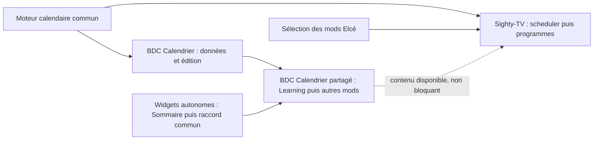

# Sighty-TV — calendrier puis structure des programmes

**Statut : A relire.** Plan de préparation des premiers blocs du mod
`digital-signage`. Les choix métier ci-dessous sont issus de la discussion ;
les propositions de raccord et les décisions ouvertes ne sont pas des
contrats implémentés. Aucun changement de code n'est engagé par ce document.

## Objectif et périmètre

Créer d'abord le calendrier graphique de Sighty-TV dans Elcé, avec une
interface limitée aux besoins retenus et EventCalendar comme modèle visuel
et d'interactions, puis la structure
des programmes qu'il référence. Le calcul calendaire partagé s'appuie sur une
classe métier dédiée aux usages de cette première version, avec des
conventions compatibles avec un futur moteur RRULE et une API Temporal
privilégiée lorsque son intégration le permet.
Un calendrier de diffusion Sighty-TV correspond à un écran.
La [description générale du mod](../notes/2026-10-20-dgs-mod-study.md) porte
l'intention de diffusion TV collective et autonome, le réemploi des contenus
Elcé et la cohérence de l'édition entre mods. Ce plan en prépare une partie,
dans le périmètre précisé par la discussion actuelle.
L'étude conserve les exemples et le raisonnement dans la
[note programmes/scheduler](../notes/2026-10-20-sequence-scheduler-study.md).
Ce plan rassemble le périmètre, les décisions et l'ordre de réalisation.

La première étape construit le calendrier et ses règles, puis la seconde
introduit les programmes réels et raccorde leur placement. La validation
complète des placements dépend donc de la seconde étape. Ne pas créer de
faux programmes ou de références pendantes pour rendre le calendrier
artificiellement utilisable avant ce raccord.

La lecture, la prévisualisation et la diffusion autonome seront traitées
ensuite. Sont également reportés : vue mensuelle, plusieurs calendriers avec
action « diffusion » activant l'un d'eux, plusieurs écrans et exécution des
commandes matérielles. Les intentions futures d'allumage, veille et extinction
restent dans le cadrage ; aucun pilote matériel n'est à créer ici.

Le BDC Calendrier constitue un chantier parallèle utilisant le même moteur,
décrit dans la note liée. Il affiche des contenus datés, par exemple le
planning hebdomadaire d'une salle, sans gérer de programmes. Son interface
de création est distincte du rendu de diffusion. Sa première étape est un
rendu foreign opaque, hébergé par un composant CodPlay. L'accueil commun,
la présentation illustrative et la variante menu émettant vers Sighty
relèvent du [plan distinct des widgets autonomes](../../../sighty/plan/2026-11-11-widgets-foreign-plan.md).
Les parts internes et le pilotage fin dans le récit restent une évolution
intégrée guidée par l'usage. Aucun outil de gestion du calendrier n'est prévu
en diffusion.
Sa réalisation
ne suit pas la dépendance calendrier Sighty-TV → structure des programmes.
Les adaptateurs de sources appartiennent à une évolution ultérieure :
import/abonnement iCalendar, Microsoft 365 / Outlook avec réunions Teams,
et Google Calendar avec réunions Meet. Ces capacités calendaires partagées
alimentent notamment le BDC et restent indépendantes des programmes et du mod.

Elcé est déjà organisé pour accueillir de nouveaux mods selon ses règles
de composition. Sighty-TV s'ajoute dans cette architecture. L'adaptation de
l'interface de choix des mods est un chantier Elcé distinct, porté par le
[plan des mods](2026-10-20-elce-mods-reconfiguration-plan.md#sélection-extensible-des-mods).
Le présent plan utilise les raccords d'ajout d'un mod et suit cette dépendance
d'interface sans entreprendre une nouvelle architecture de mods.

## Liens entre chantiers et ordre de réalisation

Les cinq chantiers forment un ensemble coordonné. Cette section possède
l'ordre commun ; les plans widgets et sélection des mods gardent leurs
actions et critères détaillés. Les dépendances ci-dessous n'effacent pas
les frontières de ressources ou de mods.

| Chantier | Ce qu'il reçoit | Ce qu'il fournit aux autres |
| --- | --- | --- |
| Moteur calendaire commun | Besoins des interfaces scheduler et BDC : périodes, dates, occurrences, récurrences et exceptions. | Une même projection calendaire pour l'édition du scheduler et les données du BDC. Prérequis de leur validation métier ; indépendant des widgets, des programmes et du choix de mod. |
| Widgets autonomes | Contrats CodPlay/Sighty existants et données de présentation de chaque consommateur. | Accueil foreign, cycle et échanges communs, qualifiés d'abord avec le Sommaire global existant. Prérequis du rendu et du menu du BDC ; le widget Calendrier reçoit les occurrences du moteur par sa ressource. |
| Sélection des mods Elcé | Compositions et règles de session existantes ; entrée publique du mod Sighty-TV pour son raccord final. | Accès produit au nouveau mod, création et réouverture de ses documents. Prérequis du parcours auteur Sighty-TV complet ; ne conditionne pas le moteur ni la migration du Sommaire. |
| Sighty-TV : scheduler et programmes | Moteur commun ; raccord produit fourni par la sélection des mods. | Calendrier auteur, puis programmes réels et leur placement. Leur métier reste dans le mod `digital-signage`. Le BDC peut fournir des scènes à ces programmes, sans conditionner leur structure initiale. |
| BDC Calendrier partagé | Moteur pour ses données ; accueil widgets pour sa diffusion ; composition de ressources d'un mod pour son édition et son placement. | Planning comme illustration ou menu Sighty. Learning est le premier consommateur à raccorder ; d'autres mods sélectionnent ensuite cette même ressource. Ne dépend ni des programmes Sighty-TV ni d'un nouveau choix de mod. |

Les deux nœuds BDC distinguent les dépendances d'une même ressource : son
métier/édition et son rendu. La flèche en pointillés est un réemploi possible,
pas un prérequis du scheduler. L'interface auteur du scheduler n'attend pas
le renderer diffusé du BDC. La future lecture autonome Sighty-TV réemploiera
le raccord widgets lorsqu'elle composera de tels contenus ; cette lecture
reste hors des deux premiers blocs.

### Ordre commun et points de passage

| Étape | Travaux et parallélisme | Condition pour passer à la suite |
| --- | --- | --- |
| 0 — cadrage commun | Maquetter les gestes graphiques V1 avant de figer le moteur ; formaliser les données communes aux deux calendriers, le raccord foreign et l'entrée produit des mods. | Décisions propres à chaque frontière validées dans son plan avant son code dépendant. Ne pas attendre un moteur RRULE exhaustif pour qualifier l'interface. |
| 1 — socles partagés | En parallèle : moteur calendaire limité ; raccord widgets puis migration du Sommaire global ; sélection extensible testée sur les compositions existantes et des fixtures. | Moteur qualifié avec ses propres valeurs ; Sommaire réel validant le cycle/événements du raccord commun ; sélection préservant sessions et catalogues. |
| 2 — premiers consommateurs | Calendrier auteur Sighty-TV dans son mod, avec son document et son entrée produit réels. En parallèle, BDC partagé : données et édition, raccord à Learning, puis rendu illustratif quand les widgets sont qualifiés. | Calendrier Sighty-TV créable et rouvrable par le parcours produit ; BDC alimenté par le vrai moteur et utilisable dans Learning sans attendre le nouveau mod. Chaque parcours garde son acceptation propre. |
| 3 — usages complets de la tranche | Introduire la structure des programmes après le calendrier auteur, puis raccorder leurs placements réels. Qualifier en parallèle le Calendrier-menu avec une scène et les guards Sighty existants. | Programmation réelle, historique et persistance validés ; même widget Calendrier éprouvé comme illustration et menu, sans dépendre d'un programme factice. |
| 4 — tranches ultérieures | Exécution de la diffusion Sighty-TV, sources externes et besoins fins de composant intégré selon leurs décisions. | Plans propriétaires enrichis et validés pour ces extensions ; elles ne bloquent pas les étapes précédentes. |

Les étapes constituent un ordre de livraison proposé. Un chantier peut
commencer dès que ses propres prérequis sont disponibles : il n'attend pas
la fin de tous les travaux placés sur la même ligne. Les contrats de données
doivent être communs avant le raccord des deux consommateurs ; il n'est pas
nécessaire que tout le moteur soit terminé pour préparer leurs maquettes.

Deux validations se font en deux temps pour éviter une dépendance circulaire :

- Le sélecteur se qualifie d'abord sans exiger Sighty-TV en production. Son
  acceptation avec ce mod se termine quand l'entrée et le document Sighty-TV
  sont réels. Les tests à plusieurs choix utilisent leurs propres fixtures.
- Le calendrier auteur se construit avant la structure des programmes ; la
  validation de ses gestes de programmation se termine seulement après le
  raccord aux programmes réels. Aucun catalogue fictif de production ne
  remplace cette dépendance.

L'étape 1 du chantier widgets n'attend pas le moteur : le Sommaire global
sert de premier consommateur réel. Ses lots Calendrier attendent en revanche
la projection métier et le raccord BDC. Les données/commandes du BDC peuvent
avancer sans renderer ; son rendu complet et sa publication attendent les
deux socles. Learning peut recevoir ce BDC avant Sighty-TV : le BDC n'attend
ni le sélecteur étendu ni le scheduler/programmes du nouveau mod. Les
ressources restent composées explicitement dans les mods, sans ajout
implicite à tous les catalogues.

Le partage du moteur et du BDC est initial. Le scheduler et les programmes
restent propres à `digital-signage` ; leur extraction ne sera envisagée
qu'après l'apparition d'un autre projet ayant un besoin réel. Ne pas ajouter
d'API ou de dossiers de ressources partagées pour anticiper cette extraction.

## Décisions métier retenues

| Sujet | Décision |
| --- | --- |
| Scheduler | Léger : calendrier et placement de programmes, horaires, récurrences et interlude dans les plages libres. |
| Objets placés | Des programmes uniquement. Les scènes et slots sont organisés dans les programmes. |
| Grille | Vues jour et semaine, précision à la seconde. |
| Référence d'interface | EventCalendar, retenu comme modèle visuel et d'interactions. L'intégration du widget complet n'est pas imposée à la V1. |
| Moteur V1 | Classe métier dédiée aux besoins calendaires retenus, séparée de l'interface ; conventions compatibles RRULE et Temporal privilégié si possible. |
| BDC en diffusion | Calendrier foreign dans un hôte CodPlay. Les usages illustration/menu et les échanges Sighty suivent le plan commun des widgets autonomes ; le moteur calendaire reste dans sa ressource. |
| Prise en main | Priorité V1 : interface graphique simple inspirée de l'usage iCal/Calendrier, avec blocs manipulables, sélection de plages et réglages contextuels. La complétude du moteur peut évoluer ensuite. |
| Période du calendrier | Année ou période plus courte, notamment saisonnière. |
| Placement | Heure de début avec fin calculée depuis le programme, ou créneau avec début et fin propres. |
| Gestes | Ajouter, déplacer, retirer et copier-coller une suite de passages consécutifs. |
| Récurrences | Heure, jour, semaine, toutes les deux semaines, mois. La demande « bimensuelle » signifie ici toutes les deux semaines. |
| Neutralisation | Neutraliser un passage récurrent sans supprimer sa récurrence ; pouvoir placer un autre programme dans le créneau ainsi libéré, « au-dessus ». |
| Échéance de diffusion | Le changement prévu à l'heure fixée interrompt le programme courant ; il n'attend pas sa fin naturelle. Raccord de lecture ultérieur. |
| Programme | Titre, description, layout, affectations de scènes ou programmes aux slots, règles de diffusion. |
| Durée du programme | Saisie ou calculée selon le programme, distincte de la durée du créneau. |
| Logique interne | Le programme porte suites, répétitions, alternance, tirage pseudo-aléatoire, délais, attente, filtrage, synchronisation et alignement. |
| Slot principal | Désigné par le layout ; les autres le suivent selon les règles du programme. Son nom ne lui confère pas automatiquement ce rôle. |
| Occupation des slots | Refuser deux programmes simultanés dans le même slot ; autoriser des programmes parallèles dans des slots différents du programme parent. |
| Fin des scènes | Signalée par la scène, distincte de son démontage ; une scène peut poursuivre sa propre boucle d'attente. Le programme décrit la conduite de l'attente. |
| Remplissage | Si une suite finit trop tôt, l'auteur choisit dans le programme : recommencer, maintenir l'affichage ou enchaîner un autre contenu. |
| Mises à jour | Application immédiate par défaut, avec possibilité de choisir une autre modalité. La règle et sa présentation dans l'interface sont distinctes ; exécution ultérieure. |

## Contrats existants et circuits à prolonger

Tous les chemins de code ci-dessous sont relatifs à `packages/elce/`.

- [Décisions des mods](2026-10-20-elce-mods-reconfiguration-plan.md) : métier
  des ressources indépendant des mods ; composition directe en TypeScript.
- [Consolidation](2026-11-09-elce-mods-consolidation-plan.md) : frontières
  entre ressources, core et mods ; ne pas reprendre ses anciens points
  d'import ni élargir son acceptation à Sighty-TV.
- [Session documentaire](../../specs/project-session-spec.md),
  [historique](../../specs/document-history-spec.md),
  [stockage local](../../specs/document-store-spec.md) et
  [API projets](../../specs/project-api-spec.md) : même circuit d'admission,
  commandes, commit, droits, cache et synchronisation.
- [Quiz Hunt](../../specs/quiz-hunt-mod-spec.md) : exemple de document,
  codec et compositions propres au mod réutilisant ces services. C'est une
  référence de raccord, pas une dépendance de `digital-signage`.
- [Organisation auteur](../../specs/organization-editor-spec.md) : gestes et
  cadre communs à préserver ; son Sommaire et sa hiérarchie ne deviennent
  pas le modèle documentaire du nouveau mod.
- [Sighty](../../../sighty/specs/authoring-library-spec.md) et
  [slot CodPlay](../../../codplay/specs/slot-component-spec.md) : références
  pour les identités et la composition future. Leur lecture effective reste
  hors des deux blocs ; ne pas inventer d'API de slot principal existante.

Les points d'entrée existants à utiliser ou adapter sont :

| Rôle | Propriétaire actuel |
| --- | --- |
| Acteur et file documentaire | `src/core/controller/controller-machine.ts` et `controller-types.ts` |
| Historique | `src/core/history/document-history.ts` |
| Session et synchronisation | `src/core/projects/project-session-coordinator.ts`, `src/core/sync/` |
| Cache et codec | `src/core/persistence/indexed-db/`, `src/core/persistence/project-api/project-document-codec.ts` |
| Cadre et sélecteur | `src/core/authoring/layout/{editor-frame.tsx,project-application.tsx}` |
| Routes auteur | `src/app/remix/{elce-authoring-routes.ts,browser-entry.tsx,remix-spa-router.tsx}` |
| Composition HTTP et styles | `src/server/{elce-http-server.ts,elce-local-server.ts}` |
| Base partagée | `src/server/elce-project-database.ts` |

## Règles d'ajout du mod et propriétaires

L'ajout suit AGENTS et le
[guide Elcé Mod](../../src/mods/docs/SKILL.md). Avant chaque lot, lire les
spécifications propriétaires et identifier le circuit existant, les
changements du lot accepté et leur validation. La création du mod ne
justifie pas de recopier les services des autres mods.

| Propriétaire | Ce qui lui appartient |
| --- | --- |
| Core Elcé partagé | Acteur documentaire, file, historique, session, droits, cache, synchronisation et transports communs. |
| Ressources partagées | Moteur calendaire et BDC Calendrier avec leurs services, éditeurs et builders indépendants des mods. Le BDC est proposé à Learning puis aux autres mods par leurs compositions. |
| Mod `digital-signage` | Métier du scheduler et des programmes, document et organisation Sighty-TV, règles d'agrégat, commandes, codec et adaptateurs de persistance, sélection/configuration des ressources et compositions auteur, serveur puis lecture. |
| Composition produit Elcé | Déclaration des mods proposés et raccords de leurs entrées publiques, routes et styles, avec choix d'interface traité dans son chantier. |

Le moteur et le BDC restent chez leurs ressources communes. Le scheduler,
les programmes et les adaptations du document/parcours Sighty-TV restent
dans le mod. Un éventuel partage ultérieur du scheduler ou des programmes
fera l'objet d'une extraction justifiée par un autre consommateur réel.
Les ressources et le core n'importent aucun mod ; les mods ne s'importent
pas entre eux. Les compositions restent directes en TypeScript. Un seul
acteur et circuit documentaire est actif pour la session sélectionnée.

## Organisation proposée des nouveaux éléments

- Ressource `src/resources/calendar/` : moteur calendaire commun, dates,
  périodes, récurrences, occurrences, exceptions et projection bornée.
  Une classe métier V1 possède les calculs nécessaires ; les conventions
  des références éprouvées guident son modèle et ses tests. La conversion
  entre les calculs et les gestes graphiques reste dans le raccord d'édition.
  Ce moteur ne connaît ni programme, ni slot, ni logique de diffusion.
- Fonctionnalité `src/mods/digital-signage/scheduler/` : usage du moteur commun
  pour les placements de programmes et la surface auteur Sighty-TV. Le
  scheduler reste propre au mod et ne recalcule pas les récurrences.
- Ressource `src/resources/bdcs/calendar/` : chantier parallèle du BDC
  d'affichage, utilisant directement le moteur commun. Il ne dépend ni de la
  scheduler ni du mod `digital-signage`. Learning peut la composer dès le
  premier raccord du BDC ; les autres mods la sélectionnent explicitement.
- Fonctionnalité `src/mods/digital-signage/program/` : structure métier des
  programmes et validation de leurs références. Introduite dans le second
  bloc, sans extraction prématurée dans les ressources partagées.
- Mod `src/mods/digital-signage/` : document, commandes, codec, persistance,
  sélection auteur et compositions de ces ressources.
- Entrées produit : sélection du mod, route, API et chargement des styles.

Le scheduler ne dépend pas des détails des scènes. Son raccord au programme
fournit les identités et les informations de durée nécessaires, sans lui
transférer l'exécution des attentes, filtres ou enchaînements. Les ressources
ne dépendent d'aucun mod ; aucun mod n'importe un autre mod.

Le socle commun porte le calcul calendaire. Le scheduler possède les
affectations de programmes ; le BDC possède les données et réglages de son
affichage. Leurs interfaces peuvent différer tout en partageant le moteur.
Les règles d'interlude, de changement de programme ou d'occupation des slots
ne deviennent pas des contraintes d'affichage du BDC.

## Classe métier V1 et évolution du moteur

Le calcul nécessaire aux usages V1 appartient à une classe métier de la
ressource calendar, indépendante du DOM, d'EventCalendar et des mods. Cette
classe reçoit les données et produit les occurrences et projections utiles ;
elle ne devient pas propriétaire d'un deuxième document mutable.

Limiter le périmètre aux besoins retenus : périodes, précision à la seconde,
récurrences à l'heure, au jour, à la semaine, toutes les deux semaines ou au
mois, et neutralisation d'un passage. Les comportements suivent les
conventions de la [RFC 5545](https://www.rfc-editor.org/rfc/rfc5545.html) pour
les notions utilisées : ancrage du début, fréquence, intervalle, fin de
récurrence et exceptions. Il ne s'agit pas de couvrir toute la norme en V1.

Formaliser une surface métier limitée et des données indépendantes de son
implémentation. Un adaptateur pourra ultérieurement substituer un moteur
comme [rrule](https://github.com/jkbrzt/rrule) ou
[rrule-temporal](https://github.com/ggaabe/rrule-temporal), sans réécrire
l'éditeur, le rendu du BDC ou les documents. Cette évolution n'impose pas
de registre de moteurs ou de framework générique dans la V1.

Privilégier [Temporal](https://tc39.es/proposal-temporal/docs/) pour l'API de
calcul si les environnements ciblés le permettent, avec polyfill adapté si
nécessaire. Préserver la distinction entre temps civil et instant daté.
Une éventuelle reprise de code d'interface ne doit pas imposer son modèle
de dates à la classe métier ; toute conversion reste au raccord de la vue.
Les données persistées restent lisibles et ne
dépendent pas des instances internes d'une bibliothèque.

Les réalisations et tests recensés dans la note servent de références pour
les cas standards et les limites du sous-ensemble choisi. Si du code ou des
tests amont sont repris, figer leur provenance et conserver leurs licences
et attributions. Les signatures du service restent à formaliser dans le lot.

Un seul noyau calcule les occurrences pour le scheduler et le BDC. Les
adaptateurs conservent le document Elcé lisible et les responsabilités de
chaque usage. Les futurs adaptateurs iCalendar, Microsoft Graph et Google
Calendar rejoignent les données communes par conversion, sans introduire
un calcul concurrent des récurrences. Distinguer les séries des occurrences
déjà développées par un fournisseur pour ne pas développer celles-ci à nouveau.
Leurs accès et mécanismes d'actualisation restent dans les adaptateurs de
source, hors de cette première tranche.

## Direction d'interface

EventCalendar sert de modèle pour la grille et ses interactions. Sa démo
ne vaut pas adoption de toutes les responsabilités du widget. Concevoir
une surface Elcé limitée aux gestes nécessaires, raccordée à la classe
métier et aux commandes documentaires existantes.

L'intégration complète de la bibliothèque n'est pas un prérequis. Une
reprise ciblée de code utile reste possible si elle simplifie le besoin ;
dans ce cas, fixer sa provenance et conserver les mentions de licence.
L'interface conserve un document et un historique uniques pour les gestes
auteur. Les responsabilités de calcul, de persistance et de diffusion ne
sont pas transférées à la grille.

La note de discussion conserve les références Apple, Google Agenda et
Fantastical et un exemple de manipulation. Le calendrier auteur est une
interface graphique : les programmes sont des blocs manipulables dans la
grille jour/semaine. Les opérations utilisent des termes français.
Les expressions RRULE et les objets Temporal ne sont pas des champs à
manipuler pour placer un programme.

Préparer une maquette de la surface graphique : placement et déplacement
des blocs, sélection de plages, copie-collage, ajustement des bornes des
créneaux à fin fixée et représentation des récurrences. Les secondes restent
accessibles avec une grille lisible. Les commandes et réglages contextuels
accompagnent la sélection. La neutralisation d'un passage conserve son lien
à la série et s'exprime par une action compréhensible, par exemple « Ne pas
diffuser ce passage ». Le placement reste distinct de l'édition graphique
du programme. Reprendre les conventions auteur d'Elcé.

## Éditeur de programmes — priorité à la représentation visuelle

La simplicité de lecture et de construction des programmes conditionne leur
conception détaillée. Qualifier la représentation auteur avant de figer le
format documentaire et les commandes du bloc 2. Le choix de cette interface
ne transforme pas les programmes en ressource partagée : ils restent dans
`digital-signage`.

Les maquettes peuvent être étudiées pendant le cadrage et la réalisation
des socles. L'implémentation du bloc programmes reste après le calendrier
auteur, selon l'ordre commun ; cet ordre ne reporte pas l'étude de son
principal risque d'ergonomie à la fin du chantier.

Préparer des maquettes avec les contenus, le layout, les slots et les règles
retenues. Étudier les cartes et groupes visuels, des relations fléchées
lisibles et la représentation d'enchaînements entre plusieurs slots.
Le SVG est une piste pour les blocs et connexions ; aucun choix de
bibliothèque ou de rendu intégralement SVG n'est arrêté à cette étape.
Ne pas ajouter un moteur de diagrammes avant d'avoir qualifié les gestes.

Cas à qualifier : suite simple ; répétition appliquée à une sélection ou un
groupe ; synchronisation de slots ; accès à un programme imbriqué. L'auteur
doit comprendre les contenus concernés, leur destination, l'ordre et la
portée de chaque règle sans saisir du code ou des événements internes.
Garder lisibles les durées inconnues avant lecture, sans leur attribuer une
largeur temporelle trompeuse. Les détails apparaissent avec la sélection.

La [note d'édition visuelle](../notes/2026-10-20-sequence-scheduler-study.md#édition-visuelle-des-programmes--rendre-la-logique-lisible)
conserve les pistes et exemples. Les maquettes ne valent pas validation de
la lecture : leurs gestes devront rejoindre les commandes et l'historique
existants. Le modèle auteur conserve la logique, indépendamment du dessin.

La [comparaison de projets publics](../notes/2026-10-20-sequence-scheduler-study.md#projets-publics-de-référence-pour-léditeur-de-programmes)
fournit les références à examiner : Sequential Workflow Designer pour les
conteneurs SVG, ossia score pour les relations temporelles et Xibo pour
les gestes de composition de signalétique ; Blockly et React Flow complètent
les pistes. Comparer une maquette structurée par groupes et une maquette
par slots avec liens sur les mêmes cas. Évaluer lisibilité, modification
des règles et ambiguïtés avant de choisir une bibliothèque ; vérifier le
périmètre réellement disponible et la licence de toute reprise. Aucun moteur
d'exécution ou historique concurrent n'est introduit avec un outil graphique.

## BDC Calendrier — dépendance au plan des widgets autonomes

Le [plan distinct des widgets foreign](../../../sighty/plan/2026-11-11-widgets-foreign-plan.md)
porte la normalisation des deux usages : illustration dans un récit et menu
émettant des intentions vers Sighty. Il possède le raccord commun, le cycle,
les échanges et la migration du Sommaire global. Ces décisions ne sont pas
réimplémentées dans le scheduler.

Le BDC Calendrier reste un chantier parallèle aux deux blocs de ce plan.
Sa ressource `src/resources/bdcs/calendar/` reçoit les occurrences du moteur
commun, prépare les données de présentation et raccorde le renderer retenu.
Le BDC est partagé entre mods, avec Learning comme premier consommateur
à raccorder ; ce choix ne fait pas dépendre son métier de Learning.
Il n'attend ni le scheduler ni les programmes privés de `digital-signage`.
EventCalendar reste
le candidat pour les vues Liste, Jour et Semaine ; les gestes d'édition du
scheduler ne sont pas proposés dans le rendu diffusé.

Qualifier les données calendaires, les fuseaux, les occurrences simultanées
ou traversant minuit, la lisibilité selon le cadre et les styles publiés avec
le raccord commun. La variante menu adresse Sighty par une intention
configurée ; elle n'exécute pas la diffusion du scheduler. Les tests du
calendrier auteur ne valent pas validation de ce rendu ou de sa navigation.

La future intégration d'items comme persos, de parts internes ou d'une
reconstruction temporelle fine reste à décider d'après l'usage. L'étude
conserve ces pistes dans sa [rubrique de rendu](../notes/2026-10-20-sequence-scheduler-study.md#rendre-le-bdc-calendrier-dans-codplay--étude-du-composant).
Elles ne sont pas des prérequis du premier accueil foreign.

## Faisabilité des abonnements — évolution des sources

Les abonnements restent indépendants du choix de widget : un adaptateur
possède l'accès, la conversion et l'actualisation de sa source iCalendar,
Microsoft Graph ou Google Calendar. Il fournit les données calendaires
communes ; l'interface d'édition et le rendu utilisent leurs projections.
Les occurrences déjà développées par le fournisseur ne demandent pas de
nouveau calcul local des récurrences pour leur seul affichage.

Les mécanismes de sources et de rechargement d'EventCalendar examinés dans
la note sont des références techniques, pas des API imposées à Elcé. Le
raccord d'abonnement et son actualisation restent une évolution distincte
de la première interface.

## Points à arrêter avant l'implémentation concernée

Ces points relèvent de la formalisation du calendrier et de ses raccords ;
ils ne rouvrent pas la répartition des responsabilités retenue.

| Point | Décision nécessaire et dépendance |
| --- | --- |
| Interface V1 | Maquetter et qualifier les gestes nécessaires en prenant EventCalendar comme modèle visuel et d'interactions. N'intégrer ou reprendre du code de bibliothèque que pour un besoin justifié. |
| Classe métier | Formaliser la surface et les données de la classe V1, avec conventions RRULE et API Temporal privilégiée ; l'interface graphique reste un consommateur par son raccord. |
| Premier rendu BDC | Suivre le raccord commun du plan des widgets autonomes. Les décisions de montage/échanges y sont propriétaires, indépendamment du calendrier auteur. |
| Calendrier civil | Arrêter le sous-ensemble standard : bornes de validité, ancrage, passage de minuit, fuseaux et jour mensuel absent ; qualifier ces cas sans étendre le moteur à toute la RFC. |
| Neutralisation | Définir l'identité stable du passage neutralisé et sa conservation lorsque la série est éditée ; ne pas effacer toute la série. Nécessaire au codec et aux commandes. |
| Copie d'une plage | Formaliser le traitement des intervalles libres, des passages partiellement inclus et des récurrences copiées. Nécessaire au geste de copie. |
| Durée calculée | Définir la représentation d'une durée non encore calculable dans la structure de programme ; ne pas produire de faux résultat numérique. Nécessaire au placement dont la fin dépend du programme. |
| Entrées du mod | Proposition : route `/digital-signage/:documentId`, catalogue `mod_key` dédié et préfixe API `/api/digital-signage/`, suivant les raccords existants. À valider avec les formats du mod. |
| Format et stockage | Arrêter le document, son codec versionné et la projection des calendriers, passages, récurrences, neutralisations et programmes en persistance. Les signatures et tables ne sont pas encore des contrats. |
| Dépendance d'interface Elcé | Suivre l'adaptation de la présentation du choix des mods dans le plan propriétaire ; l'architecture d'ajout et les compositions existantes restent la base. Ne pas porter ce sélecteur dans le scheduler. |

## Bloc 1 — calendrier

Ce bloc suit les étapes 0 à 2 de l'ordre commun. Le moteur est son prérequis
métier ; la sélection des mods conditionne son parcours produit complet.
Le raccord widgets et le rendu du BDC ne sont pas des prérequis de son
interface auteur. Commencer les maquettes pendant la préparation des socles.

1. Étudier les interactions d'EventCalendar et maquetter une surface Elcé
   limitée aux gestes graphiques V1. Employer des
   cas de qualification propres à ce parcours ; l'acceptation des
   placements de programmes réels attend le raccord du bloc 2. Ne pas
   conditionner ce choix à l'étude d'un moteur exhaustif.
2. Formaliser les données et opérations nécessaires au parcours retenu,
   leurs invariants et résultats attendus. Construire la classe métier
   limitée dans la ressource calendar : projection bornée, précision à la seconde,
   récurrences demandées et exceptions. Si des sources sont reprises,
   conserver provenance, licences et tests associés.
   Raccorder la neutralisation des passages et les références de programmes
   par la fonctionnalité scheduler du mod. Les tests du moteur n'utilisent pas de
   programmes ; ceux du scheduler possèdent leurs références et valeurs de
   programme, sans dépendance à une démo ou à un catalogue fictif en production.
3. Composer le document du mod avec l'acteur et la file existants. Ajouter
   cache, codec et persistance propres au format retenu, en réutilisant la
   session et le transport communs. Placer les migrations chez leur
   propriétaire et les charger depuis la base partagée ; ne pas modifier
   l'historique SQL Learning pour ce nouveau mod.
4. Maquetter puis ajouter la surface calendrier : navigation jour/semaine,
   période de validité et réglages de récurrence simples. Préserver une saisie
   précise à la seconde sans rendre la grille illisible. Le calendrier
   Sighty-TV initial reste sans passage tant que les vrais programmes ne sont
   pas disponibles. Préparer les blocs et gestes graphiques de placement pour leur
   raccord au bloc 2.
5. Raccorder le mod à sa route et à la sélection extensible fournie par le
   chantier Elcé distinct ; conserver les routes, catalogues et comportements
   des mods existants. Adapter le cadre partagé pour rendre la
   prévisualisation optionnelle : aucun bouton sans fonction ni faux lecteur
   pour Sighty-TV dans cette tranche.

Acceptation : créer, enregistrer et rouvrir un calendrier saisonnier ;
vues jour/semaine cohérentes ; tests de projection pour chaque récurrence,
bornes et neutralisation. Les gestes nécessitant un programme restent ouverts
jusqu'au bloc 2, sans annoncer le calendrier entièrement validé avant cela.

## Bloc 2 — structure des programmes et raccord au calendrier

Ce bloc suit le calendrier auteur du bloc 1 et termine son acceptation avec
des programmes réels. Il n'attend ni le BDC Calendrier ni les abonnements
externes. Le réemploi d'un BDC Calendrier dans une scène de programme reste
un raccord de contenu ultérieur, selon les placements réellement disponibles.

1. Maquetter et qualifier la composition visuelle : sélection de contenus,
   affectation aux slots, suite, groupes, règles et relations. Retenir une
   notation compréhensible avant de figer son modèle et ses commandes ;
   garder le choix SVG au niveau nécessaire à cette qualification.
2. Introduire les vrais objets programme : identité, titre, description,
   référence de layout, affectations aux slots, règles et mode de durée.
   Représenter le slot principal désigné par le layout sans déduire son rôle
   de son nom ni ajouter opportunément un champ au core CodPlay.
3. Conserver la structure des règles demandées et les références aux scènes
   ou programmes imbriqués. Valider les références, les occupations
   concurrentes d'un même slot et les cycles d'imbrication. Ce bloc structure
   les données ; il ne crée pas de second interpréteur de lecture.
4. Ajouter leur création et édition structurelle par les commandes du même
   acteur. Conserver les sélections utiles dans le même historique.
5. Brancher la bibliothèque réelle de programmes sur le calendrier : ajouter,
   déplacer, retirer, neutraliser un passage et copier-coller une plage.
   Conserver l'identité du programme référencé plutôt que le dupliquer pour
   chaque passage.
6. Vérifier le trajet complet : intention auteur → commande → validation →
   historique → cache → API → stockage → réouverture. Un geste de copie ou de
   déplacement forme un changement cohérent et annulable.

Acceptation : un programme référencé par plusieurs passages ; placements
avec les deux modes de durée selon les informations disponibles ; toutes
les récurrences ; neutralisation d'un passage puis placement de remplacement,
sans perte de la série ; copie de 9 h–11 h vers 15 h–17 h ; Annuler/Rétablir,
sauvegarde et réouverture conservant les identités et références.

Vérifier aussi qu'une suite, un groupe répété et une synchronisation se
lisent sans interpréter des flèches ambiguës, que leur portée reste visible
après modification et réouverture, et que les gestes principaux sont
accessibles au clavier. Ces critères précèdent l'acceptation de la notation
graphique ; ils ne prescrivent pas à eux seuls une technologie SVG.

Vérifier aussi qu'un auteur peut régler un passage « un lundi sur deux de
9 h à 10 h », lire son résumé, puis neutraliser un passage sans manipuler
de syntaxe technique ni modifier la logique interne du programme.

## Invariants et validation finale

- Un seul document, acteur, historique et circuit de commit par session.
- Le scheduler ne lit ni n'exécute les scènes, attentes et filtres.
- Le moteur calendaire est commun au scheduler et au BDC ; il ne dépend
  d'aucun de ces deux usages.
- Le BDC Calendrier est partagé et utilisable d'abord dans Learning. Le
  scheduler et les programmes restent dans `digital-signage` tant qu'aucun
  autre projet ne justifie leur extraction.
- L'édition graphique et le rendu statique du BDC consomment les mêmes
  données et projections, indépendamment de l'implémentation du moteur.
- Si un noyau est repris, il reste identifiable par sa provenance ; ses
  algorithmes et tests utiles sont préservés lors des adaptations au projet.
- Le calendrier référence les programmes ; les programmes référencent leurs
  contenus et portent leur logique interne.
- Les données auteur restent lisibles ; les projections calculées ne
  deviennent pas une seconde source documentaire.
- Ne pas modifier `packages/codplay` ou `packages/sighty` dans ces blocs.

Depuis `packages/elce/`, exécuter les tests ciblés des frontières modifiées,
puis `npm run check:architecture`, `npm run typecheck`, `npm test` et
`npm run build`. Vérifier la non-régression de Learning et Quiz Hunt pour
les entrées partagées, la session et la persistance.

Les tests calendaires utilisent des événements datés indépendants des
programmes. Qualifier le moteur avec les cas des deux consommateurs, dont
un planning de salle hebdomadaire. La réalisation et le rendu complet du
BDC feront l'objet de l'acceptation de son chantier parallèle.

Valider ensuite le vrai parcours auteur dans le navigateur connecté selon
les règles MCP et de focus d'AGENTS : création, édition, gestes calendaires,
Annuler/Rétablir, réouverture et isolation des catalogues. La prévisualisation
de scènes et la lecture ne font pas partie de cette acceptation.

Après implémentation et vérification, mettre à jour les spécifications
propriétaires existantes pour les raccords communs ; créer une spécification
propriétaire du mod uniquement pour son comportement nouveau vérifié. Garder
les décisions et acceptations inachevées dans ce plan.
