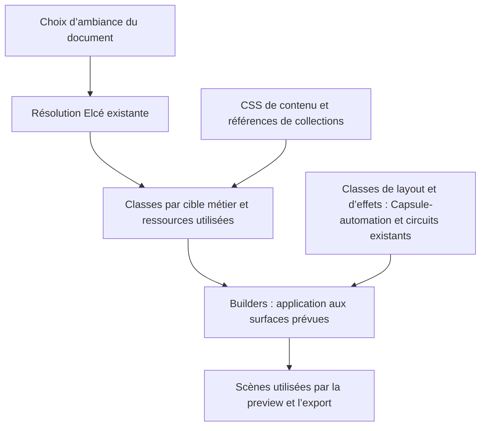

# Notes — apparence et classes CSS du contenu Elcé

Cette note conserve les décisions détaillées, la méthode proposée et ses
exemples. Le [plan Style](../plan/2026-10-22-elce-style-tab-plan.md) réunit les
arbitrages, les actions et leur état. Les comportements vérifiés sont décrits
par la [spécification d’apparence](../specs/appearance-spec.md).

La méthode des collections reste une proposition à relire. Les décisions de
périmètre déjà acceptées ne valent pas preuve de leur réalisation.

## Décisions détaillées


| Repère | Sujet | Proposition et point à arrêter |
| --- | --- | --- |
| D1 | Périmètre des réglages et du rendu | Fixe : réglages auteur sur le contenu ; adaptation de navigation différée après le premier état, sans réglages auteur dédiés. Anticiper le besoin futur d’un rendu dépendant des choix auteur, par exemple un chargement CSS selon clair/sombre ; aucun mécanisme n’est encore décidé. Pour le premier état, identifier les racines de contenu et les surfaces auteur qui les reflètent. Les éléments de navigation, la portée et les correspondances seront arrêtés lors de l’extension. Préserver les comportements et les états accessibles existants. |
| D2 | Preset général du projet | Fixe : cinq gammes de couleurs harmonisées initiales, à enrichir plus tard ; seul le projet choisit le preset général, qui applique ensemble palette, polices de titre et de corps, et espacement. Les propriétés du projet restent ajustables séparément selon D4. Composer leurs teintes, noms et associations. Ambiance et clair/sombre servent à choisir les palettes ; le contraste du texte suit D8. |
| D3 | Personnalisation locale | Fixe : les pages et tous les BDC ne choisissent pas de preset général ; ils personnalisent uniquement leurs propriétés individuelles. Toute propriété sans exception locale hérite de son contexte. Réutiliser les définitions d’apparence et les mêmes commandes à tous les niveaux. Distinguer explicitement le preset d’apparence du layout `presetId`. |
| D4 | Exceptions et changement de preset | Fixe : remplacer le preset général du projet conserve les ajustements explicites du projet et les exceptions des descendants ; une commande par réglage supprime son exception locale, sans choix « Hériter » affiché. Aux pages, Sections et Cartes, les réglages sont des exceptions directes aux valeurs héritées. Les libellés de réinitialisation restent à préciser. |
| D5 | Priorité par propriété | Chaîne acceptée : bloc → parent BDC éventuel → page → réglages du projet → défauts de l’app. Le preset général et les ajustements explicites du projet constituent ses valeurs ; pour toute propriété absente, l’héritage s’applique depuis le niveau supérieur. Les pages, Sections et Cartes n’ont pas de preset local et ne portent que des ajustements directs. Base provisoire de l’app : couleurs actuelles et Crimson Text/DM Sans. Aucun niveau chapitre dans la première tranche. Fixe : un bloc au catalogue conserve ses exceptions et hérite des défauts du projet puis de l’app ; sa réaffectation lui donne son nouveau contexte d’héritage. |
| D6 | Fond | Héritage implicite et réinitialisation conservés. Révision du 25 octobre : le choix Transparent sélectionne `density: none`, sans valeur de fond transparente enregistrée. Le fond du projet reste celui du layout ; les fonds page/BDC gardent leurs surfaces distinctes. |
| D7 | Densité et padding | Décision acceptée et appliquée le 25 octobre : Transparent est un préréglage d’interface qui enregistre `density: none`. Le profil CSS du rôle définit ensemble fond transparent et padding nul. Choisir ensuite une couleur opaque rétablit Normal par défaut ; les autres densités explicites restent prioritaires. Les paddings structurels restent au layout. |
| D8 | Texte et contraste | Fixe et appliqué — confirmé le 25 octobre : simple case « Contraste auto », héritage implicite et réinitialisation par réglage. Employer `contrast-color(<couleur>)` dans les règles de classe ; une couleur littérale suffit, sans variable CSS d’apparence ni calcul JS du contraste. JS résout le fond opaque de référence, notamment pour une surface transparente. Le rendu réel de Demo5 reste à valider dans le lecteur. |
| D9 | Couleurs liées ou libres | Fixe : une teinte de palette conserve une référence sémantique et suit les changements de palette applicables ; une couleur personnalisée conserve sa valeur fixe. Les couleurs personnalisées démarrent unies et opaques ; Transparent sélectionne le profil de densité `none`. |
| D10 | Ressources typographiques initiales | Huit suggestions d’association de familles Google Fonts pour l’interface, avec choix titre/corps enregistrés séparément, avec Bubblegum Sans/Open Sans comme exception ludique explicitement retenue ; Figma peut inspirer la sélection sans imposer ses noms ni ses associations. Utiliser les noms Google Fonts dans l’interface et le CSS. Définir les variantes nécessaires aux titres et aux enrichissements existants. Décision acceptée : l’export ne conserve que les typographies utilisées et inclut par défaut leurs fichiers comme ressources du package. Les tailles restent gérées par l’application. L’extension administrable reste hors de cette étape. |
| D11 | Références et version documentaire | Décision acceptée et appliquée le 25 octobre : document v7, choix séparés `headingFontId` et `bodyFontId`, conversion SQLite ciblée sur Demo5 sans compatibilité générale. `appearance` reste facultatif au projet, aux pages et aux BDC ; seul le projet porte le preset général. Chaque propriété absente hérite indépendamment. Le fond conserve les références de couleur ; les anciens fonds transparents sont convertis en `density: none`. |
| D12 | Picker natif | Choix Fixe : priorité au champ natif `input` de type `color`. Raccorder la couleur validée aux commandes et à l’historique existants. Présenter simplement les teintes prédéfinies si nécessaire ; aucun cycle spécifique d’aperçu ou d’annulation à construire. |
| D13 | Types de BDC | Fixe — décision confirmée : Carousel, Question, Résultat et Graphe font partie du périmètre immédiat, avec Section et Carte. Tous utilisent le même langage d’apparence et les mêmes commandes ; chaque règle cible la surface de son BDC. L’inset actuel est réservé aux surfaces textuelles définies en D7 ; il ne s’applique pas aux racines Carousel/Graphe ni aux médias Photo. Les couleurs de correction, d’état, de données et de navigation gardent leur sens ; elles ne deviennent pas automatiquement la couleur du texte courant. |
| D14 | Unités CSS du document | Fixe — 24 octobre : dans les CSS du contenu document (preview, lecteur, exports), les propriétés qui règlent le rythme du texte (taille, interlignage, marges, espacements et padding de sa surface) utilisent des unités relatives, avec `rem` comme base ; `vw` et `cqw` servent à l’adaptation au layout. Aucune de ces propriétés textuelles n’est déclarée en pixels ; les pixels observés dans les styles calculés du navigateur restent des mesures résolues. Cette décision ne s’applique pas au chrome de l’interface d’édition, qui conserve ses propres règles. |
| D15 | Construction et application des classes | Méthode acceptée et appliquée le 25 octobre : déclarations uniques des palettes, familles, densités et presets dans `appearance-definitions.ts` ; valeurs fixes dans les feuilles CSS ; métadonnées du picker lues depuis les CSS ; résolution commune par cible métier ; application par les builders aux surfaces et champs existants. Les couleurs libres seules ajoutent des règles directes dédupliquées au niveau projet. Les classes d’ambiance réutilisables sont partagées entre les scènes ; les règles CSS et fontes communes sont installées une fois dans la scène layout du projet et réutilisées par l’export. |
| D16 | Transport des fichiers CSS | Fixe — 24 octobre : servir les feuilles d’apparence comme assets CSS via le routeur Remix. En preview, le player ajoute au document lecteur les seuls liens CSS utilisés ; ils restent séparés des feuilles de l’interface d’édition. Pour l’export, le scénario Sighty importe les seules feuilles CSS utilisées et le paquetage CodPlay les développe dans la feuille scoped de la scène layout, via le circuit d’import CSS local existant. Aucun import `?inline` CSS ni générateur de règles thématiques propriété par propriété. Les teintes nécessaires au picker sont des métadonnées générées depuis les fichiers palette CSS. |
| D17 | Lecture du BDC texte | Cadre du 25 octobre : préserver le layout fonctionnel et régler la largeur maximale du texte, la taille bornée, l’interligne et les paragraphes. Cibler 70 à 95 caractères par ligne, espaces compris, pour les tests ; le réglage final sera retenu après ces essais. Respecter un plancher de 9 pixels CSS et conserver les unités relatives dans les déclarations. Les réglages précis et leur acceptation sont suivis au §7 de cette note. |

Les propriétés communes concernent tous les types de BDC. La révision de leur
projection et les décisions techniques encore ouvertes sont suivies dans la
présente note ; le transport d’assets accepté en D16 reste le
circuit identifié pour la preview et l’export.

## Duos typographiques


Les duos utilisent les familles officielles Google Fonts. Les associations
Figma consultées le 22 octobre 2026 ont servi d’inspiration, sans contrainte sur
les noms affichés ni sur les associations retenues. Les liens renvoient aux
métadonnées Google Fonts. Les appréciations de caractère sont les motifs de
sélection pour Elcé ; le rendu dans l’application reste à vérifier.

| Titraille | Texte courant | Caractère recherché |
| --- | --- | --- |
| [Inter](https://raw.githubusercontent.com/google/fonts/main/ofl/inter/METADATA.pb) | [Krub](https://raw.githubusercontent.com/google/fonts/main/ofl/krub/METADATA.pb) | Sobre, entièrement sans empattements. |
| [Montserrat](https://raw.githubusercontent.com/google/fonts/main/ofl/montserrat/METADATA.pb) | [Karla](https://raw.githubusercontent.com/google/fonts/main/ofl/karla/METADATA.pb) | Titres géométriques, texte sans empattements. |
| [Nunito](https://raw.githubusercontent.com/google/fonts/main/ofl/nunito/METADATA.pb) | [PT Sans](https://raw.githubusercontent.com/google/fonts/main/ofl/ptsans/METADATA.pb) | Titres arrondis, texte sans empattements. |
| [Raleway](https://raw.githubusercontent.com/google/fonts/main/ofl/raleway/METADATA.pb) | [Merriweather](https://raw.githubusercontent.com/google/fonts/main/ofl/merriweather/METADATA.pb) | Titres fins dans leur dessin, texte à empattements. |
| [Crimson Text](https://raw.githubusercontent.com/google/fonts/main/ofl/crimsontext/METADATA.pb) | [DM Sans](https://raw.githubusercontent.com/google/fonts/main/ofl/dmsans/METADATA.pb) | Titres classiques à empattements, texte courant sans empattements. |
| [Instrument Sans](https://raw.githubusercontent.com/google/fonts/main/ofl/instrumentsans/METADATA.pb) | [Geist](https://raw.githubusercontent.com/google/fonts/main/ofl/geist/METADATA.pb) | Alternative sobre : dessin discret, entièrement sans empattements. |
| [Philosopher](https://raw.githubusercontent.com/google/fonts/main/ofl/philosopher/METADATA.pb) | [Mulish](https://raw.githubusercontent.com/google/fonts/main/ofl/mulish/METADATA.pb) | Titres expressifs, texte courant sobre sans empattements. |
| [Bubblegum Sans](https://raw.githubusercontent.com/google/fonts/main/ofl/bubblegumsans/METADATA.pb) | [Open Sans](https://raw.githubusercontent.com/google/fonts/main/ofl/opensans/METADATA.pb) | Exception ludique pour les titres, texte courant sobre sans empattements. |

**D10 — nom confirmé le 24 octobre.** L’interface et le CSS emploient les noms
Google Fonts ; la famille utilisée est Crimson Text/DM Sans. Figma ne contraint
ni le nom de la famille ni le choix de l’association. Les fichiers locaux
contiennent les variantes normales et italiques 400/700 pour les familles qui
les proposent ; Bubblegum Sans utilise sa variante normale 400. Le rendu dans
preview et export reste à valider.

**Décision acceptée le 25 octobre, à appliquer :** le document conserve
`headingFontId` et `bodyFontId` séparément. `typographyPairId` appartient au
modèle v6 existant et doit être remplacé dans le prochain contrat documentaire.
Le duo reste une suggestion de l’interface ; sa sélection renseigne les deux
références, sans identifiant de duo enregistré sur le projet, les pages ou les BDC.

Exemple d’association conservée uniquement dans la configuration d’interface :

```ts
{
  label: 'Crimson Text / DM Sans',
  headingFontId: 'crimson-text',
  bodyFontId: 'dm-sans',
}
```

L’héritage et la réinitialisation concernent chaque référence séparément.
Changer le titre laisse le corps inchangé ; les fontes et CSS utilisés se
déduisent des deux choix effectifs. Les presets généraux fournissent également
les deux références, avec conservation des exceptions locales. La conversion
ciblée de Demo5 remplace chaque référence de duo conservée par les références
des deux familles correspondantes. Les variantes de gras et d’italique restent
conservées ; les tailles et axes ne deviennent pas des réglages auteur.

## Circuits propriétaires


| Concerné | Contrat à relire | Circuit à prolonger |
| --- | --- | --- |
| Réglages persistés et intentions | [Modèle documentaire](../specs/document-model-spec.md) | Types, invariants et commandes purs ; façades applicatives vers le même acteur XState. |
| Historique et sauvegarde | [Historique](../specs/document-history-spec.md), [projet actif](../specs/project-session-spec.md) | Historique unique, IndexedDB, synchronisation et droits d’édition existants. |
| Panneaux et sélection | [Entrée Remix](../specs/remix-spa-spec.md), [Section](../specs/section-editor-spec.md) | Vues Remix et adaptateur Tiptap existants ; pas de styles libres injectés dans le texte pour simuler le style du bloc. |
| Structure des blocs | [Modèle documentaire](../specs/document-model-spec.md), [Carousel](../specs/carousel-bdc-spec.md) | Configuration de presets et `ElceCardPresetBuilder` pour le markup ; le layout reste indépendant de l’apparence. |
| Projection réelle | [Flux](../specs/flux-scene-builder-spec.md), [Diapo](../specs/diapo-scene-builder-spec.md), [ancres](../specs/codplay-anchor-integration-spec.md) | Builders et racines utiles existants ; relations parent/enfant conservées, réservations de flux et cadrages média préservés. |
| Preview et diffusion | [Lecteur](../specs/player-preview-spec.md), [export Sighty](../specs/sighty-export-spec.md), [export SCORM](../specs/scorm-export-spec.md) | Même producteur de scénario ; CSS commune sur le layout, CSS de page sur sa scène, ressources embarquées par le paquetage existant. |

La projection traduit les choix documentaires en classes et règles CSS sur les
surfaces existantes. Les valeurs variables propres à une cible sont déclarées
dans la feuille de sa scène, puis appliquées par sa classe ; les réglages ne
sont pas portés par des propriétés `style` ni des attributs HTML `style`. La
cascade et l’héritage portent le rendu ; les contrôles présentent directement
la valeur effective et la réinitialisation supprime une exception locale. Aucun
libellé d’origine n’est affiché. Lorsque parenté métier et arbre DOM diffèrent,
définir la traduction minimale nécessaire dans les builders
existants, sans dupliquer la cascade dans un moteur JavaScript. Le domaine ne
lit pas le DOM pour décider ce qui est sauvegardé. Les propriétés CSS ne
deviennent pas un second stockage éditorial.

Les tailles de texte restent réglées par l’application. Les réglages visuels
préservent les niveaux de titre, les contenus riches, les médias, les événements
de fin de page, les transitions, les commandes et la progression. La navigation
de preview reste indépendante, avec synchronisation manuelle.

## 1. Cadre donné par l’utilisateur

- La composition des pages réserve des classes au layout et aux effets de
  transition : sliders, moves, révélations, états des vues, etc.
- Capsule-automation sert d’abord à construire les layouts : grilles, zones,
  placements et règles CSS de composition. Elle intervient également dans
  les transitions et effets associés.
- Toutes les classes du contenu sont scopées par construction. Leur nom
  n’a pas à répéter un préfixe d’application ; il exprime le rôle et les
  variantes utiles à l’intérieur de cette portée.
- Dans la palette Style, l’auteur choisit des propriétés d’ambiance,
  principalement les couleurs et les familles de polices.
- La densité est un paramètre général. « Dense, Normal, Large » peut sélectionner
  plusieurs préréglages de marges et de paddings adaptés au contenu ; elle ne
  désigne pas une valeur CSS unique.
- Transparent est un préréglage d’interface sélectionnant `density: none`.
  Ce profil règle ensemble fond transparent et padding nul sur la surface.
  Il remplace la sélection de densité précédente ; les réglages de lecture
  du profil restent à calibrer.
- Les choix auteur sont interprétés en collections de classes à appliquer.
  Le développeur dispose des règles CSS pour créer et enrichir ces collections.
- Les fichiers CSS contiennent les définitions de style. La méthode proposée
  doit privilégier la sélection de classes en JS et des déclarations CSS
  directes, sans chaîne de variables servant seulement de relais entre classes.
  Les animations et transitions suivent le circuit de composition existant.
- Pour le BDC texte, borner la largeur de lecture sur grand écran et régler
  ensemble largeur, taille, interligne et espace entre paragraphes. Cibler
  70 à 95 caractères par ligne pour les tests ; le réglage final sera retenu
  après ces essais. Une taille de police ne doit pas descendre sous 9 pixels CSS ;
  ce plancher ne définit pas la taille normale du corps de texte.

Ces orientations sont traduites par la méthode des sections suivantes. Les réglages typographiques de lecture restent à calibrer avec Demo5 ; le suivi est dans le plan Style.

## 2. Propriétaires des règles

| Ensemble | Propriétaire | Rôle et frontière |
| --- | --- | --- |
| Layout | Capsule-automation, builders de page et de BDC, presets de contenu | Construction des grilles, zones et placements, classes et règles CSS de composition ; structure, dimensions des cadres, réservations média, ancres et débordements nécessaires au layout. |
| Effets | Capsule-automation, builders et actions CodPlay existantes | Transitions, transforms, opacité ou visibilité lorsqu’elles participent à un effet, états des vues et contrôle temporel. |
| Ambiance | CSS de contenu et collections configurées par le développeur | Couleurs, familles de polices et préréglages d’espacement autorisés sur les surfaces désignées. L’auteur sélectionne ces choix sans éditer les classes ni les règles. |

Cette distinction décrit les responsabilités des règles. Capsule-automation
intervient d’abord dans la construction des layouts, ainsi que dans les
transitions associées ; les builders intègrent ses résultats à leurs scènes.

Le builder connaît la surface à habiller et les propriétés réservées à sa
composition. Une collection d’ambiance n’écrit pas les propriétés possédées par
le layout ou les effets sur cette même surface. Les marges et paddings de
contenu réglés par une densité sont distingués de ceux nécessaires à la
structure. Les tailles typographiques restent définies par l’application.

Le [contrat Carousel](../specs/carousel-bdc-spec.md#projection-et-lecture)
fournit un cas concret : les classes de Capsule et de vue participent au
montage, et les actions CodPlay portent les transitions. Le
[contrat Capsule](../../editor/plan/2026-07-08-capsule-spec.md#7-pipeline-de-résolution)
et sa [réconciliation](../../editor/plan/modules/2026-07-08-capsule-automation-reconciliation-plan.md#2-décision)
identifient déjà ces responsabilités. L’ambiance utilise les emplacements de
contenu de cette composition et préserve les classes et règles produites pour
ses layouts et ses effets.

## 3. Construction des collections côté développement

### 3.1 Déclaration unique des collections

**Méthode retenue le 25 octobre.** Les déclarations du catalogue sont réunies
dans un module de données
`config/appearance/appearance-definitions.ts`, partagé par l’application et
son générateur de métadonnées. Il réunit identifiants, libellés, références
de fontes, feuilles CSS et noms de classes. Il ne dépend pas des métadonnées
générées. `appearance-config.ts` conserve les accès métier existants et joint
les données de couleur produites depuis les CSS.

Cette extraction remplace les listes de chemins séparées actuellement dans
`appearance-theme-styles.ts` et la liste de palettes propre au générateur.
Une collection source se déclare une seule fois. L’enregistrement consiste à ajouter
une entrée de données et sa CSS ; aucune méthode runtime `register` ni service
de styles supplémentaire n’est proposé.

Organisation retenue, dans le dossier existant :

```text
config/appearance/
  appearance-definitions.ts             références des collections
  appearance-config.ts                  accès métier existants
  appearance-palette-colors.generated.ts métadonnées tirées des CSS
  css/
    palettes/forest.css                 couleurs de Forêt
    typography/crimson-text.css          règles de cette famille
    typography/dm-sans.css               règles de cette famille
    typography/reading.css               mesure de lecture commune
    densities/normal.css                espacements Normal par rôle
```

Formes indicatives de deux entrées de familles indépendantes, limitées ici
aux rôles et densités de l’exemple. Une association d’interface référence ces
familles ; elle ne possède ni CSS de duo ni profils de rendu propres.

```ts
[
  {
    id: 'crimson-text', label: 'Crimson Text', family: 'Crimson Text',
    styleSheet: 'typography/crimson-text.css',
    classes: { heading: 'headings-crimson-text' },
  },
  {
    id: 'dm-sans', label: 'DM Sans', family: 'DM Sans',
    styleSheet: 'typography/dm-sans.css',
    classes: {
      normal: { body: 'body-dm-sans-normal' },
      large: { body: 'body-dm-sans-large' },
    },
  },
]
```

Les entrées réelles couvrent les rôles et densités applicables. Plusieurs
entrées peuvent référencer une même classe lorsque leur réglage est identique ;
elles ne demandent pas de recopier sa règle CSS. Les rôles des champs Carte
(surtitre, titre, description, message, note, légende) gardent leurs dimensions
propres lorsqu’elles diffèrent. Une classe de corps ne remplace pas toutes ces
tailles par une valeur unique.

### 3.2 Ce que contient chaque collection

**Précision acceptée le 25 octobre :** Forêt est un exemple de données. Le
modèle de styles ne fixe ni cette palette, ni les cinq entrées initiales,
ni leur provenance. Une collection existante peut fournir les teintes,
notamment les [palettes de Tailwind CSS](https://tailwindcss.com/docs/colors).
La documentation Tailwind présente des familles comme `emerald` et leurs
nuances de `50` à `950`.

Extrait d’affectations possibles, proposé pour illustrer cette indépendance :

| Rôle du contenu | Teinte de la collection source |
| --- | --- |
| `background` | `emerald-50` |
| `text` | `emerald-950` |
| `accent` | `emerald-600` |

Ces affectations appartiennent à la définition d’ambiance du développeur.
Les rôles de rendu ne fixent pas le nombre de teintes de la collection source.
Les règles restent dans les CSS de contenu ; la résolution sélectionne leurs
références et la compilation optimise la sortie. Aucune condition sur `forest`,
`emerald` ou l’origine des couleurs n’est ajoutée aux builders. Cet exemple
n’engage pas le remplacement du catalogue actuel ni une intégration du framework.

| Collection | Références de classes déclarées | Règles CSS possédées |
| --- | --- | --- |
| Palette | Pour chacun des six rôles sémantiques : fond, texte et contraste auto. | Couleurs directes ; `contrast-color(<couleur>)` pour le contraste. Aucun alias de variable entre le choix et la propriété. |
| Famille typographique | Profils par rôle de texte et densité, avec réemploi des classes identiques. | Famille, réglage du corps et interligne adaptés au rôle ; valeurs relatives, `clamp()` lorsque pertinent. |
| Densité | Profils par rôle et densité, dont `none` pour fond transparent et padding nul ; rythme du corps riche. | Marges, espacements des paragraphes/titres et inset textuel ; `none` définit aussi la transparence du fond. |
| Preset général | Références de palette, polices de titre/corps et densité existantes. | Aucune copie de CSS ; il sélectionne les collections précédentes. |

La densité peut donc choisir à la fois un profil typographique et un profil
d’espacement. Le catalogue ne construit pas le produit de toutes les palettes,
polices, densités et cibles. Les CSS contiennent les variantes utiles ; les
références de classe permettent de les réemployer.

Fond et texte étant réglables indépendamment, leurs choix disposent de règles
de couleur directes distinctes. Cette granularité reste limitée aux choix
d’auteur ; les autres propriétés sont regroupées par rôle cohérent. Le nom source
d’une classe fixe n’encode ni l’identifiant du BDC ni celui de sa page.

Les exemples utilisent des noms sans préfixe d’application :
`body-dm-sans-normal`, `bg-forest-background`, `section-normal`.
Le scope assure l’isolation ; les indications de rôle, de collection et de
variante distinguent les règles qui coexistent dans une même portée. Les noms
se simplifient selon ce contexte. Cette convention concerne les collections
proposées ; les classes de layout et d’effets restent celles produites par
leurs circuits existants.

### 3.3 Source des teintes et vérification des déclarations

Faire évoluer `generate-appearance-palette-metadata.mjs` : il lit les palettes
dans ce module unique, puis les déclarations `background-color` des classes
enregistrées pour les six rôles. Les littéraux restent écrits dans les CSS.
Le générateur produit les valeurs requises par le picker et le résolveur,
sans réécrire les feuilles de style.

Le relevé utilise une analyse CSS de build, avec PostCSS déjà employé dans le
paquetage du dépôt, à déclarer comme dépendance de développement directe d’Elcé
lors de son raccord. Vérifier les chemins, l’existence des classes, les rôles
complets et la cohérence des couleurs de texte/contraste associées. Un défaut
de catalogue est une erreur de préparation, sans remplacement silencieux.

Le module de données reste du TypeScript à syntaxe effaçable, importable par
Node dans la chaîne existante (`node >= 24.3.0` requis par Elcé ; environnement
inspecté : 26.12.1 avec type stripping). Les imports de source utilisent leur
extension explicite. Cette séparation évite que le générateur ait besoin du
fichier de couleurs qu’il est justement chargé de produire.

### 3.4 Enregistrement du projet auteur et couleurs libres

**Exemple simplifié le 25 octobre :** quand une cible choisit localement
`paletteId: 'forest'`, les teintes de référence `background` et `text` sont
déjà fournies par cette palette. L’exemple du plan ne réenregistre pas ces
mêmes choix dans `background` et `textColor`. Une exception locale reste
nécessaire pour choisir une autre teinte ou couleur fixe. Transparent
enregistre `density: none` et n’ajoute pas de choix `background`. Cela simplifie l’exemple documentaire ; cela
n’introduit pas de suppression automatique des intentions explicites existantes.

Le projet conserve uniquement ses intentions dans `appearance` : identifiants
de preset/palette, `headingFontId`, `bodyFontId`, densité, références de couleur, valeurs libres et
booléen de contraste. Les classes résultantes, les chemins CSS et les règles
calculées ne sont pas enregistrés dans le document métier. La révision
typographique remplace le champ de duo par les deux références et demande
la conversion ciblée de Demo5, suivie en P1 du plan.

Une couleur libre est le seul cas de couleur qui ne peut pas avoir sa règle
prédéfinie dans le catalogue. Réutiliser le générateur de classes personnalisées
existant, en lui faisant écrire directement `background-color`, `color`, ou
`color: contrast-color(<fond libre>)`. Dédupliquer par usage et valeur
normalisée avec le nom compact déjà disponible, jamais par identifiant de BDC.
Ces règles sont émises une seule fois pour le document, sans répétition dans
chaque scène de page. Elles remplacent la référence de couleur correspondante
dans le résultat de projection ; elles ne reconstruisent pas les thèmes fixes.

### 3.5 Modèle de développement et sortie compilée

**Distinction acceptée, à appliquer au travail de mise au propre.** Le modèle
source sert au développeur qui modifie ou enrichit les styles : identifiants
compréhensibles, CSS regroupées, références déclarées, rôles et exemples.
La compacité du rendu est une responsabilité de la compilation. Le développeur
ne maintient pas à la main un catalogue d’alias optimisés.

Les builders et le résolveur produisent la projection source par le circuit
commun. La compilation peut ensuite sélectionner les usages, dédupliquer,
regrouper et compacter les artefacts en conservant leur comportement. Les
couleurs et réglages fixes continuent d’être écrits dans les CSS ; optimiser
ces règles à la compilation ne les transforme pas en un générateur de styles
à maintenir propriété par propriété.

Exemple de transformation cible, à prendre en charge par la compilation :

```text
Source CSS :   .section-none { background-color: transparent; padding: 0; }
Source scène : class="section-none"
Sortie CSS :   .c7{background-color:transparent;padding:0}
Sortie scène : class="c7"
```

Conserver une correspondance avec les références source pour le débogage.
Toute substitution doit couvrir les sélecteurs, portées et références de
scène concernées, notamment les liaisons utilisées par le layout et les effets.
Les identifiants et choix métier du document restent les données auteur.

**Frontière vérifiée aujourd’hui :** le
[contrat CSS du paquetage CodPlay](../../codplay/specs/scene-package-export-v1-spec.md)
conserve noms de classes, sélecteurs, déclarations et ordre ; il développe les
imports et relocalise les URL. Le renommage et l’élimination générale des
règles inutilisées ne sont donc pas des capacités certifiées. Le cadrage des
extensions doit prolonger ce circuit dans son plan propriétaire, avant code,
avec les autorisations du cœur applicables. Aucun circuit d’optimisation
spécifique à Elcé n’est introduit par cette distinction.

## 4. Application des classes côté JS



### 4.1 Une projection pour un instantané du document

Réutiliser le résolveur Elcé et calculer ses résultats une fois par cible
métier pendant la préparation d’un instantané. Conserver la priorité BDC →
parent BDC → page → projet → défauts de l’application. La résolution du fond
opaque de contraste réemploie ces résultats.

Cette cascade s’applique à tous les BDC, y compris aux Cartes ancrées et aux
enfants de Carousel. Leur emplacement ne crée ni résolution de style ni
commande de personnalisation supplémentaire. Les builders consomment le
résultat commun pour leurs surfaces respectives.

À partir de ce résultat, sélectionner les classes par rôle, densité et état
du fond. Produire une table dérivée distinguant projet, pages et BDC, indexée
par leurs identifiants métier. Les builders restent propriétaires des IDs DOM
et des parts CodPlay : le projecteur n’a plus à reproduire leurs formules
d’identifiants pour prévoir où poser une classe.

Le raccord actuel `appearanceClassNamesByTarget` est à faire évoluer dans ce
sens, dans son circuit existant. Chaque entrée fournit les classes prêtes
pour ses surfaces et rôles de texte. Exemple indicatif d’une Section :

```ts
{
  surface: ['bg-forest-background', 'section-normal'],
  body: ['body-dm-sans-normal', 'headings-crimson-text', 'ink-forest-text', 'rhythm-normal'],
  heading: ['headings-crimson-text', 'ink-forest-text'],
}
```

Le même résultat dérivé fournit les CSS, fontes et règles de couleurs libres
utilisées. Il remplace les parcours de résolution répétés pour les classes,
les liens CSS, les fontes et les feuilles de page. Sa durée de vie est celle
de l’instantané ; aucun cache de styles global mutable n’est nécessaire.

### 4.2 Cibles dans les builders

Les presets connaissent déjà leurs zones, leurs classes structurelles et
leurs parts (`zoneClassNames`, `zonePartIds`). Les builders utilisent ces
informations pour joindre les classes d’ambiance aux classes existantes dans
le markup ou dans `initial.className` du perso texte.

| Cible métier | Surface peinte / espacement | Cibles typographiques |
| --- | --- | --- |
| Projet | Fond sur la racine layout. | Défauts de contenu sur sa région existante ; commandes de navigation gardées dans leur circuit. |
| Page Flux ou Diapo | Racine de contenu de la page, selon le rôle existant. | Contenu propre à la page ; chaque BDC reçoit ensuite ses valeurs résolues. |
| Section | Racine Section : fond et inset ; corps riche : rythme et largeur de lecture. | Titre sur son perso `h2`, corps sur son conteneur existant. |
| Carte Texte court | Racine Carte. | Champs existants selon leur rôle : surtitre, titre, description, message, note. |
| Carte Texte avec image | Conteneur de texte existant, distinct du cadre média. | Mêmes rôles de champs que Texte court. |
| Carte Image avec légende | Perso légende, lorsqu’il existe. | Profil de légende sur ce même texte. |
| Photo | Fond de sa surface actuelle, sans inset média. | Aucun texte à créer. |
| Carousel, Graphe | Surfaces de fond existantes, sans inset sur les racines mixtes. | Champs textuels applicables ; données, contrôles et états fonctionnels restent propriétaires de leurs couleurs. |
| Question, Résultat | Surface actuelle de fond et inset textuel prévu. | Rôles de texte des builders ; états de correction/résultat préservés. |

La table de projection contient les classes de chaque cible même lorsque ses
choix sont hérités : la parenté métier n’est pas toujours la parenté DOM. Une
réinitialisation change les intentions puis la projection ; elle n’appelle
pas une manipulation manuelle des nœuds du lecteur.

### 4.3 Composition et portée des règles

Sur un élément, joindre et dédupliquer les classes de layout, d’effets et
d’ambiance. Les classes fixes de ces propriétaires sont conservées par leur
builder. Une seule variante de chaque profil d’ambiance est sélectionnée :
le passage à `none` retire les classes de fond coloré et d’espacement
précédentes, puis sélectionne le profil sans fond ni padding du rôle.

Une classe reste nécessaire seulement si elle porte une règle ou constitue
une limite réellement utilisée. Retirer le marqueur haché de surface sans
règle, tout en conservant les classes spécifiques des géométries calculées.
Le marqueur commun de limite de portée, proposé sous le nom `bdc`,
est placé une fois par le builder/preset sur la racine de chaque BDC. Pour
Texte avec image, cette limite reste la racine Carte, même si le fond et le
padding visent son conteneur de texte intérieur. Ce marqueur ne règle aucune
couleur, police ou variable.

Les champs texte matérialisés reçoivent leurs profils directement. Pour les
titres et paragraphes internes au corps riche, proposer une portée CSS bornée
par la racine du BDC enfant, avec ce marqueur comme limite :

```css
@scope (.headings-crimson-text) to (.bdc) {
  h1, h2, h3, h4, h5, h6 {
    font-family: 'Crimson Text';
  }
}
```

Cette portée empêche un sélecteur de Section de viser le titre d’une Carte
ancrée. Elle ne bloque pas l’héritage CSS : les BDC enfants gardent donc leurs
propres classes résolues. Vérifier ce cas dans les CSS déjà scoped par Sighty
et dans l’export, avant d’accepter ce raccord. Référence technique :
[MDN — scope](https://developer.mozilla.org/en-US/docs/Web/CSS/Reference/At-rules/@scope).

### 4.4 Priorité et propriétés possédées

L’ordre des mots dans `class` n’est pas une règle de priorité CSS. Éviter les
conflits par propriété : typographie pour famille/corps/interligne, densité
pour les espacements, couleurs pour le fond et le texte, layout/effets pour
leurs propriétés réservées. Le réglage de densité qui influence l’interligne
choisit le profil typographique correspondant ; il n’ajoute pas une seconde
règle concurrente de `line-height`.

Les anciennes déclarations de présentation doivent être regroupées dans les
CSS de contenu, avec des défauts à faible spécificité. Une règle scoped de
scène ne doit pas conserver une couleur ou un padding concurrent sous couvert
de layout. Conserver les états fonctionnels et la géométrie dans leur circuit.

Pour le contraste auto, garder la classe de couleur ordinaire comme valeur
applicable sans support, et ajouter la classe de contraste lorsque le contrat
l’autorise. Proposition de priorité explicite : règle de couleur ordinaire
dans `:where(...)`, règle de contraste par classe normale sous `@supports`.
La seconde l’emporte lorsqu’elle est disponible, sans `!important`, variable
relais ou dépendance à l’ordre des fichiers de palette. Référence :
[MDN — where](https://developer.mozilla.org/en-US/docs/Web/CSS/Reference/Selectors/:where).

### 4.5 Chargement, export et modification d’un choix

Le chargement existant consomme les feuilles des classes sélectionnées,
les déduplique et les ordonne de façon stable : contenu commun, palettes,
typographies et densités. La preview les charge comme assets dans le document
lecteur. La feuille du layout porte une seule fois les faces de fonte et
les règles de couleurs libres ; les pages gardent les règles calculées de
leurs builders, sans recopier ces définitions communes.

L’export consomme les mêmes références à travers le producteur de scénario
existant et ses imports CSS locaux. Le contrat actuellement vérifié sélectionne
des feuilles entières. L’exigence du plan Style vise les définitions réellement
utilisées : la suppression éventuelle des règles inutilisées à l’intérieur
d’une feuille n’est pas vérifiée aujourd’hui. Identifier cette granularité et
sa preuve en P0/P4, sans présenter le transport actuel comme une élimination
de chaque règle inutilisée ni affaiblir l’exigence existante.

Un choix auteur passe par les commandes et l’historique existants. À la
construction de l’instantané suivant, le projecteur resélectionne les classes.
La signature de cache d’une page prend en compte sa projection effective et
celle de ses enfants. La synchronisation manuelle du lecteur, le remontage et
le nettoyage des assets restent dans leur cycle de vie existant.

Cette mise au propre n’autorise pas de modification du cœur CodPlay ou de
capsule-automation. Les structures ci-dessus sont une proposition de données
et de raccord, pas des API actuellement implémentées.

### 4.5.1 Mutualisation sous le scope du projet

**Principe accepté le 25 octobre, mise en œuvre et validation restantes.**
La conception d’Elcé favorise la réutilisation des classes entre scènes :
les builders sélectionnent directement des profils communs au projet. Chaque
profil a une identité et une définition réutilisées par toutes les scènes
concernées. Les sources restent organisées par collection ; la préparation
collecte les usages et installe chaque définition une fois sous la racine du projet.

| Feuille commune du projet | Feuilles propres aux scènes |
| --- | --- |
| Profils de palette, typographie et densité utilisés ; règles de contenu réutilisables ; couleurs libres identiques ; faces de fontes. | Géométrie et règles réellement particulières aux pages ou à leurs instances de BDC. |

Deux scènes qui sélectionnent `section-normal` conservent chacune cette
référence sur leurs éléments. La déclaration CSS correspondante figure une
fois dans la feuille commune. Les exceptions locales choisissent leurs profils
par la même cascade : elles ne demandent pas de recopier la collection dans
chaque scène. Les noms/alias partagés sont attribués à l’échelle du projet ;
deux règles distinctes ne doivent pas recevoir le même alias dans cette portée.

**Circuit déjà disponible :** le
[runtime Sighty](../../sighty/specs/authoring-library-spec.md) installe les feuilles
de scène via `owner.preload.css.set()`, avec `runtime.root` comme conteneur
`@scope`. Elcé rattache déjà la CSS commune du lecteur et les fontes à la scène
layout dans
[`createElcePlayerScenario`](../src/player/elce-player-composition.ts).
La proposition réutilise cette feuille et son cycle de vie, avec une portée
projet ; elle ne crée pas de registre de styles global au document navigateur.

**Doublon concret à retirer :**
[`appearance-scene-style-sheet.ts`](../src/player/appearance-scene-style-sheet.ts)
émet les couleurs libres dans `createDocumentAppearanceStyleSheet` pour tous
les usages, puis dans `createPageAppearanceStyleSheet` pour chaque page.
Ces règles doivent rester dans la feuille commune. Les CSS d’apparence fixes
et les fontes sont déjà en partie mutualisées ; mesurer le gain après retrait
des répétitions au lieu de considérer toute CSS de page comme un doublon.

**Points de raccord et de validation :**

- Collecter les usages de toutes les scènes du scénario, y compris celles
  qui ne sont pas encore affichées, puis préparer la feuille avant leur montage.
- Vérifier l’installation des CSS servis comme assets sous ce même scope.
  Le [canal CSS en mémoire](../../codplay/specs/preload-v2-spec.md#canal-css-en-mémoire)
  certifie remplacement et nettoyage, pas le chargement par URL ; raccorder
  le transport d’assets existant à ce canal sans supposer une API supplémentaire.
- Conserver la feuille lors des navigations et démontages de pages. La retirer
  avec le projet, en vérifiant l’isolation de deux racines de projet.
- Sur un nouvel instantané, mettre à jour le commun avant les scènes qui en
  dépendent ; garder caches de scènes, alias et feuilles cohérents. Retirer
  les définitions devenues inutilisées sans perdre celles d’une autre scène.
- À l’export, transporter le commun une fois dans le paquet de la scène layout
  par le circuit Sighty existant ; les autres paquets gardent leurs particularités.
  Vérifier leurs ressources, leurs liaisons de classes et le contrat de paquets
  intégraux/remplaçables, sans dépendance implicite ajoutée.
- Deux scènes partageant un profil doivent montrer une définition commune,
  le même rendu après navigation/Seek/replay/resize, puis un nettoyage correct.

La mutualisation conserve les sélecteurs, conditions, portées et priorités.
L’égalité de quelques déclarations ne suffit pas à fusionner des règles dont
le contexte diffère. Les extensions de compilation nécessaires restent à
cadrer dans leur circuit propriétaire ; aucune modification du cœur n’est
engagée par cette étude.

### 4.6 Exemple de composition entre niveaux

| Niveau | Choix auteur | Résultat de la projection |
| --- | --- | --- |
| Projet | Preset Forêt | Palette Forêt, titre Nunito, corps PT Sans, densité Large ; le fond projet peint son layout. |
| Page | Titre Crimson Text et corps DM Sans | Deux choix indépendants pour les textes sans exception locale ; palette et densité conservées. |
| Section | Transparent, donc `density: none` | Profil Section sans fond ni padding ; références de polices de page conservées. |
| Carte ancrée dans la Section | Fond lié au rôle `surface` et densité Large locale | Surface de texte peinte avec la teinte Forêt `surface`, profil Large avec padding ; ses champs reçoivent leurs profils résolus. |
| Carte de Carousel sur cette page | Palette Océan locale | Classes Océan sur ses surfaces et textes applicables, polices de page et densité héritées ; le montage Carousel conserve ses classes et transitions. |

Un changement de palette du projet resélectionne les classes de la Section et
de sa Carte, mais conserve l’exception Océan. Le passage de la Carte ancrée à
Transparent remplace sa densité Large par `none` et sélectionne le profil
sans fond ni padding. Les builders
appliquent le résultat sans connaître le chemin des feuilles ni résoudre
eux-mêmes l’héritage.

## 5. Transparent est le profil de densité `none`

**Décision acceptée le 25 octobre, à réaliser.** Le libellé Transparent dans
l’interface sélectionne un ensemble de règles via `density: none`. Il ne
correspond plus à `background: { kind: 'transparent' }` dans le futur modèle.
Le preset général reste réservé au projet ; ce préréglage d’interface utilise
la propriété de densité existante.

| Choix | Donnée enregistrée | Classes sélectionnées |
| --- | --- | --- |
| Normal avec le fond de palette | `density: normal` | Fond de palette et profil Normal du rôle. |
| Large avec le fond choisi | `density: large` | Fond choisi et profil Large du rôle. |
| Transparent | `density: none` | Profil `none` du rôle, sans classe de fond coloré concurrente. |

```css
.section-none {
  background-color: transparent;
  padding: 0;
}
```

Cette règle groupe les deux propriétés de ce profil. Le choix de palette ou
de couleur reste une référence disponible ; le fond effectivement peint par
`none` est transparent. Le contraste remonte donc vers le contexte opaque,
sans traiter la couleur mémorisée comme un fond peint.

Le rythme de lecture et les espacements de chaque profil restent à calibrer.
Les paddings structurels du layout gardent leur propriétaire. L’ancienne
combinaison Large + Transparent n’est plus une donnée à maintenir ; choisir
Transparent remplace la densité par `none`.

**Raccord UI accepté :** Normal est le défaut. Réactiver un fond coloré après
Transparent sélectionne `density: normal`, puis le fond choisi et le profil
Normal du rôle. Ce point est fermé dans le plan.

## 6. Contraste automatique — fonction retenue le 25 octobre

La référence indiquée par l’utilisateur est la
[documentation MDN de `contrast-color()`](https://developer.mozilla.org/fr/docs/Web/CSS/Reference/Values/color_value/contrast-color),
confirmée par [CSS Color 5](https://www.w3.org/TR/css-color-5/#contrast-color).
La fonction prend une couleur et renvoie noir ou blanc selon le contraste.
Elle accepte une couleur littérale ; son usage n’exige pas de variable CSS.

Le contraste auto reste une simple case auteur. JS détermine le fond de
référence et sélectionne les classes applicables ; la fonction CSS calcule
la couleur du texte. Exemple nominal de classe, avec nom illustratif :

```css
.bg-forest-background {
  background-color: #f5f7ef;
}

:where(.ink-forest-text) {
  color: #263c2c;
}

@supports (color: contrast-color(#f5f7ef)) {
  .auto-forest-background {
    color: contrast-color(#f5f7ef);
  }
}
```

La surface peinte reçoit la classe de fond. Les champs texte reçoivent leur
couleur ordinaire et, lorsque le contraste auto s’applique, la classe auto
correspondant au fond résolu. La règle auto ne repeint pas leur fond.

Pour une surface au profil `none`, l’entrée de la fonction est la couleur opaque
du contexte résolue par Elcé, conformément au contrat d’apparence actuel.
La fonction ne découvre pas elle-même le fond situé derrière l’élément.
Le padding de cette surface reste nul. Aucun calcul JS de noir/blanc ni
analyse des pixels des médias n’est ajouté.

Conserver le contrôle de support CSS déjà prévu : si la fonction n’est pas
prise en charge, la couleur ordinaire reste applicable. Le choix de la
fonction est arrêté ; son raccord aux collections et aux couleurs libres
fait partie de la méthode de projection encore à relire et à vérifier.

## 7. Réglages de lecture du BDC texte

Les [références typographiques](../notes/2026-10-25-content-typography-references.md)
apportent des repères issus de contextes différents. Le seuil de longueur de
ligne et les réglages associés seront retenus à partir de nos tests dans Elcé.
La plage retenue pour les essais est de 70 à 95 caractères par ligne,
espaces compris. Le réglage final résultera de la lecture observée.

L’ensemble du guide [Practical Typography](https://practicaltypography.com/)
est retenu comme référence pour construire les variantes de densité :
interligne, rythme des paragraphes, espace autour des titres et marges de
lecture sont à travailler ensemble. La composition de la page
[Line length](https://practicaltypography.com/line-length.html) fournit une
référence concrète pour comparer leur équilibre avec la largeur et le corps. Le
[relevé de sa CSS](../notes/2026-10-25-content-typography-references.md#composition-de-référence-désignée-par-lutilisateur)
montre des profils adaptés aux différentes familles. Les essais Elcé doivent
rechercher cet équilibre avec les fontes du projet.

### Méthode proposée

- Définir une largeur maximale sur la zone de lecture réelle, à l’intérieur
  de la composition existante. La page, les médias et les cadres de transition
  conservent leur fonction ; la limite de lecture ne devient pas une nouvelle
  limite globale de leur layout.
- Relier modérément la taille à la largeur disponible, avec des bornes et une
  expression `clamp()` écrites dans les classes CSS. Examiner le contenant réel
  du texte, notamment pour une Carte, et vérifier les conteneurs déjà présents
  avant de choisir les unités de conteneur. Le viewport entier ne représente
  pas toujours la largeur disponible pour ce texte.
- Préserver le retour naturel à la ligne sur les petites largeurs. La cible
  de longueur ne justifie pas de réduire indéfiniment le corps pour conserver
  le même nombre de caractères.
- Calibrer les largeurs en `ch` ou autres unités relatives avec les familles
  effectivement chargées : `ch` n’est pas un compte exact de caractères. Les
  mesures de référence incluent les espaces et distinguent les lignes pleines
  des dernières lignes de paragraphes.
- Écrire l’interligne comme un rapport sans unité et les marges de paragraphe
  en `em` ou `rem`. Définir un espacement effectif entre paragraphes, en tenant
  compte de la fusion ou de l’addition des marges selon leur contenant.
- Vérifier le plancher de 9 pixels CSS dans le rendu, y compris les petits
  textes concernés. Les déclarations de taille restent relatives ; la taille
  racine du navigateur est prise en compte. Le corps de lecture utilise une
  taille confortable distincte de ce plancher.

Les réglages appartiennent aux préréglages de contenu définis par le
développeur. La palette auteur conserve ses choix d’ambiance et de densité.
Le JS sélectionne les classes ; aucun mécanisme de mesure permanente de chaque
ligne ou de génération des règles fixes n’est introduit par cette méthode.

### Premiers essais proposés, seuils à calibrer

| Paramètre | Comparaison à effectuer |
| --- | --- |
| Longueur des lignes | Cibler 70 à 95 caractères par ligne, espaces compris, avec les textes et polices Elcé. Le réglage final résulte de la lecture observée. |
| Taille du corps | Calibrer les bornes par famille en comparant le rendu à la composition de référence ; vérifier la variation avec la largeur. Le plancher de 9 pixels CSS reste un garde-fou. |
| Interligne | Comparer notamment des rapports de `1.4`, `1.45`, `1.5` et `1.6`, en les associant à la largeur et à la police. |
| Espacement entre paragraphes | Prendre `1em` comme point de comparaison de la page de référence et essayer aussi `0.5em` et `0.75em`, indépendamment du padding du fond. |
| Densité | Construire des ensembles cohérents d’interligne, d’espaces entre paragraphes, de marges autour des titres et de marges de lecture, avec Practical Typography comme référence. Les valeurs sont adaptées au rôle et à la police puis vérifiées par nos essais. Le profil `none` règle fond transparent et padding nul ; son rythme de lecture reste à calibrer. |

### Première mise en place CSS — 25 octobre

Le corps riche des BDC Section utilise maintenant le profil normal de
`appearance/css/typography/reading.css` : `0.9–1rem` par une expression
`clamp()` liée au contenant avec `cqi`, et le corps de Section borné par
`min(100%, 82ch)`. Compact applique `0.9–0.95rem` /
`min(100%, 70ch)`, Large `0.95–1.125rem` / `min(100%, 95ch)` dans leurs
feuilles de densité ; Transparent garde la base normale. Le corps de Section
est le contenant de requête ; l’article Flux et la racine visuelle de Section
gardent leur largeur de layout. Ces
limites `ch` sont des points de départ, pas une conversion exacte de 70–95
caractères. Le test visuel de Demo5 reste à faire avant de retenir les valeurs.

Les essais couvrent les textes longs et courts, titres, enrichissements et
fontes du catalogue ; écran étroit, Carte étroite sur écran large et grande
page ; chargement des fontes, resize, zoom à 200 % et agrandissement de la
police du navigateur. Les espacements utilisateur de référence W3C doivent
pouvoir s’appliquer sans perte de contenu ; ce ne sont pas des valeurs par
défaut prescrites au projet.

Le contrat [Flux](../specs/flux-scene-builder-spec.md#contrat) place les ancres
dans le corps de la Section. Une limite de lecture doit donc être validée avec
ces ancres et leurs réservations, dans le circuit réel. La mise au propre
conserve le contenu riche, ses alignements et ses cibles de montage.

## 8. Contrats à préserver et écarts à traiter

Le preset général reste réservé au projet. Les exceptions locales, les
références de palette, la réinitialisation et l’historique suivent les commandes
existantes. Les couleurs fonctionnelles de correction, de données et de
navigation conservent leur rôle.

L’application actuelle doit être révisée sur ces points :

- Empilement de classes de palette, de choix de couleur et de rôle qui font
  transiter une même valeur par plusieurs variables.
- Classes hachées de surface sans règle associée et résolutions répétées.
- Espacements répartis entre feuilles de densité et consommateurs de variables
  dans les styles du lecteur.
- Transparence actuellement stockée comme choix de fond séparé. La révision
  sélectionne `density: none`, retire les classes de fond coloré et utilise
  le fond effectivement peint pour le contraste.
- Génération des teintes du picker actuellement dépendante des variables des
  CSS de palettes. Elle doit rester cohérente avec les nouvelles définitions.

Les spécifications vérifiées continuent de décrire l’existant. Les écarts et
propositions de cette étude seront transférés dans ces spécifications après
implémentation et validation.

## Carte Citation — évolution différée

**Évolution souhaitée, différée — cadre précisé le 25 octobre.** Le contenu
est une Carte « Citation », insérée dans le bloc texte par le même mécanisme
qu’un média. Les annotations latérales de Practical Typography servent de
référence de composition.

Le [circuit d’ancre existant](../specs/anchor-spec.md#contrat-vérifié) accepte
déjà des BDC Carte ; Texte court peut servir aux citations et exergues.
L’évolution prolonge ce circuit et les presets Carte : même point d’insertion
logique dans la Section, même BDC enfant et mêmes commandes de déplacement et
de suppression. Le nom « Citation » désigne la présentation de la Carte ; il
n’introduit pas un nouveau type de BDC ni un second système d’annotations.

| Espace disponible | Présentation visée |
| --- | --- |
| Viewport large et espace suffisant à côté du texte principal | Carte placée latéralement, de type aside, rattachée à son point d’insertion. |
| Viewport étroit, notamment mobile, ou place latérale insuffisante | Même Carte dans le flux du texte, à sa position logique. |

La bascule dépend des possibilités concrètes de la composition : largeur de
lecture du texte principal, largeur de la citation et espace de séparation.
Un viewport large ne garantit pas qu’un bloc donné dispose de cette place.
Le seuil sera fixé par les essais, en préservant la lisibilité du texte
principal. Le resize change la présentation du même BDC, sans dupliquer la
citation ni modifier son rattachement documentaire.

Le placement latéral reste à étudier dans le circuit de layout propriétaire :
le contrat actuel réserve une insertion pleine largeur après la ligne
visuelle. Vérifier aussi la hauteur naturelle d’une citation textuelle, la
réservation en mode flux, l’ordre de lecture et le rendu autonome en export.
Ces travaux appartiennent à cette évolution ultérieure ; ils ne conditionnent
pas la mise au propre actuelle.

## Cas détaillés de validation


Les tests possèdent leurs documents, valeurs, fontes et ressources. Un projet
d’essai navigateur valide le parcours auteur et le runtime réel ; les démos ne
deviennent pas des dépendances des tests.

| Cas | Résultat attendu après validation des décisions |
| --- | --- |
| Nouveau projet sans personnalisation | Couleurs reprises des styles actuels et polices Crimson Text pour les titres et DM Sans pour le corps héritées des défauts provisoires de l’app ; hiérarchie typographique maintenue et mêmes commandes disponibles aux périmètres retenus. |
| Défauts du projet et retour aux défauts de l’app | Une valeur générale du projet prévaut sur le défaut de l’app pour la même propriété ; retirer cette valeur rétablit le défaut de l’app. Les exceptions locales des pages et blocs restent prioritaires. |
| Catalogue initial du picker | Cinq presets de couleurs harmonisées sélectionnables ; les teintes proposées correspondent au preset actif. |
| Preset général coordonné | Le projet seul choisit le preset ; palette, polices de titre et de corps, et espacement s’appliquent ensemble, puis restent ajustables séparément avec conservation des ajustements conformément à D4. |
| Personnalisation sous le projet | La page, la Section ou la Carte n’affiche pas de preset général ; chacune peut ajuster ses propriétés disponibles, tandis que les autres continuent d’hériter du contexte. |
| Duos typographiques initiaux | Les huit suggestions ci-dessus renseignent les références titre/corps indépendantes ; vérifier le chargement des familles, les accents français et les enrichissements existants dans l’éditeur, le lecteur et les exports. |
| Changement du preset général du projet | Valeurs héritées actualisées et exceptions conservées conformément à D4 ; une Carte au fond rouge personnalisé garde ce rouge après changement du preset du projet ; palette liée et couleur libre suivent D9. |
| Modification et réinitialisation d’une seule propriété | Les autres propriétés continuent d’hériter ; origines locales, preset et défaut d’application restent lisibles, sans libellé d’héritage ; aucune option « Hériter » affichée. La commande de réinitialisation du réglage supprime uniquement son exception locale. |
| Fond sombre de page et Carte sans couleur locale | La fonction CSS de contraste utilise la couleur de background applicable au texte de la Carte. |
| Cibles distinctes du fond | Le fond réglé au projet cible la racine du layout ; un réglage de page, Section ou Carte cible sa propre surface. Modifier un BDC ne modifie ni le réglage projet ni celui d’un autre BDC ; en l’absence d’exception, l’héritage D5 s’applique. |
| Inset texte sur fond opaque | Section, Question, Résultat et les trois layouts de Carte textuelle reçoivent leur padding Normal quand leur fond est opaque ; une densité explicite reste prioritaire. Photo ne reçoit pas de padding autour du média. Le padding des racines Carousel et Graphe reste hors du premier débogage texte. |
| Fond de référence et Transparent | Sans exception, le fond suit le contexte. Transparent écrit `density: none` et sélectionne ensemble fond transparent/padding nul ; aucune valeur transparente parallèle dans `background`. |
| Profils de densité | `none` porte la transparence et le padding nul ; Compact, Normal et Large portent les profils adaptés au rôle. |
| Cascade commune sur une Carte ancrée | Même résolution app → projet → page → Section → Carte ; réserve du cadre, ratio et lecture média conservés. |
| Cascade commune sur une Carte de Carousel | Même résolution avec le Carousel comme parent ; changement de vue et retour sur la page sans perte des styles ni fuite vers une autre Carte. |
| Déplacement vers une autre page ou un autre parent | Identité, contenu et exceptions conservés ; valeurs héritées recalculées depuis le nouveau contexte. |
| Retour au catalogue et réaffectation | Réglages locaux conservés ; hors page et sans parent, héritage des défauts du projet puis de l’app ; nouveau contexte pris en compte lors de la réaffectation sans perte des exceptions. |
| Changement de layout Carte | Valeurs métier et style conservés ; propriétés sans cible textuelle visibles comme telles ; retour à un layout textuel correct. |
| Historique, persistance et accès | Un changement puis Annuler/Rétablir, rechargement, fermeture/réouverture et Enregistrer sous conservent les valeurs attendues ; projet lecteur incapable de modifier le style. |
| Picker natif | Le champ natif valide une couleur par le circuit documentaire existant ; Annuler/Rétablir fonctionne sans gestion spécifique au picker. |
| Preview | Style reçu à l’ouverture puis au clic Synchroniser ; aucun rafraîchissement automatique ajouté. Preview réseau conforme à la révision serveur confirmée. |
| Lecture et cycle de vie | Play, seek et replay sur les scènes concernées ; navigation A → B → A, resize, remontage et destruction sans perte de style ni contamination d’un autre projet. |
| Réglages de contenu et navigation existante | Contenu personnalisé dans l’éditeur et le lecteur ; réinitialisation et Undo/Redo fonctionnels, absence d’effet des exceptions locales hors de leur portée, comportements et états accessibles de navigation conservés. L’adaptation visuelle de navigation n’est pas un critère du premier état. |
| Export des seuls usages | Les définitions et valeurs utilisées par les contenus et états des scènes exportées sont présentes, y compris les défauts hérités nécessaires. Les palettes, couleurs et familles inutilisées sont absentes ; la sélection ne se limite pas à l’affichage initial. |
| Export autonome avec fontes | Rendu conforme à la preview dans les paquets Sighty et SCORM ; les fichiers des fontes utilisées sont inclus par défaut comme ressources du package et chargent depuis celui-ci. |
| Contraste et accessibilité du panneau | Simple case « Contraste auto », sans sélecteur de modes ; cas limites de D8, états focus/sélection/erreur distinguables, libellés accessibles, case, picker et réinitialisation utilisables au clavier. |

L’acceptation du contraste vérifie uniquement l’application de la fonction CSS
à la couleur de background du texte, y compris dans les contextes hérités et
les exports. P0 identifie les fonctions CSS disponibles ; P2 exprime les
propriétés nécessaires dans les feuilles et racines existantes ; P4 vérifie
leur application. Aucune analyse de média ni solution JavaScript n’est prévue.

La configuration locale et l’inventaire complet des outils Safari MCP ont été
comparés avant la validation du 24 octobre. L’acceptation navigateur restante
est suivie dans P2/P4/P5 ; le rendu réel des surfaces vérifiées ne valide pas
encore toutes les interactions, exports et cycles de vie.

Les catégories de validation ci-dessus ne peuvent être omises qu’avec une
justification causale explicite de leur absence d’impact. Un build ou un test
isolé ne remplace pas la preuve du parcours réel.
