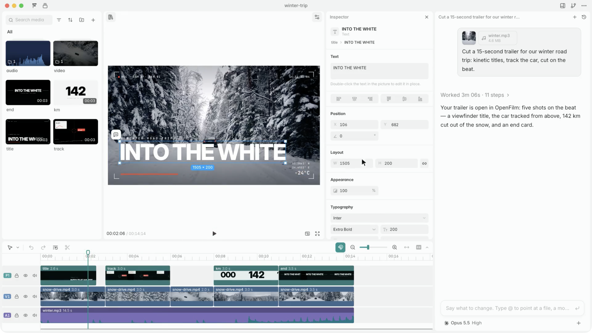

# OpenFilm et Editor — comparaison et pistes d’évolution

Étude demandée le 18 novembre 2026. Référence OpenFilm : commit
[`715c3a6`](https://github.com/openfilm/openfilm/tree/715c3a6e46b11a0b3ee038e8f7b3e3b4e19c5c36),
dont les manifestes de paquets indiquent `0.4.0` ; le protocole se présente
comme un draft `0.1`.

Cette note conserve l’analyse comparative et approfondit trois sujets :
construire une scène avec un agent, produire une vidéo ou un transfert vers
After Effects, et examiner l’interface, particulièrement la timeline.
Elle expose des observations et des propositions d’étude, pas de nouveaux
contrats Editor ou CodPlay ni un plan d’implémentation accepté.

L’analyse d’OpenFilm repose principalement sur son code GitHub : suivi des
appels entre composants, calculs purs, écritures serveur et présentation.
Le README et le protocole servent au cadrage. Les liens de code sont figés
sur le commit ci-dessus ; la capture publiée est identifiée séparément.

Le périmètre vidéo fourni par l’utilisateur exclut les interactions utilisateur.
Les animations et transitions temporelles de la scène restent le sujet du rendu.

## 1. Une parenté réelle, des responsabilités différentes

Les deux projets associent rendu web, timeline et manipulation directe des
éléments. Leur proximité dépasse l’apparence de l’interface. Leur document
auteur et la responsabilité de leur moteur restent toutefois différents.

| Dimension | OpenFilm | Editor et CodPlay |
| --- | --- | --- |
| Finalité | Construire un film avec un agent et le retoucher visuellement. | Composer une scène spatio-temporelle pour CodPlay ; le moteur possède aussi des capacités interactives. |
| Document auteur | `film.html`, pages des plans et ressources dans un dossier. | `EditorScene`, avec items, contenus, décors, zones et keyframes référencés par identité. |
| Composition | Pistes de clips et films imbriqués. | Capsules : hiérarchie, placement et distribution temporelle des enfants. |
| Animation | Pages pilotées par `frame(t)` et animations CSS des clips. | Builder existant vers `SceneDoc`, compilation CodPlay, reconstruction et présentation par le player. |
| Géométrie | Cadre du film et boîtes des clips en pixels CSS. | Longueurs auteur en `cqw`, placement libre ou grilles et zones. |
| Retouches | Modifications du montage et `overrides` des éléments internes aux plans. | Commandes documentaires centrales, previews temporaires et commits avec historique. |
| Diffusion | Rendu audiovisuel et transferts vers des logiciels de montage. | Paquets de scènes exécutables au niveau CodPlay ; toutes les capacités du moteur ne sont pas nécessairement exposées dans Editor. |

Sources : [présentation OpenFilm][of-readme], [protocole][of-spec],
[modèle Editor](../../packages/editor/specs/editor-document-model-spec.md),
[intégration V2](../../packages/editor/specs/editor-v2-integration-spec.md) et
[paquet de diffusion CodPlay](../../packages/codplay/specs/scene-package-export-v1-spec.md).

La capsule est une différence majeure : ses enfants peuvent recevoir leur
placement, leurs transitions et leurs bornes temporelles par distribution.
L’auteur fixe certaines bornes ; la capsule déduit les autres. Un film imbriqué
OpenFilm fournit une composition, mais le protocole consulté ne décrit pas
l’équivalent complet de cette orchestration spatiale et temporelle.

OpenFilm possède un périmètre audiovisuel plus étendu autour du montage,
des sous-titres, des médias et de l’export. Cela ne permet pas de conclure à une
meilleure stabilité générale : les gestes de son application n’ont pas été
validés dans cette étude. Des suites ciblées ont en revanche été exécutées,
comme précisé dans la dernière section.

## 2. Décrire une scène à un agent qui la construit

L’analyse détaillée du pilotage IA est extraite dans l’[étude dédiée :
enseignements d’OpenFilm, WebMCP, Elcé et Editor](../pilotage-ia/2026-11-18-pilotage-ia-webmcp-elce.md).

OpenFilm associe création par l’agent, références visuelles et protection des
retouches humaines. Pour Editor, le point d’appui identifié reste le circuit
des commandes du contrôleur vers le document auteur et le Builder existants.
La réception des résultats, les propositions devenues périmées et l’inspection
du vrai rendu restent des sujets d’intégration à concevoir.

## 3. Produire une vidéo de la scène, sans interactions

### Ce que change le périmètre retenu

Le rendu peut partir d’une occurrence neuve, de son état initial et d’une
graine fixe. Il n’a pas à rejouer des clics, des déplacements ou une session
utilisateur enregistrée. Les éléments dépendant exclusivement d’une interaction
ne deviennent pas automatiquement visibles : le film suit le déroulement
temporel disponible sans cette interaction.

Il reste nécessaire de définir le traitement des effets automatiques de cycle
de vie ou des dépendances externes d’une scène. Exclure les interactions ne
rend pas déterministe, à lui seul, tout code auteur arbitraire.

### Circuit de rendu à examiner

```text
Document auteur committé
    → Builder Editor et compilation existants
    → occurrence CodPlay dédiée au rendu
    → présentation aux instants des images
    → capture du résultat visuel
    → encodage vidéo et assemblage du son
```

L’occurrence de rendu évite de déplacer le playhead, de committer une preview
ou de modifier la scène ouverte. Le paquet de diffusion existant peut fournir
un support de chargement autonome ; il ne constitue pas encore un export vidéo.

Pour 20 secondes à 30 images/s, les 600 images sont demandées à `n / 30`
secondes, pour `n` de 0 à 599. La durée du traitement peut dépasser 20 secondes :
le débit de calcul n’a pas à être la cadence du film.

La taille de sortie fixe la projection des `cqw`. Elle ne transforme pas les
coordonnées auteur sauvegardées en pixels. Le raccord temporel doit réutiliser
la conversion de temps auteur et le `preRollMs` existants, sans les recalculer
dans un autre Builder.
[Façade et transport](../../packages/codplay/specs/facade-v2-spec.md),
[intégration Editor](../../packages/editor/specs/editor-v2-integration-spec.md).

OpenFilm fournit un précédent concret : instances de pages parallèles,
captures d’images, encodage et mixage ; sa commande expose cadence, résolution,
transparence et flou de mouvement. Son outil `look` compare également le même
instant après des ordres de visite différents.
[Rendu][of-render], [inspection][of-look], [options documentées][of-cli].

Le chemin effectif précise ce que « capturer après un seek » implique :
`FilmPage.seek()` fixe le temps de l’hôte, attend `film.frame(t)`, stabilise les
animations, attend les vidéos concernées avec des délais bornés, puis deux
frames de présentation. `capture()` lit ensuite l’image composée par le navigateur.
Le recours à `requestVideoFrameCallback`, lorsqu’il est disponible dans cette
attente, montre pourquoi le seul événement `seeked` ne suffit pas toujours.
Ces mécanismes Chromium sont à comprendre, pas à recopier comme une nouvelle
horloge dans CodPlay. [Hôte de rendu][of-host].

Dans `render.mjs`, `encode()` alimente FFmpeg par un flux d’images et peut
échantillonner plusieurs temps pour le flou. `encodeAll()` répartit les segments
à calculer et reprend des segments terminés. Les portions de footage compatibles
peuvent aussi passer directement par FFmpeg ; tout le film n’est donc pas
nécessairement capturé dans le navigateur. [Chaîne d’encodage][of-render].

### Les limites à lever avant de promettre un export

| Sujet | État de l’étude |
| --- | --- |
| Temps logique | La reconstruction et les opérations publiques de Seek existent. Réutiliser leur chemin. |
| Image effectivement capturable | L’acquittement logique d’un Seek ne constitue pas, dans les contrats consultés, une garantie universelle de décodage vidéo et de présentation finale de tous les composants. |
| Médias synchronisés | `auto` et `master` suivent les règles de synchronisation existantes ; vérifier la frame décodée après repositionnement. |
| Médias indépendants | Leur temps natif n’est pas reconstruit par le Seek CodPlay. Une politique explicite est nécessaire ; leur rendu déterministe n’est pas acquis. |
| Rive, Three.js et autres projections | Vérifier la disponibilité de leur image au temps demandé pour chaque famille retenue. Ne pas déduire leur acceptation de celle des éléments HTML simples. |
| Son | Capturer une image ne capture pas le mix audio. Sources, fenêtres, volumes et synchronisation doivent être décrits pour produire une piste fidèle. |
| Qualité | Cadence, résolution, polices, alpha, colorimétrie et reproductibilité doivent être éprouvés sur les vrais chemins. |

Références : [reconstruction logique](../../packages/codplay/specs/runtime-reconstruction-v2-spec.md),
[Engine/Player](../../packages/codplay/specs/engine-player-v2-spec.md),
[présentation motion](../../packages/codplay/specs/motion-frame-v2-spec.md) et
[synchronisation média](../../packages/codplay/specs/media-sync-v2-spec.md).

Le [plan média](../../packages/codplay/plan/media-preload-plan.md) conserve déjà un
défaut d’isolation des vidéos futures et des acceptations de préparation
manquantes. L’étude vidéo ne les ferme pas et ne justifie pas un contournement
du runtime. Une preuve sur texte, images et mouvements déclaratifs serait une
première étape d’évaluation ; elle ne certifierait pas automatiquement les médias
et les composants tiers.

**Appréciation :** faisabilité plausible et périmètre nettement simplifié par
l’absence d’interactions. La priorité technique est de vérifier la capture
fidèle d’une image après présentation, puis le son, avant d’ajouter les options
de confort ou le parallélisme.

## 4. Transférer vers Adobe After Effects

### Trois résultats différents

| Résultat | Ce que l’utilisateur peut reprendre dans After Effects | Conséquence |
| --- | --- | --- |
| Rendu global | Une vidéo ou une séquence d’images, éventuellement transparente, et le son. | Fidélité visuelle recherchée ; éléments internes non modifiables séparément. |
| Composition hybride | Calques et timings, avec textes ou transformations natifs lorsque la conversion est maîtrisée, et rendus pour les parties complexes. | Compromis entre fidélité et retouche. |
| Reconstruction native étendue | Textes, formes, médias, groupes et animations convertis en objets After Effects. | Travail de correspondance important ; une équivalence générale avec HTML/CSS ne peut pas être promise. |

After Effects prend en charge des médias et séquences d’images, dont PNG.
Adobe documente aussi l’automatisation par scripts ExtendScript `.jsx`.
Un paquet de ressources et un script construisant la composition constituent
donc une voie à examiner. Il serait exécuté dans After Effects ; cette étude
ne propose pas un encodeur maison du format de projet `.aep`.
[Formats pris en charge][adobe-formats], [scripts After Effects][adobe-scripts].

OpenFilm exporte notamment du XML pour les logiciels de montage et du FCPXML.
Son code prévoit le rendu des plans web en médias, notamment avec alpha.
Cela fournit un exemple de transfert hybride, pas la preuve d’un export
After Effects natif de leurs éléments internes.
[Implémentation des exports][of-exports].

Adobe décrit une voie intermédiaire via l’import d’un projet Premiere : clips
transformés en calques, séquences imbriquées en compositions, avec des limites
de conservation des effets et titres. Un export XML de montage n’est donc
pas à présenter comme une conversion universelle vers After Effects.
[Import depuis Premiere][adobe-premiere].

### Correspondances à étudier pour Editor

| Donnée Editor | Correspondance envisageable | Limite à examiner |
| --- | --- | --- |
| Scène | Composition à une résolution et une cadence données. | Ratio auteur et durée de sortie explicites. |
| Capsule | Précomposition ou groupe de calques. | Résoudre d’abord sa grille et sa distribution par le circuit existant ; After Effects ne connaît pas ces règles auteur. |
| Texte | Calque texte. | Métriques, polices, retours à la ligne et styles CSS peuvent produire des différences. |
| Image ou vidéo | Ressource importée et calque. | Recadrage, temps source et disponibilité des fichiers. |
| Pose | Position, rotation, échelle, point d’ancrage. | Convertir les repères et transformations parentes ; une valeur locale ne suffit pas toujours. |
| Décor | Opacité et propriétés supportées, ou rendu. | Filtres CSS, layout, masques et mélanges n’ont pas tous un équivalent direct. |
| Mouvement | Keyframes et interpolation, ou valeurs échantillonnées. | Respect du chemin, de l’easing et de l’orientation tangentielle ; l’échantillonnage peut multiplier les clés. |
| Composant complexe | Média rendu avec alpha, ou groupe rendu. | Le contenu interne reste aplati. |

Cette table est une proposition de correspondance, pas une compatibilité
implémentée. Pour un premier transfert utile, un export hybride paraît plus
réaliste qu’une reconstruction native exhaustive.

Le rendu séparé d’un item exige aussi une étude : retirer ses voisins peut
changer sa grille, sa mesure ou son apparence. Certains effets dépendent du
fond et imposeraient de rendre plusieurs éléments ensemble. Un export par
calques ne doit pas modifier la scène pour fabriquer artificiellement des
images isolées réputées équivalentes.

**Appréciation :** commencer l’étude par la vidéo importable, puis un paquet
hybride ressources + script. La fidélité d’un aller-retour serait à évaluer
dans After Effects ; aucun import réel dans Adobe n’a été réalisé ici.

## 5. Interface : composants, outils et timeline

### Ce qui produit son rendu visuel

Le code consulté utilise React, Tailwind, des CSS Modules, la police Inter et
les icônes Lucide. Les panneaux, menus, infobulles et outils de timeline sont
des composants du projet. Leur présence ne constitue pas une bibliothèque
d’éditeur prête à intégrer chez nous.
[Dépendances][of-package], [styles partagés][of-styles].

Notre application utilise `remix/component` et son contrôleur XState, avec
`lucide-static`, tandis qu’OpenFilm utilise des composants React et
`lucide-react`. Leur JSX ne suffit donc pas à rendre les composants
interchangeables. Reprendre l’ergonomie et les principes de style dans nos
régions existantes est une piste distincte d’un port de leur code React.
[Composition Editor](../../packages/editor/src/app/layout/app-layout.tsx),
[dépendances Editor](../../packages/editor/package.json).

La lecture montre aussi une coordination importante concentrée dans
`Timeline.tsx` et `ProjectView.tsx`, malgré les calculs et composants extraits.
Une reprise de ces fichiers impliquerait leur modèle documentaire, leur
transport et une grande partie de leur environnement. La finition visuelle
n’est donc pas un indicateur du coût d’intégration de leur code.

| Élément | Observation | Intérêt pour Editor |
| --- | --- | --- |
| Surfaces | Fond d’application, panneaux, surfaces relevées et champs distingués par des tons neutres proches. | Créer une hiérarchie sans multiplier les contours et les couleurs. |
| États | Tokens séparés pour survol, pression, sélection, focus et messages. | Faire percevoir le mode et la sélection sans dépendre du texte des boutons. |
| En-têtes | Styles communs pour hauteur, titres et boutons des panneaux. | Harmoniser les régions existantes avant de refaire leur disposition. |
| Inspecteur | Sections et propriétés adaptées à la sélection ; valeurs alignées et unités lisibles. | Distinguer contenu, pose et apparence tout en gardant un accès prévisible. |
| Commandes | Icônes Lucide, infobulles et raccourcis affichés. | Une action iconique reste identifiable et apprenable. |
| Préréglages | Petites vignettes animées au survol dans le panneau Motion. | Montrer le résultat d’une transition plutôt que son seul nom. |
| Espace de travail | Panneaux redimensionnables, masquables et réorganisables. | À considérer selon les usages ; notre séparateur scène/timeline existe déjà. |

Sources : [barres communes][of-pane-bars], [inspecteur][of-inspector],
[infobulles][of-tooltip], [panneau Motion][of-motion-panel] et
[organisation des panneaux][of-workspace].

L’impression de finition tient principalement à la cohérence de ces éléments.
Les dimensions physiques de leur interface ne justifient pas de convertir nos
valeurs de scène ou de palette auteur en pixels : notre contrat `cqw` reste
distinct de la présentation des contrôles.

### La timeline de montage

Le composant `Timeline` affiche pistes et clips, vignettes, formes d’onde,
règle, curseur et sélection. Il réutilise des calculs séparés pour les éditions.
Son code prévoit déplacement, découpage, ajustement des bords, suppression avec
ou sans fermeture du vide, ainsi que des outils de roll, slip et slide.

Le chemin d’écriture est identifiable : les calculs `planMove()`,
`planEdges()` ou `planRemove()` de `timeline-edit.ts` produisent un lot
d’opérations ; `Timeline.runPlan()` le transmet à `onEditOps` ; `ProjectView`
le raccorde à `useFilm`. Ce hook applique les mêmes `applyOps()` que le serveur
pour la présentation immédiate, puis sérialise les requêtes d’écriture avec
leur révision. Le serveur valide et `filmHtml()` conserve le texte des éléments
inchangés. La timeline n’est donc pas un assemblage de rectangles sans contrat
documentaire. [Calcul des éditions][of-timeline-edit],
[raccord applicatif][of-project-view], [état du film][of-use-film],
[opérations communes][of-ops], [sérialisation HTML][of-film-doc].

Trois réglages méritent d’être distingués : alignement aux repères (`snap`),
fermeture de la piste principale (`magnet`) et déplacement associé des éléments
liés (`linkage`). Ce sont des préférences de travail, pas trois noms pour
le même geste. Leur intérêt chez nous dépendrait du modèle média retenu.
[Timeline][of-timeline], [préférences de montage][of-timeline-prefs].

La règle et les libellés suivent le défilement de la zone de pistes, qui en
reste la source. Le zoom conserve un point d’ancrage ; le curseur de lecture
dispose d’un chemin de présentation évitant de refaire tout le rendu React à
chaque progression. Les images des clips sont demandées selon la portion
visible. Ce sont des mécanismes intéressants à évaluer sur nos scènes longues,
sans déduire leurs performances de la seule lecture du code.

### La vue détaillée Motion

Le code `Timeline` expose explicitement une bascule `edit` / `motion`.
`ProjectView` la fournit lorsque les deux modes font partie des modes
disponibles. La vue détaillée conserve la règle et la mécanique de timeline,
avec des en-têtes et des lignes supplémentaires pour les calques et leurs
propriétés. [Condition de raccord][of-project-view].

L’accès utilisateur à ce mode reste à confirmer : `useWorkModes()` dérive les
modes des plugins actifs ; les plugins livrés dans l’arbre étudié sont
`edit`, `canvas`, `screening` et `color`, sans dossier `motion`. Le code de la
vue détaillée est bien présent, mais sa seule présence ne prouve pas qu’une
installation standard l’expose. Aucun état interne n’a été forcé pour la capture.
[Sélection des modes][of-work-modes], [plugins livrés][of-plugin-tree].

`MotionLayers` présente les calques dépliables : transformation, effets,
masques, animation du texte et propriétés disponibles. Les valeurs peuvent être
glissées ou saisies ; des chronomètres activent l’animation. Le code prévoit
les raccourcis P/S/R/T pour les transformations et U pour les propriétés animées.
[Calques détaillés][of-motion-layers].

`MotionLanes` dessine les keyframes par propriété. Leur forme distingue
linéaire, interpolation eased et maintien. La navigation précédent/suivant,
la sélection multiple et le déplacement temporel sont présents. Une bascule
affiche les courbes de valeurs ; les points et poignées permettent d’éditer
temps, valeur et courbure.
[Lignes et graphe de keyframes][of-motion-lanes].

Ces lignes correspondent à de vraies données d’animation : `readMotion()` et
`writeMotion()` lisent et écrivent une animation CSS par propriété, sous un
nom lié au clip ; `valueAt()` résout la valeur interpolée. Pour les éléments
internes d’une page, `writeElementMotion()` réutilise ce mécanisme et inscrit
l’animation dans l’override ciblé. `ProjectView.writeElement()` regroupe les
overrides et les blocs de keyframes dans la même édition.
[Modèle des animations][of-clip-motion], [animation des éléments][of-element-motion],
[raccord des écritures][of-project-view].

**La limite de transposition est importante :** notre contrat conserve deux
canaux `pose` / `decor`, avec décors clairsemés et sans timeline par propriété.
Une copie du modèle Motion d’OpenFilm modifierait ce contrat. Une présentation
plus détaillée pourrait être étudiée comme projection des informations déjà
présentes, mais sa signification et ses écritures doivent être définies avant
de devenir un outil d’édition.
[Modèle actuel](../../packages/editor/specs/editor-document-model-spec.md),
[frontières d’édition](../../packages/editor/specs/editor-v2-integration-spec.md).

Les idées immédiatement utiles à l’étude sont la hiérarchie dépliable, la
navigation des keyframes, la lisibilité des états et des transitions, la
stabilité du zoom et l’inspecteur contextuel. Elles ne nécessitent pas de
présupposer une nouvelle donnée auteur.

### Capture : inspecteur détaillé et montage multipiste



[Ouvrir la capture en grand](assets/openfilm-editor-timeline.png).

Cette capture a été réalisée avec Safari Technology Preview via Safari MCP,
sur l’[enregistrement officiel publié par OpenFilm][of-hero], arrêté à
16,5 secondes. Elle montre l’application enregistrée, pas une instance
OpenFilm installée et manipulée pendant cette étude. Les commandes du lecteur
vidéo ont été masquées ; le contenu de l’enregistrement n’a pas été retouché.

On peut y observer :

1. La bibliothèque de ressources à gauche.
2. Le texte sélectionné et son cadre dans le visualiseur.
3. L’inspecteur : texte, alignement, position, dimensions, apparence et typographie.
4. La timeline : compositions `P1`, vidéo `V1`, audio `A1`, vignettes, waveform,
   règle, curseur, commandes de visibilité et verrouillage.
5. La conversation avec l’agent à droite.

Cette vue a été retenue parce qu’elle montre simultanément la construction par
l’agent, la retouche directe et la relation entre les trois pistes. Elle ne
montre pas la bascule Motion et son graphe : ces derniers sont établis ici par
lecture des composants cités, sans validation de leurs gestes dans l’application.
Les couleurs de l’enregistrement peuvent aussi différer des tokens du commit
étudié ; la vidéo publiée n’est pas versionnée avec ce commit.

## 6. Appréciation des trois pistes

| Piste | Conclusion de l’étude | Preuve utile avant un engagement d’implémentation |
| --- | --- | --- |
| Agent constructeur | Bonne adéquation avec le document structuré et les commandes centrales. | Créer puis corriger une scène par le même circuit, préserver une retouche manuelle, vérifier Undo/Redo et restauration. |
| Vidéo sans interactions | Faisable en principe ; capture et son restent à établir par famille de contenu. | Rendre une séquence complète et comparer plusieurs frames au player, y compris après des visites temporelles différentes. |
| After Effects | Séparer rendu global, transfert hybride et reconstruction native. | Importer un petit paquet hybride et examiner fidélité, timing et éléments réellement modifiables. |
| Interface et timeline | Référence utile de finition et de détail progressif ; modèle temporel différent. | Examiner les gestes Motion dans une instance réelle, puis évaluer une proposition respectant les canaux Editor. |

Les premières investigations peuvent rester au niveau de l’intégration Editor,
du chargement et du transport publics existants. Cette étude ne démontre ni
la nécessité ni l’autorisation d’une modification du cœur CodPlay. Une évolution
retenue devra recevoir son plan propre et son parcours d’acceptation ; elle ne
sera ajoutée à une spécification qu’une fois implémentée et vérifiée.

### Portée des vérifications du code

**174 tests existants passent**, exécutés sans modifier leurs fixtures dans
une copie temporaire des fichiers de ce commit, avec Node `26.12.1` et React
déjà disponible dans le workspace pour les imports des modules de timeline.
Ils portent sur le document, les animations, les retouches, les calculs de
montage, la fusion et les références transmises à la conversation.

Les neuf fichiers exercés sont `film-doc.test.mjs`, `clip-motion.test.mjs`,
`overrides.test.mjs`, `motion-keys.test.ts`, `element-motion.test.ts`,
`timeline-edit.test.ts`, `person-merge.test.mjs`, `dropped-overrides.test.ts`
et `studio-refs.test.ts`. Les suites de fusion incluent des entrelacements
pseudo-aléatoires et le magasin de versions avec son worker.
[Tests de montage][of-timeline-tests], [tests de fusion][of-merge-tests],
[tests des animations][of-motion-tests].

Ce résultat vérifie les cas de ces suites. Il ne valide ni l’application HTTP
complète, ni les gestes Motion dans le navigateur, ni un export vidéo de
CodPlay, ni un import dans After Effects. La capture de l’enregistrement et la
lecture du code gardent les limites explicitées ci-dessus.

[of-readme]: https://github.com/openfilm/openfilm/blob/715c3a6e46b11a0b3ee038e8f7b3e3b4e19c5c36/README.md
[of-spec]: https://github.com/openfilm/openfilm/blob/715c3a6e46b11a0b3ee038e8f7b3e3b4e19c5c36/packages/openfilm/SPEC.md
[of-package]: https://github.com/openfilm/openfilm/blob/715c3a6e46b11a0b3ee038e8f7b3e3b4e19c5c36/packages/openfilm/package.json
[of-render]: https://github.com/openfilm/openfilm/blob/715c3a6e46b11a0b3ee038e8f7b3e3b4e19c5c36/packages/openfilm/src/render.mjs
[of-host]: https://github.com/openfilm/openfilm/blob/715c3a6e46b11a0b3ee038e8f7b3e3b4e19c5c36/packages/openfilm/src/host.mjs
[of-look]: https://github.com/openfilm/openfilm/blob/715c3a6e46b11a0b3ee038e8f7b3e3b4e19c5c36/packages/openfilm/src/look.mjs
[of-cli]: https://openfilm.dev/docs/cli/
[of-exports]: https://github.com/openfilm/openfilm/blob/715c3a6e46b11a0b3ee038e8f7b3e3b4e19c5c36/packages/openfilm/studio/server/exports.mjs
[of-styles]: https://github.com/openfilm/openfilm/blob/715c3a6e46b11a0b3ee038e8f7b3e3b4e19c5c36/packages/openfilm/studio/ui/src/globals.css
[of-pane-bars]: https://github.com/openfilm/openfilm/blob/715c3a6e46b11a0b3ee038e8f7b3e3b4e19c5c36/packages/openfilm/studio/ui/src/components/dock-pane-bar.ts
[of-inspector]: https://github.com/openfilm/openfilm/blob/715c3a6e46b11a0b3ee038e8f7b3e3b4e19c5c36/packages/openfilm/studio/ui/src/components/InspectorPanel.tsx
[of-tooltip]: https://github.com/openfilm/openfilm/blob/715c3a6e46b11a0b3ee038e8f7b3e3b4e19c5c36/packages/openfilm/studio/ui/src/components/Tooltip.tsx
[of-motion-panel]: https://github.com/openfilm/openfilm/blob/715c3a6e46b11a0b3ee038e8f7b3e3b4e19c5c36/packages/openfilm/studio/ui/src/components/MotionPanel.tsx
[of-workspace]: https://github.com/openfilm/openfilm/blob/715c3a6e46b11a0b3ee038e8f7b3e3b4e19c5c36/packages/openfilm/studio/ui/src/components/WorkspaceEditor.tsx
[of-work-modes]: https://github.com/openfilm/openfilm/blob/715c3a6e46b11a0b3ee038e8f7b3e3b4e19c5c36/packages/openfilm/studio/ui/src/lib/work-modes.ts
[of-plugin-tree]: https://github.com/openfilm/openfilm/tree/715c3a6e46b11a0b3ee038e8f7b3e3b4e19c5c36/packages/openfilm/plugins
[of-timeline]: https://github.com/openfilm/openfilm/blob/715c3a6e46b11a0b3ee038e8f7b3e3b4e19c5c36/packages/openfilm/studio/ui/src/components/Timeline.tsx
[of-timeline-edit]: https://github.com/openfilm/openfilm/blob/715c3a6e46b11a0b3ee038e8f7b3e3b4e19c5c36/packages/openfilm/studio/ui/src/lib/timeline-edit.ts
[of-project-view]: https://github.com/openfilm/openfilm/blob/715c3a6e46b11a0b3ee038e8f7b3e3b4e19c5c36/packages/openfilm/studio/ui/src/components/ProjectView.tsx
[of-use-film]: https://github.com/openfilm/openfilm/blob/715c3a6e46b11a0b3ee038e8f7b3e3b4e19c5c36/packages/openfilm/studio/ui/src/editor/use-film.ts
[of-ops]: https://github.com/openfilm/openfilm/blob/715c3a6e46b11a0b3ee038e8f7b3e3b4e19c5c36/packages/openfilm/studio/server/ops.mjs
[of-film-doc]: https://github.com/openfilm/openfilm/blob/715c3a6e46b11a0b3ee038e8f7b3e3b4e19c5c36/packages/openfilm/src/film-doc.mjs
[of-timeline-prefs]: https://github.com/openfilm/openfilm/blob/715c3a6e46b11a0b3ee038e8f7b3e3b4e19c5c36/packages/openfilm/studio/ui/src/lib/timeline-prefs.ts
[of-motion-layers]: https://github.com/openfilm/openfilm/blob/715c3a6e46b11a0b3ee038e8f7b3e3b4e19c5c36/packages/openfilm/studio/ui/src/components/MotionLayers.tsx
[of-motion-lanes]: https://github.com/openfilm/openfilm/blob/715c3a6e46b11a0b3ee038e8f7b3e3b4e19c5c36/packages/openfilm/studio/ui/src/components/MotionLanes.tsx
[of-clip-motion]: https://github.com/openfilm/openfilm/blob/715c3a6e46b11a0b3ee038e8f7b3e3b4e19c5c36/packages/openfilm/src/clip-motion.mjs
[of-element-motion]: https://github.com/openfilm/openfilm/blob/715c3a6e46b11a0b3ee038e8f7b3e3b4e19c5c36/packages/openfilm/studio/ui/src/lib/element-motion.ts
[of-timeline-tests]: https://github.com/openfilm/openfilm/blob/715c3a6e46b11a0b3ee038e8f7b3e3b4e19c5c36/packages/openfilm/studio/ui/src/lib/timeline-edit.test.ts
[of-merge-tests]: https://github.com/openfilm/openfilm/blob/715c3a6e46b11a0b3ee038e8f7b3e3b4e19c5c36/packages/openfilm/studio/server/person-merge.test.mjs
[of-motion-tests]: https://github.com/openfilm/openfilm/blob/715c3a6e46b11a0b3ee038e8f7b3e3b4e19c5c36/packages/openfilm/studio/ui/src/lib/motion-keys.test.ts
[of-hero]: https://openfilm.dev/assets/media/hero.6cf0b3ff91.mp4
[adobe-formats]: https://helpx.adobe.com/after-effects/desktop/get-started/supported-file-formats/supported-file-formats.html
[adobe-scripts]: https://helpx.adobe.com/after-effects/desktop/automate-in-after-effects/automate-animation/scripts.html
[adobe-premiere]: https://helpx.adobe.com/after-effects/desktop/work-with-other-applications/work-with-adobe-premiere/importing-effects-premiere-pro.html
